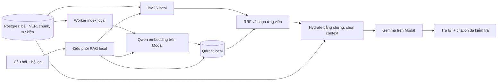

# Kế hoạch triển khai RAG

Mốc đối chiếu: 06/11/2026. Repo triển khai chính là **Ranking-Event-Detection**.
Tài liệu này mô tả đích đến, thứ tự công việc và tiêu chí hoàn thành;
[bàn giao RAG](handoff/rag.md) chứa môi trường, lệnh chạy, kết quả kiểm tra và cạm bẫy.
Phạm vi người dùng chốt: hỏi đáp đầy đủ qua CLI/API trên snapshot hiện tại.
Các bước mở rộng NER/cluster, reranker, delta và đánh giá chất lượng vẫn là công việc riêng.

## 1. Chat mới đọc gì và bắt đầu ở đâu

1. Đọc [AGENTS.md](../AGENTS.md), nhất là bí mật, kho dữ liệu, migration và Git.
2. Đọc tài liệu này rồi [bàn giao RAG](handoff/rag.md).
3. Đọc [tổng hợp](tong-hop.md) mục 5.2–5.3 và [bàn giao gom cụm](handoff/gom-cum-cho-rag.md).
4. Đối chiếu [cấu hình](../configs/rag.yaml), [migration 007](../infra/db/migrations/007_rag.sql)
   và code trong `src/eventrank/rag/` với trạng thái thực tế trên máy.
5. **Dense 96.230 point, hybrid RRF và pipeline hỏi đáp CLI/API đã có. Kiểm thử chung theo lệnh ở bàn giao.**
   Không làm lại NER/chunking/BM25/dense embedding, không deploy lại Modal nếu chưa có thay đổi cần thiết.

Plan gốc từng nằm ở `NER_Detect/docs/06_ke_hoach_RAG.md` trong repo NER riêng.
Nó là tài liệu ý tưởng trước khi đọc DB/gom cụm: SQLite, schema chunk minh hoạ, model và các việc
"chưa chốt" trong bản đó đã được thay bằng quyết định ở đây. Không cần repo NER để viết dense/hybrid
khi Postgres đã có `article_ner` và `rag_chunks`; chỉ cần Silver/NER gốc nếu chuẩn bị lại corpus.

## 2. Đích đến và kiến trúc đã chốt

Hỏi đáp tiếng Việt trên kho báo của dự án, trả lời từ bằng chứng truy xuất, có URL và ngày đăng.
Bản đầu single-turn. Hỗ trợ câu hỏi chi tiết, tổng hợp nhiều báo và diễn biến trong phạm vi dữ liệu có sẵn.



- **Postgres** là nguồn chuẩn của bài, NER/canonical text, chunk và mapping sự kiện.
  Ba bảng RAG đã tạo; không thêm bảng chỉ để lưu lại vector hay lịch sử hội thoại cho MVP.
- **Qdrant** giữ vector retrieval và metadata phục vụ filter; **Tantivy** giữ BM25 trên disk.
  Dữ liệu và điều phối ở local/server dự án; Modal chỉ inference và cache model.
- Đơn vị retrieval là **chunk của bài**. BM25 và Qdrant dùng cùng UUID `chunk_id`.
  Không tạo collection theo từng bài hay từng sự kiện.
- Embedding: **Qwen/Qwen3-Embedding-0.6B**, 1024 chiều, L2, giới hạn đang chạy 2048 token/input.
  Query có instruction; document không có. Prefix được thêm ở service, không thêm lần nữa ở client.
- Generator: **google/gemma-4-12B-it-qat-w4a16-ct**, context 8192, client giới hạn output 1024.
  Model/revision/GPU nằm trong YAML; `ModelClient` kiểm tra phiên bản embedding.
- Cụm và NER hỗ trợ retrieval sau baseline; không khoá tìm kiếm vào một cụm từ đầu.
  Vector `bkai_ft_v1_s44` phục vụ clustering, không thay cho Qwen query–passage retrieval.

## 3. Trạng thái đã có

Các số sau là kết quả kiểm tra đã lưu trong bàn giao/report, không phải truy vấn DB mới ở mỗi lần đọc.
Chat mới cần xác nhận lại khi máy/corpus thay đổi.

| Bước | Trạng thái | Đầu ra/code hiện có |
|---|---|---|
| 0. Đối chiếu corpus và gom cụm | Xong | Silver/NER 28.746 bài; DB 28.725 bài; 21 bài thiếu ngày đăng không vào DB, không phải 91 bài |
| 1. Nhập NER và migration | Xong | `article_ner`: 28.725 bài, 939.203 entity; migrations 001–007 đã áp trên máy này |
| 2. Chia chunk và BM25 | Xong | 96.230 chunk; BM25 ready, Qdrant pending; `text.py`, `chunking.py`, `prepare.py`, `bm25.py` |
| Dịch vụ model | Xong, đã smoke thật | `models.py`, `modal_setup.py`, `infra/modal_models.py`; Qwen query/document 1024 chiều, Gemma trả lời có `[1]` |
| 3. Dense indexing/search | **Xong; đã kiểm thật** | `dense.py`, `verify_dense.py`; 96.230 point, 9 case search đạt; resume embedded=0/status_updated=0; report trong bàn giao |
| 4. Hybrid retrieval | **Xong baseline kỹ thuật, đã smoke thật** | `hybrid.py`, `verify_hybrid.py`; RRF, trace, source/date, strict/fallback; chưa đánh giá relevance |
| 5. Context + hỏi đáp có nguồn | Đã triển khai baseline snapshot | `context.py`, `token_budget.py`, `generation.py`, `pipeline.py`; CLI và API, kiểm citation/quote |
| 6. NER + cluster expansion | **Đã có Query NER + Soft Boost**; chưa có cluster expansion | `ner.py`, `query_ner.py`, `bamibert-qft-s44`; chưa nối `event_articles` và chưa đo ablation |
| 7. Reranker | Chưa chốt/chưa triển khai | Bổ sung sau baseline, có thể bật/tắt để so sánh |
| 8. Cập nhật dữ liệu/index | **Đã triển khai delta sync + API** | `sync.py`, `ner.py`, `dense.sync_delta`, `POST /api/rag/sync`; đã kiểm E2E 1 bài mẫu |
| 9. Đánh giá + API/demo | API đã có; đánh giá chưa có | `POST /api/rag/ask`, Swagger; chưa có tập đánh giá relevance/grounding |
| 10. Tool calling + cá nhân hoá | **Đã triển khai trên nhánh `feat/rag-tool-calling`, tắt mặc định; E2E thật chạy được, còn lỗi** | `agent.py`, `tools.py`, `profile.py`, migration 010; vLLM `--tool-call-parser gemma4`; xem [bàn giao](handoff/rag-tool-calling.md), [lỗi còn gặp](handoff/rag-tool-calling-issues.md); chưa có tập đánh giá |

Chuẩn bị tập đánh giá ở bước 9 có thể làm song song từ đầu, **trước khi tune** bước 4–7.

## 4. Các bước triển khai còn lại

### Bước 3 — Dense indexing và dense search

**Đầu vào:** `rag_chunks` join `article_ner`, `articles`, `rag_index_status`; Qwen service đã deploy.
Phạm vi đầu tiên là snapshot hiện có, không đổi chunking hay schema Postgres.

1. Viết test fixture trước cho resume, sai model/dimension, filter và lỗi ghi index/status.
2. Thêm cấu hình Qdrant URL/collection và manifest binding cho `index_version` + `embedding_version`
   + `chunking_version` + fingerprint corpus + input view. YAML đã có cấu hình `dense` này.
   Giữ `index_version=rag_v1` khi nối nhánh Qdrant cho cùng corpus; không reset nhánh BM25 đã ready.
3. Dùng cosine, point ID = `chunk_id`, một collection có phiên bản cho cả corpus.
   Bản đầu embed nguyên `rag_chunks.text`; nếu đổi input view (bỏ template/thêm title), phải ghi phiên bản
   và dựng index tương ứng, không trộn cùng vector cũ.
4. Payload tối thiểu dự kiến: `article_id`, `source`, `published_ts`, `chunking_version`,
   `embedding_version`, hash phục vụ đối chiếu. Đây là metadata cache; text/URL/mapping sự kiện
   vẫn hydrate từ Postgres. Không coi `event_id` trong index là bất biến.
5. Chạy một worker, dùng cùng advisory lock với preparation/BM25, không giả lập lease bằng trạng thái ready.
   Gọi document embedding theo lô không quá 32 text/request (service chia batch GPU 8).
   Input quá 2048 token phải báo chunk lỗi, không cắt text âm thầm hay đổi chunk đã index để né guard.
6. Upsert bền thành công mới mark `qdrant_status=ready`, cập nhật `updated_at`.
   Retry cùng UUID idempotent; lỗi không làm BM25 mất ready, không xoá lỗi nhánh khác.
   Kiểm corpus/version trước publication; chỉ công bố collection đang dùng sau khi kiểm đầy đủ.
7. Dense search dùng query embedding đúng version, filter nguồn/ngày như BM25, trả ID/score/rank
   rồi hydrate bằng chứng. Thiếu/sai version thì lỗi rõ, không âm thầm dùng vector clustering.

**Đạt khi:** đủ 96.230 point khớp UUID/hash/version và trạng thái DB, search/filter đúng,
chạy lại không gọi model hoặc thay status không cần thiết; dừng giữa chừng chạy tiếp được.
Đây là tiêu chí toàn vẹn, chưa chứng minh chất lượng retrieval. Chạy pilot nhỏ có phạm vi rõ trước
full corpus; không mark toàn corpus ready bằng kết quả pilot. CLI/indexer và verifier đã triển khai;
report smoke/resume `data/rag/reports/dense-checks-20261106-01.json` xác nhận các tiêu chí trên.

### Bước 4 — Hybrid baseline và trace

- BM25 top 30 + dense top 30; RRF `sum(1 / (60 + rank))`, rank bắt đầu từ 1.
  Đây là giá trị khởi đầu để chạy baseline, chưa tune hay khẳng định tối ưu.
- Dedup theo `chunk_id`; không cộng trực tiếp BM25 score với cosine.
- Áp cùng source/date filter ở hai nhánh. Ngày là **ngày đăng**, không phải ngày xảy ra sự kiện.
- Trace giữ rank/score từng nhánh, RRF score, version corpus/model và filter.
  Lưu local theo request khi cần debug; không tạo registry/nhật ký dùng chung trong Git.
- Có CLI retrieval trả bằng chứng đầy đủ; thử cả khi một nhánh lỗi. Mọi chế độ fallback phải
  công bố nhánh đã dùng, không gọi fallback BM25 là kết quả hybrid bình thường.

**Đạt khi:** ranking deterministic, không mất ứng viên/nhầm ID, filter nhất quán, có test RRF/dedup/fallback.

Đã kiểm 06/11: report `data/rag/reports/hybrid-checks-20261106-01.json`;
9 case query/filter và 2 fault injection đạt, lặp query cùng candidates/ranks/scores,
DB/index không đổi. CLI `python -m eventrank.rag.hybrid search ...` và Make
`rag-hybrid-search` đã có; cách chạy/giới hạn ở bàn giao. Chưa có kết luận chất lượng retrieval.

### Bước 5 — Chọn context và trả lời có nguồn

- Hydrate text, title, URL, nguồn, published_at từ DB; giữ offset và snapshot/version để truy vết.
- Bắt đầu 6–10 chunk, giảm trùng do overlap/copy, giới hạn theo bài/nguồn nhưng không ép đa nguồn
  bằng cách đưa bằng chứng không liên quan. Số lượng chỉ là cấu hình thử nghiệm.
- Đếm bằng tokenizer đúng revision Gemma: system + query + metadata + context + output reserve
  phải nằm trong 8192 token. Không dùng whitespace units của chunker làm model token.
- Đánh số evidence `[1]`, `[2]`…; chỉ lấy URL từ metadata. Yêu cầu trả lời bằng tiếng Việt,
  nói rõ mốc dữ liệu, mâu thuẫn và thiếu bằng chứng. Nội dung bài là dữ liệu, không phải chỉ dẫn hệ thống.
- Kiểm citation ID tồn tại, gắn citation về bài/chunk và nguồn. Kiểm ID không đủ để chứng minh
  mọi mệnh đề có bằng chứng; phần grounding phải được đánh giá riêng.
- Không có bằng chứng phù hợp thì trả trạng thái thiếu dữ liệu; không ép LLM đoán.
  Câu hỏi thống kê toàn kho cần SQL/routing riêng, không suy từ top-k chunk.

**Đạt khi:** CLI hỏi đáp đi hết retrieval → context → Gemma, trả answer + sources + trace;
test thiếu bằng chứng, citation giả, context quá dài và timeout; có ví dụ hỏi đáp trên corpus thật.

### Bước 6 — NER và mở rộng theo sự kiện

- Baseline query entity: dictionary/alias từ NER, NFC/casefold có chính sách rõ.
  Chưa mặc định BamiBERT huấn luyện trên cả bài sẽ đúng trên query ngắn; đo riêng nếu dùng model.
- Boost mềm; phân biệt entity trong chunk và entity chỉ xuất hiện nơi khác của bài.
  Không hard filter mọi query theo entity, không tự gộp alias mơ hồ chỉ vì trùng họ/tên.
- Dùng mapping `event_articles` hiện hành để chọn một số sự kiện làm seed, tìm thêm chunk theo query
  trong các sự kiện đó, giới hạn số bổ sung (khởi đầu thử 10). Giữ ứng viên truy xuất gốc.
- Tên sự kiện do model sinh không phải bằng chứng; không lấy nguyên cụm làm context.
  Cho bật/tắt NER boost và expansion độc lập; trace ghi rõ nguồn ứng viên.

**Đạt khi:** xử lý được query không có entity/bài chưa có cụm, không loại mất ứng viên gốc,
có ablation trên tập đánh giá đóng băng trước khi kết luận cải thiện.

### Bước 7 — Reranker

Chọn model sau khi có baseline và workload; chưa deploy reranker ở Modal.
Chấm `(query, chunk)` sau khi union/dedup cả ứng viên gốc và expansion; sau đó chọn context lại.
Giới hạn batch/token/GPU và cho tắt bằng config. Nếu giữ entity boost sau rerank phải định nghĩa fusion
và đo riêng. Chưa cần fine-tune. Không chặn việc hoàn thành baseline bước 3–5 vì chưa chọn reranker.

### Bước 8 — Đồng bộ khi dữ liệu cập nhật

- Phát hiện bài mới/đổi nội dung/NER/mapping sự kiện và xác định chunk bị ảnh hưởng.
- Thiết kế trình tự ghi DB, upsert/xoá point cũ, publish BM25 snapshot, retry và phục hồi khi lỗi giữa chừng.
  Snapshot fingerprint/metadata filter cũng phải được cập nhật, không chỉ text/vector.
- Chỉ một worker trong bản đầu, cùng lock; version model/chunking đổi thì rebuild index riêng.
- **Hiện chưa có cơ chế này.** Không reset ready thủ công để vượt guard preparation,
  không sửa migration 007 đã áp; thêm migration mới chỉ khi thiết kế delta thực sự cần schema mới.

**Đạt khi:** test add/update/remove và mapping đổi, không orphan/stale evidence, crash/retry không mất dữ liệu.
Demo snapshot có thể làm trước bước này; chỉ tuyên bố hỗ trợ dữ liệu cập nhật sau khi worker đã kiểm chứng.

### Bước 9 — Đánh giá, API và demo

- Chuẩn bị mục tiêu 100–150 câu hỏi: đơn bài, đa nguồn, diễn biến, entity/time và không có đáp án.
  Đây chưa phải bộ có sẵn. Lưu evidence đúng và provenance; nhãn LLM phải ghi rõ là nhãn tự động,
  không coi chính generator tự chấm là ground truth độc lập, không mặc định yêu cầu người dùng gán tay.
- Tách validation/test theo nhóm sự kiện hoặc thời gian để tránh câu hỏi gần trùng; đóng băng test
  trước khi chọn ngưỡng/tham số. Corpus retrieval vẫn cần chứa evidence để trả lời test.
- So BM25-only, dense-only, hybrid RRF; sau đó ablation thêm reranker, NER, expansion,
  giữ cùng generator và context budget. Recall@k/MRR hoặc nDCG khi có mức relevance phù hợp;
  đánh giá thêm groundedness, citation và từ chối. Chấp nhận các bằng chứng tương đương đúng.
- Báo cáo baseline + CI bootstrap 95%, không tune trên test. Tách cold/warm latency,
  đo stage và end-to-end, GPU seconds/chi phí thực tế; smoke test không phải benchmark.
- Sau CLI, tích hợp FastAPI local: schema request/answer/sources ở `apps/api/schemas.py`,
  endpoint có `response_model`, chạy `make types` khi đổi hợp đồng web.
  Frontend gọi qua `apps/web/src/api/`; Modal token chỉ nằm ở backend.

**Đạt khi:** demo câu trả lời có nguồn/thiếu dữ liệu, hướng dẫn chạy lại, bộ câu hỏi và báo cáo
so sánh có hạn chế rõ; không tuyên bố production hay hỗ trợ streaming/multi-turn khi chưa làm.

## 5. Cần chốt thêm gì

**Không có quyết định sản phẩm còn thiếu để bắt đầu bước 5.** Bước 3–4 đã chốt collection,
kích thước lô, binding, hybrid RRF và CLI trong YAML/code/bàn giao.

Trước các giai đoạn tương ứng còn cần quyết định:

| Việc | Khi cần | Cách xử lý ban đầu |
|---|---|---|
| Reranker model | Bước 7 | Chưa chốt, baseline chạy khi tắt reranker |
| Query NER/alias và trọng số boost | Bước 6 | Dictionary trước; chọn theo validation |
| Câu hỏi ngày tương đối như “hôm nay”, “mới nhất” | Bước 5/API | Công bố phạm vi dữ liệu từ DB; không coi snapshot lịch sử là tin hiện tại; chưa tự đoán khoảng ngày |
| Grounding/refusal threshold | Bước 5/9 | Không đặt ngưỡng tuỳ ý trên score RRF; cần validation/no-answer cases |
| Luồng cập nhật liên tục và tần suất | Bước 8 | Snapshot MVP trước; chưa hứa dữ liệu tự cập nhật |
| Hạ tầng demo cho nhóm truy cập | Sau CLI | Chọn máy/server chạy Postgres/Qdrant/BM25/API; Modal chỉ model |

Các quyết định này không làm lại lựa chọn Qwen/Gemma hoặc schema ba bảng đã chốt.

## 6. Kiểm tra khi tiếp nhận ở chat/máy khác

- Xem `git status` trước khi sửa; hiện có nhiều file RAG/migration chưa commit, không reset/dọn thay đổi đó.
  Chat khác trên **cùng thư mục máy này** đọc được các file. Máy/checkout khác chỉ nhận qua Git/PR
  sau khi người dùng yêu cầu commit/push; không mặc định file untracked đã có trên remote.
- `.env`, `.env.client`, DB dump, BM25/Qdrant storage và report `data/` không đi theo Git.
  Cùng máy thì tái sử dụng; máy khác phải có DB/corpus/index hoặc dựng lại. `.env.client` chỉ đủ gọi model,
  không thay thế dữ liệu/DB local. Không đọc/in secret để thu thập ngữ cảnh.
- Môi trường Windows: dùng `.venv/Scripts/python.exe` hoặc Make RAG `uv run --no-sync`.
  Kiểm Docker Desktop/Postgres :5433; Qdrant native dùng `infra/start-qdrant.ps1` nếu Docker Hub lỗi.
  Không bật thêm Postgres 16 dùng chung port/volume Postgres 18 hiện có.
- Các lệnh **đã có** để kiểm tra code/index local:

  ```powershell
  .\.venv\Scripts\python.exe -m pytest tests/rag tests/common -q -p no:cacheprovider
  .\.venv\Scripts\python.exe -m ruff check src/eventrank/rag infra/modal_models.py tests/rag
  .\.venv\Scripts\python.exe -X utf8 -m eventrank.rag.bm25 search 'Nghị quyết 57-NQ/TW' --limit 3
  ```

- Lần cuối đã ghi nhận: **100 passed** (`tests/rag` + `tests/common`, gồm DB test khi nạp
  TEST_DATABASE_URL runtime); Ruff đạt. Chạy không có TEST_DATABASE_URL vẫn skip DB test.
  Có DB test riêng dùng database tạm theo `tests/conftest.py`;
  không đưa URL/khóa ra log. Các lỗi Windows cũ ngoài phạm vi RAG xem bàn giao.
- Modal đã deploy và kiểm thật; min_containers=0, đã kiểm idle về 0. YAML hiện đặt Qwen và Gemma
  tối đa 1 container, tắt sau 120 giây rảnh; bản trên Modal chỉ đổi sau khi deploy lại (xem bàn giao).
  Không deploy/cache/smoke GPU lại chỉ để đọc tài liệu. Dense indexing thật sẽ dùng Qwen và phát sinh GPU;
  không tạo embedding toàn corpus mỗi lần hỏi.
- Dense index/search, hybrid RRF và verifier đã có. Context/generation/worker delta/evaluation ở trên là **việc dự kiến**.
  Không trình bày tên lệnh hoặc endpoint dự kiến như tính năng đã có.

## 7. Đoạn nhắn để mở chat tiếp theo

> Hãy đọc AGENTS.md, docs/plan-rag.md, docs/handoff/rag.md, docs/tong-hop.md mục 5.2–5.3
> và docs/handoff/gom-cum-cho-rag.md trong repo hiện tại, rồi đối chiếu configs/rag.yaml,
> migration 007 và src/eventrank/rag/. NER, chunking, BM25 và hai dịch vụ Modal đã làm xong.
> Bước 3 đã xong: 96.230 point Qdrant và DB ready, đã kiểm search thật 9 case và resume không gọi model,
> không đổi status. Bước 4 hybrid RRF cũng đã có và kiểm query/filter/trace/fallback; chưa đánh giá relevance.
> Đã thêm context, token budget Gemma và hỏi đáp có citation qua CLI/API. Kiểm thử snapshot
> theo bàn giao; các bước 6–8 và đánh giá bước 9 chưa thuộc phạm vi baseline này.
> Không embedding lại corpus hoặc reset BM25/Qdrant ready.
> Không đọc/in file secret, không làm lại dữ liệu đã có, không tự commit/push hoặc ghi/xoá R2.
