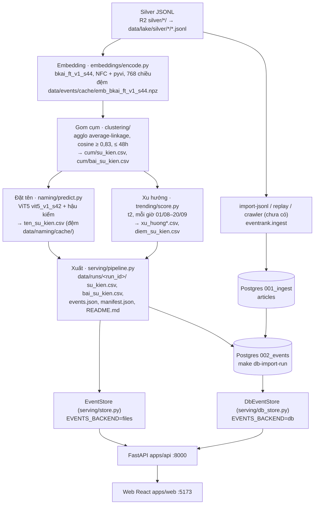

# EventRank — Nhận diện sự kiện đa nguồn và xếp hạng xu hướng tin tức tiếng Việt

> **Tài liệu tổng hợp duy nhất của dự án.** Cập nhật **04/11/2026**, đối chiếu với code nhánh `dev` (merge PR #4). Từ bản
> này, tài liệu gom cả hướng dẫn gán nhãn 4 mức, hướng dẫn viết crawler, bàn giao tầng thu thập và bàn giao "dùng gom
> cụm cho RAG" (danh sách file đã gộp ở [Phụ lục B](#phụ-lục-b-các-file-đã-gộp)). Code trích tài liệu theo **số mục** (ví
> dụ `docs/tong-hop.md mục 5.3`): số mục cũ được giữ nguyên, mục mới đánh số từ 16 trở đi.
>
> **Cách đọc:** mỗi phần ghi rõ **HIỆN TRẠNG** (đã làm, đã đo, có code) hay **KẾ HOẠCH** (thiết kế, chưa làm). Mọi số đo ghi
> tập đo, mốc so sánh và khoảng tin cậy (CI 95% bootstrap) nếu có. **Nhãn đối chiếu hầu hết do Claude gán, chưa phải nhãn
> người**; chỗ nào có nhãn người thì ghi rõ (mục 10.5). Khi tài liệu và code lệch nhau, **code đúng**; sửa tài liệu trong
> cùng PR.

## Mục lục

- [0. Đọc nhanh cho AI agent](#0-đọc-nhanh-cho-ai-agent)
  - [0.1 Dự án trong năm dòng](#01-dự-án-trong-năm-dòng)
  - [0.2 Trạng thái từng phần (cập nhật 04/11/2026)](#02-trạng-thái-từng-phần-cập-nhật-04112026)
  - [0.3 Những điều KHÔNG được làm (tóm tắt `AGENTS.md`)](#03-những-điều-không-được-làm-tóm-tắt-agentsmd)
  - [0.4 Muốn làm X → mở đâu](#04-muốn-làm-x--mở-đâu)
- [1. Đề tài](#1-đề-tài)
  - [1.1 Mục tiêu](#11-mục-tiêu)
  - [1.2 Vì sao khó (khác tóm tắt tin thông thường)](#12-vì-sao-khó-khác-tóm-tắt-tin-thông-thường)
  - [1.3 Ngoài phạm vi](#13-ngoài-phạm-vi)
  - [1.4 Đánh giá ban đầu của bản đề xuất (phân tích phản biện)](#14-đánh-giá-ban-đầu-của-bản-đề-xuất-phân-tích-phản-biện)
- [2. Repo, nhánh và mức độ hoàn thành](#2-repo-nhánh-và-mức-độ-hoàn-thành)
- [3. Kiến trúc tổng thể](#3-kiến-trúc-tổng-thể)
  - [3.1 Năm tầng (dữ liệu chỉ chảy lên trên)](#31-năm-tầng-dữ-liệu-chỉ-chảy-lên-trên)
  - [3.2 Kiến trúc mục tiêu (KẾ HOẠCH, sau khi sửa các lỗi thiết kế)](#32-kiến-trúc-mục-tiêu-kế-hoạch-sau-khi-sửa-các-lỗi-thiết-kế)
  - [3.3 Pipeline hiện tại (HIỆN TRẠNG, chạy theo lô)](#33-pipeline-hiện-tại-hiện-trạng-chạy-theo-lô)
  - [3.4 Đang chạy theo lô và còn là kế hoạch](#34-đang-chạy-theo-lô-và-còn-là-kế-hoạch)
- [4. Định nghĩa "sự kiện"](#4-định-nghĩa-sự-kiện)
  - [4.1 Vì sao phải chốt](#41-vì-sao-phải-chốt)
  - [4.2 Các phương án](#42-các-phương-án)
  - [4.3 Chấm điểm (1–5, trọng số bằng nhau)](#43-chấm-điểm-15-trọng-số-bằng-nhau)
  - [4.4 Quyết định đã chốt: **Gói 1 (hướng E, cửa sổ theo loại sự kiện)**](#44-quyết-định-đã-chốt-gói-1-hướng-e-cửa-sổ-theo-loại-sự-kiện)
  - [4.5 Ca biên (dữ liệu thật tháng 8–9/2026): 1 = cùng, 0 = khác](#45-ca-biên-dữ-liệu-thật-tháng-892026-1--cùng-0--khác)
  - [4.6 Định nghĩa nhị phân dùng khi gán (nhãn yếu v1–v3)](#46-định-nghĩa-nhị-phân-dùng-khi-gán-nhãn-yếu-v1v3)
  - [4.7 Việc sau khi chốt (trạng thái)](#47-việc-sau-khi-chốt-trạng-thái)
  - [4.8 Hướng dẫn gán mức độ liên quan giữa hai bài (4 mức)](#48-hướng-dẫn-gán-mức-độ-liên-quan-giữa-hai-bài-4-mức)
- [5. Dữ liệu](#5-dữ-liệu)
  - [5.1 Khảo sát nguồn (đo 15/09/2026)](#51-khảo-sát-nguồn-đo-15092026)
  - [5.2 Kho thực tế trên R2 (HIỆN TRẠNG, 04/11/2026)](#52-kho-thực-tế-trên-r2-hiện-trạng-04112026)
  - [5.3 Hợp đồng dữ liệu lớp Silver](#53-hợp-đồng-dữ-liệu-lớp-silver)
  - [5.4 Lớp Gold: NER (HIỆN TRẠNG)](#54-lớp-gold-ner-hiện-trạng)
  - [5.5 Làm sạch NER: kết quả đo trên mẫu 4.000 bài (`ner_gold_cleaned.jsonl`, 24/09/2026)](#55-làm-sạch-ner-kết-quả-đo-trên-mẫu-4000-bài-ner_gold_cleanedjsonl-24092026)
  - [5.6 Kế hoạch tiền xử lý Silver → Gold (KẾ HOẠCH, đo thời gian 19/09/2026)](#56-kế-hoạch-tiền-xử-lý-silver--gold-kế-hoạch-đo-thời-gian-19092026)
  - [5.7 Bố cục `data/` ở máy (không commit)](#57-bố-cục-data-ở-máy-không-commit)
  - [5.8 Thẻ mô hình trong `data/models/`](#58-thẻ-mô-hình-trong-datamodels)
  - [5.9 Các lần chạy trong `data/runs/` và `data/events/`](#59-các-lần-chạy-trong-dataruns-và-dataevents)
- [6. Thiết kế data lake (kế hoạch ban đầu và hạ tầng cloud)](#6-thiết-kế-data-lake-kế-hoạch-ban-đầu-và-hạ-tầng-cloud)
  - [6.1 Nguyên tắc của kho](#61-nguyên-tắc-của-kho)
  - [6.2 Stack đề xuất](#62-stack-đề-xuất)
  - [6.3 Luồng và bố cục](#63-luồng-và-bố-cục)
  - [6.4 Các bước dựng kho (ước 2 tuần, 1–2 người)](#64-các-bước-dựng-kho-ước-2-tuần-12-người)
  - [6.5 Mười cái bẫy đã thấy trong dữ liệu thật](#65-mười-cái-bẫy-đã-thấy-trong-dữ-liệu-thật)
  - [6.6 Hạ tầng cloud: Cloudflare R2](#66-hạ-tầng-cloud-cloudflare-r2)
- [7. Nhãn yếu "cặp cùng sự kiện"](#7-nhãn-yếu-cặp-cùng-sự-kiện)
  - [7.1 Kết quả các phiên bản (số mới nhất, đo có trọng số theo tầng)](#71-kết-quả-các-phiên-bản-số-mới-nhất-đo-có-trọng-số-theo-tầng)
  - [7.2 Pipeline](#72-pipeline)
  - [7.3 Bước 1: chuẩn hoá thực thể và độ nổi bật (`entities.py`)](#73-bước-1-chuẩn-hoá-thực-thể-và-độ-nổi-bật-entitiespy)
  - [7.4 Bước 2–4: IDF, ứng viên, đặc trưng (`corpus.py`, `pairs.py`)](#74-bước-24-idf-ứng-viên-đặc-trưng-corpuspy-pairspy)
  - [7.5 Bước 5–6: hàm gán nhãn và label model (`lfs.py`, `label_model.py`)](#75-bước-56-hàm-gán-nhãn-và-label-model-lfspy-label_modelpy)
  - [7.6 Bước 7: chia dữ liệu và chọn dữ liệu train (`build.py`)](#76-bước-7-chia-dữ-liệu-và-chọn-dữ-liệu-train-buildpy)
  - [7.7 File đầu ra (`data/weak_labels/v<n>/`)](#77-file-đầu-ra-dataweak_labelsvn)
  - [7.8 Đánh giá nhãn yếu](#78-đánh-giá-nhãn-yếu)
  - [7.9 Lỗi lớn đã gặp và cách sửa](#79-lỗi-lớn-đã-gặp-và-cách-sửa)
  - [7.10 Quyết định thiết kế quan trọng](#710-quyết-định-thiết-kế-quan-trọng)
  - [7.11 Chạy lại](#711-chạy-lại)
  - [7.12 Cạm bẫy](#712-cạm-bẫy)
  - [7.13 Bước tiếp theo (theo Gói 1 / hướng E) — trạng thái 04/11/2026](#713-bước-tiếp-theo-theo-gói-1--hướng-e--trạng-thái-04112026)
  - [7.14 Nhãn 4 mức v4 (`graded.py`, HIỆN TRẠNG)](#714-nhãn-4-mức-v4-gradedpy-hiện-trạng)
- [8. Fine-tune mô hình embedding](#8-fine-tune-mô-hình-embedding)
  - [8.1 Mô hình và so sánh](#81-mô-hình-và-so-sánh)
  - [8.2 Hiện trạng thực thi](#82-hiện-trạng-thực-thi)
  - [8.3 Nhận biết mô hình tốt](#83-nhận-biết-mô-hình-tốt)
  - [8.4 Vòng lặp cập nhật dữ liệu + mô hình](#84-vòng-lặp-cập-nhật-dữ-liệu--mô-hình)
  - [8.5 Kết quả 7 mô hình (HIỆN TRẠNG, đo 30/10–02/11/2026)](#85-kết-quả-7-mô-hình-hiện-trạng-đo-301002112026)
- [9. Gom cụm, đặt tên, xu hướng (HIỆN TRẠNG: chạy theo lô)](#9-gom-cụm-đặt-tên-xu-hướng-hiện-trạng-chạy-theo-lô)
  - [9.1 Gom cụm](#91-gom-cụm)
  - [9.2 Đặt tên sự kiện](#92-đặt-tên-sự-kiện)
  - [9.3 Điểm xu hướng](#93-điểm-xu-hướng)
  - [9.4 Bộ điều phối pipeline và lần chạy](#94-bộ-điều-phối-pipeline-và-lần-chạy)
- [10. Đánh giá](#10-đánh-giá)
  - [10.1 Bảng đánh giá (kế hoạch và trạng thái)](#101-bảng-đánh-giá-kế-hoạch-và-trạng-thái)
  - [10.2 Tập vàng](#102-tập-vàng)
  - [10.3 Cổng kiểm chứng](#103-cổng-kiểm-chứng)
  - [10.4 Bảng tổng mọi số đo (04/11/2026)](#104-bảng-tổng-mọi-số-đo-04112026)
  - [10.5 Nhãn nào của người, nhãn nào của Claude](#105-nhãn-nào-của-người-nhãn-nào-của-claude)
- [11. Ứng dụng: cài đặt, chạy, API, triển khai](#11-ứng-dụng-cài-đặt-chạy-api-triển-khai)
  - [11.1 Cài đặt (Linux/WSL, tại gốc repo)](#111-cài-đặt-linuxwsl-tại-gốc-repo)
  - [11.2 Lệnh `make`](#112-lệnh-make)
  - [11.3 API](#113-api)
  - [11.4 Triển khai cho cả nhóm](#114-triển-khai-cho-cả-nhóm)
  - [11.5 Quy trình git](#115-quy-trình-git)
  - [11.6 Sự cố thường gặp](#116-sự-cố-thường-gặp)
  - [11.7 Web (`apps/web/`)](#117-web-appsweb)
  - [11.8 Trang kiểm soát dữ liệu nội bộ (`apps/api/static/`)](#118-trang-kiểm-soát-dữ-liệu-nội-bộ-appsapistatic)
- [12. Phân công, lịch, rủi ro](#12-phân-công-lịch-rủi-ro)
  - [12.1 Phân công 4 người (KẾ HOẠCH ban đầu, quỹ ~480 giờ = 4 người × 12h/tuần × 10 tuần)](#121-phân-công-4-người-kế-hoạch-ban-đầu-quỹ-480-giờ--4-người--12htuần--10-tuần)
  - [12.2 Rủi ro](#122-rủi-ro)
- [13. Mâu thuẫn giữa các tài liệu gốc và cách hiểu đúng](#13-mâu-thuẫn-giữa-các-tài-liệu-gốc-và-cách-hiểu-đúng)
- [14. Thuật ngữ](#14-thuật-ngữ)
- [15. Tài liệu tham khảo](#15-tài-liệu-tham-khảo)
- [16. Database Postgres](#16-database-postgres)
  - [16.1 Nguyên tắc](#161-nguyên-tắc)
  - [16.2 Migration `001_ingest.sql` (tầng Thu thập, đã áp)](#162-migration-001_ingestsql-tầng-thu-thập-đã-áp)
  - [16.3 Migration `002_events.sql` (tầng Sự kiện, đã áp)](#163-migration-002_eventssql-tầng-sự-kiện-đã-áp)
  - [16.4 Đã nạp gì (DB ở máy Nguyễn Đình Hiếu, 04/11/2026; dump trên R2)](#164-đã-nạp-gì-db-ở-máy-nguyễn-đình-hiếu-04112026-dump-trên-r2)
  - [16.5 Lệnh: tạo DB, migrate, nạp, dump/khôi phục](#165-lệnh-tạo-db-migrate-nạp-dumpkhôi-phục)
  - [16.6 Thiết kế 003–006 (CHƯA làm)](#166-thiết-kế-003006-chưa-làm)
- [17. Hướng dẫn thực hành](#17-hướng-dẫn-thực-hành)
  - [17.1 Chạy web demo](#171-chạy-web-demo)
  - [17.2 Chạy pipeline sự kiện](#172-chạy-pipeline-sự-kiện)
  - [17.3 Nạp DB và chuyển API sang DB](#173-nạp-db-và-chuyển-api-sang-db)
  - [17.4 Thêm crawler cho một báo](#174-thêm-crawler-cho-một-báo)
  - [17.5 Dùng đầu ra gom cụm để làm RAG](#175-dùng-đầu-ra-gom-cụm-để-làm-rag)
  - [17.6 Bàn giao một module](#176-bàn-giao-một-module)
- [18. Việc còn lại, lộ trình, hạn chế đã biết](#18-việc-còn-lại-lộ-trình-hạn-chế-đã-biết)
  - [18.1 Việc còn lại (đánh số theo ưu tiên, đề xuất 04/11/2026)](#181-việc-còn-lại-đánh-số-theo-ưu-tiên-đề-xuất-04112026)
  - [18.2 Hạn chế đã biết (tóm tắt, chi tiết ở từng mục)](#182-hạn-chế-đã-biết-tóm-tắt-chi-tiết-ở-từng-mục)
- [19. Lịch sử thay đổi lớn](#19-lịch-sử-thay-đổi-lớn)
- [Phụ lục A: Đường dẫn quan trọng (trong repo `Ranking-Event-Detection/`)](#phụ-lục-a-đường-dẫn-quan-trọng-trong-repo-ranking-event-detection)
- [Phụ lục B: Các file đã gộp](#phụ-lục-b-các-file-đã-gộp)

---

## 0. Đọc nhanh cho AI agent

### 0.1 Dự án trong năm dòng

- Đầu vào: bài báo tiếng Việt của 6 báo (tuoitre, thanhnien, vietnamnet, nhandan, vnexpress, baochinhphu), lớp **Silver**
  JSONL trên Cloudflare R2 (bucket `vietnam-news-datalake`). Dữ liệu tĩnh đến **19/09/2026**, 28.746 bài.
- Đơn vị phân tích là **sự kiện**, không phải bài: nhiều báo cùng đưa một việc → một sự kiện (định nghĩa: mục 4).
- Pipeline **chạy theo lô**: embedding (bkai fine-tune) → gom cụm (agglomerative, cosine ≥ 0,83, cửa sổ 48h) → đặt tên
  (ViT5 fine-tune + hậu kiểm) → điểm xu hướng mỗi giờ (công thức t2) → thư mục `data/runs/<run_id>/` → (tuỳ chọn) nạp
  Postgres → API FastAPI → web React.
- Chưa có: crawler thật, worker chạy liên tục, gom lại + đối chiếu ID sự kiện, cổng thông báo, mobile, backend tài khoản.
- Lệnh vào cửa: `make install`, `make dev` (mục 11.1–11.2), `make pipeline` (mục 17.2), `make test`.

### 0.2 Trạng thái từng phần (cập nhật 04/11/2026)

| Phần | Trạng thái | Số đo chính (tập đo · mốc · CI) | Đọc |
|---|---|---|---|
| Kho Silver trên R2 | **Có**, 6 báo, 28.746 bài, đến 19/09/2026 (76% trong 01/08–19/09) | — | 5.2, 5.3 |
| Gold NER | **Có** trên R2 (thành viên khác làm), 940.474 thực thể, 6 nhãn | ~90% đúng trên mẫu 400 bài có nhãn chuẩn | 5.4, 5.5 |
| Khung thu thập + Postgres `001_ingest` | **Xong, có test**; đã nạp 28.725 bài Silver vào DB | `import-jsonl` 8,3 s; chạy lại 0 bài mới | 16.2, 17.4 |
| Crawler thật cho 6 báo | **Chưa có** (mọi báo `enabled: false` trong `configs/sources.yaml`) | — | 17.4 |
| Nhãn yếu nhị phân v3 | **Xong** (dùng làm nguồn cặp cho v4) | precision cặp dương 0,93 [0,85; 0,98], recall 0,28 [0,22; 0,37] trên 400 cặp holdout, **nhãn Claude** | 7 |
| Nhãn 4 mức v4 (`final_v3`) | **Xong**, dữ liệu train embedding hiện tại | train 25.006 cặp; Claude ↔ người κ 4 mức 0,85 [0,77; 0,93] trên 100 cặp (người duyệt **có xem gợi ý**) | 7.14 |
| Tập vàng gom cụm 14–15/09 | **Có**, 1.496 bài, 1.003 cụm | **Nhãn Claude**, chưa người duyệt | 10.2 |
| Embedding | **7 mô hình đã đo**; pipeline dùng bkai fine-tune v1 (`bkai_ft_v1_s44`) | tốt nhất AUC 3>2: TABERT v2 0,858 so với bkai zero-shot 0,684 (644 cặp, nhãn Claude) | 8.5 |
| Gom cụm | **Chạy lô trên cả kho** (`make cluster` / `make pipeline`) | B-Cubed F1 0,967 [0,955; 0,976] trên 15/09 so với TF-IDF 0,927, mỗi-bài-một-cụm 0,838 (**nhãn Claude**) | 9.1, 10.2 |
| Đặt tên | **ViT5 v1 chạy trong pipeline**; BARTpho base/large đã fine-tune, chưa tích hợp | ROUGE-L dev 0,632 [0,610; 0,655] so với tiêu đề medoid 0,520 [0,496; 0,545] (**nhãn LLM**); **chưa có số trên tập test** | 9.2 |
| Điểm xu hướng | **Chạy** (t2, vận tốc phân rã nửa đời 3h) | **Chưa đánh giá** (chưa có nhãn "Xem nhiều") | 9.3 |
| Lần chạy đang phục vụ | `data/runs/2026-11-03_v2`: 19.938 sự kiện (4.213 ≥ 2 bài) | tên rơi về medoid 2,82% sự kiện ≥ 2 bài | 5.9, 9.4 |
| Tầng sự kiện Postgres `002_events` | **Xong**, đã nạp run v2; dump trên R2 `db_NguyenDinhHieu/v1/` | DB khớp CSV ở 1.200 mốc xu hướng và 19.938 sự kiện | 16.3–16.5 |
| API FastAPI | **Chạy được**, nguồn sự kiện `files` (mặc định) hoặc `db` | phản hồi 1–11 ms, nạp run ~0,65 s | 11.3 |
| Web React | **Chạy được**; khu tài khoản/quản trị **giả lập** trên trình duyệt (`VITE_AUTH_MOCK`) | — | 11.7 |
| Bảng 003–006 (tài khoản, thông báo, quản trị) | **Thiết kế, chưa làm** | — | 16.6 |
| Worker liên tục, gom lại + đối chiếu ID, cổng thông báo, "Xem nhiều", mobile | **Chưa làm** | — | 3.4, 18 |
| Nhãn người | 100 cặp v4 (duyệt có gợi ý). **Chưa có**: nhãn người cho tập vàng gom cụm, tên người viết mù cho tập test đặt tên, κ người–người | — | 10.5 |

ℹ **Lỗi đã sửa (04/11/2026, nhánh `docs/tong-hop-v2`):** thư mục `apps/web/src/pages/data/` (4 file: `ClusterMapPage.tsx`,
`DataNav.tsx`, `DataQualityPage.tsx`, `ModelsPage.tsx`) từng **không có trong git** vì dòng `data/` của `.gitignore` bỏ qua
mọi thư mục tên `data` → clone mới không build được web. Đã đổi thành `/data/` (chỉ thư mục `data/` ở gốc repo) và commit 4
file (cùng loại lỗi đã gặp với `apps/web/src/lib/`, commit `64a2d4b`). Đặt tên thư mục con là `data` vẫn an toàn từ nay.

### 0.3 Những điều KHÔNG được làm (tóm tắt `AGENTS.md`)

| Quy tắc | Chi tiết |
|---|---|
| Không đọc, in, `cat`, `echo` `.env` | Cần kiểm biến thì in **độ dài** (`${#VAR}`). Không đưa khoá vào code, notebook, log, commit |
| R2 **không có versioning** | Xoá hay ghi đè là mất vĩnh viễn. Không chạy lệnh xoá/ghi đè khi người dùng chưa yêu cầu rõ và xác nhận lại. Bản mới ghi vào **prefix mới** (`…/v2/`) |
| Không tự ghi R2 | Code của repo chỉ ghi vào máy (`data/`) và Postgres; không lệnh nào tự ghi R2. Chỉ ghi R2 khi người dùng yêu cầu rõ, vào prefix mới |
| **Ẩn tên cửa sổ 14–15/09/2026** | Tập test đặt tên cần tên người viết mù. Không đưa tên mô hình của sự kiện giao 14–15/09 (và tên gần trùng) vào tài liệu, web, DB, ví dụ. Không mở `ten_su_kien.csv`, `su_kien.csv`, `events.json`, `xu_huong*.csv` của run cho người viết tên mù. Không đặt `EVENTS_HIDE_NAMES_WINDOW=off` khi có người xem (mục 11.3) |
| `uv run` phải kèm `--group embed` | Thiếu thì `uv` gỡ PyTorch/onnxruntime khỏi `.venv`. Mọi lệnh `make` đã kèm. Thêm thư viện: `uv add --no-sync <gói>` rồi `uv sync --group embed` |
| Không chỉnh ngưỡng trên tập đo | Tập chỉnh và tập đo tách riêng (mục 7.8, 7.14, 10.2). Ngưỡng gom cụm chọn trên 14/09, báo cáo trên 15/09 |
| Không báo cáo số thiếu baseline và CI | Không dùng silhouette để so hai embedding; dùng B-Cubed (mục 10.1) |
| Nhãn Claude không phải nhãn vàng | Báo cáo phải ghi rõ nguồn nhãn (mục 10.5) |
| Thu thập lịch sự | ≥ 2 s/request/domain, User-Agent trung thực, tôn trọng `robots.txt`; báo chặn → dừng, báo người dùng, **không vượt chặn** (mục 17.4) |
| Không tự commit/push | Trừ khi người dùng yêu cầu. Nhánh `feat/<module>-<mô-tả>`, PR vào `dev` (mục 11.5) |
| Không sửa file sinh tự động | `apps/web/openapi.json`, `apps/web/src/api/schema.d.ts`: sinh bằng `make types` |
| Không sửa migration đã áp | Thêm file `infra/db/migrations/NNN_….sql` mới (mục 16.1) |
| Không tạo file registry/lock/nhật ký dùng chung trong repo | Đồng bộ qua git + PR; nhật ký thay đổi nằm trong mô tả PR |

### 0.4 Muốn làm X → mở đâu

| Muốn | Mở |
|---|---|
| Cài máy, chạy web demo | mục 11.1, 17.1 |
| Biết lệnh `make` nào làm gì | mục 11.2 |
| Đọc/ghi kho R2, biết prefix nào chứa gì | mục 5.2, skill `.claude/skills/data-lake/` |
| Biết một bài Silver phải có trường gì | mục 5.3, `src/eventrank/ingest/contract.py` |
| Viết crawler cho một báo | mục 17.4, `src/eventrank/ingest/crawlers/example_rss.py`, skill `add-news-source` |
| Chạy lại pipeline sự kiện | mục 9.4, 17.2, `configs/pipeline.yaml` |
| Đổi mô hình embedding / ngưỡng gom cụm | mục 8.5, 9.1, `configs/clustering.yaml` (đổi mô hình → chọn lại ngưỡng trên 14/09 và tăng `algo_version`) |
| Đổi luật đặt tên / hậu kiểm | mục 9.2, `src/eventrank/naming/{predict,text}.py` |
| Đổi công thức xu hướng | mục 9.3, `src/eventrank/trending/score.py`, mục `trending` của `configs/pipeline.yaml` |
| Thêm/sửa endpoint | mục 11.3, `apps/api/{main,schemas}.py`, rồi `make types` |
| Sửa trang web | mục 11.7, `apps/web/src/` |
| Nạp run vào Postgres, chuyển API sang DB | mục 16.5, 17.3 |
| Thêm bảng DB | mục 16.1, 16.6 |
| Gán nhãn cặp 4 mức / gán cụm | mục 4.8, 10.2 |
| Đánh giá mô hình, viết bảng kết quả | mục 10, skill `eval-protocol` |
| Làm RAG trên đầu ra gom cụm | mục 17.5 |
| Bàn giao module | mục 17.6 |
| Việc tiếp theo | mục 18 |

---

## 1. Đề tài

### 1.1 Mục tiêu

Cùng một sự kiện thời sự được nhiều báo tiếng Việt đưa tin cùng lúc với cách viết khác nhau. Hệ thống cần:

1. **Gom cụm sự kiện**: tự nhận ra các bài từ nhiều báo đang nói về cùng một sự kiện thực tế.
2. **Đặt tên sự kiện**: sinh tên ngắn cho mỗi sự kiện (đề bài: 5–10 từ; thực tế tên dài 10–18 âm tiết vì một từ tiếng Việt
   thường 2 âm tiết; giới hạn cứng 22 âm tiết, mục 9.2). Không phải tóm tắt dài.
3. **Xếp hạng xu hướng**: xếp sự kiện theo độ "nóng" (nhiều báo đưa, lan nhanh) thành bảng trending.

**Đơn vị phân tích là sự kiện, không phải bài báo**: 12 báo cùng đưa một tin → 1 sự kiện.

**Sản phẩm cuối:** web bảng xu hướng; mobile app xem feed sự kiện + thông báo đẩy khi có sự kiện mới nổi; **ít nhất 2 mô
hình fine-tune và so sánh** cho mỗi tác vụ ML chính (embedding: bkai, e5, TABERT; đặt tên: ViT5, BARTpho).

### 1.2 Vì sao khó (khác tóm tắt tin thông thường)

- Số sự kiện **không cố định**, sinh liên tục → không phải phân loại có nhãn cố định, mà là **đo tương đồng ngữ nghĩa +
  gom cụm tăng dần**. Đây là khung kinh điển **Topic Detection and Tracking (TDT)**.
- **Không có dữ liệu gán nhãn** "bài nào cùng sự kiện với bài nào" → tự tạo dữ liệu huấn luyện bằng **giám sát yếu** (mục 7).

### 1.3 Ngoài phạm vi

Phát hiện tin giả, tóm tắt văn bản dài. Điểm xu hướng dùng **công thức**, không ép học máy (không có nhãn độ nóng).

### 1.4 Đánh giá ban đầu của bản đề xuất (phân tích phản biện)

Bản mô tả đầu tiên có các lỗi khiến kết quả ML "trông đẹp mà vô nghĩa". Bảng ghi lỗi, cách sửa và **đã sửa tới đâu**:

| Lỗi trong bản đầu | Sửa thành | Trạng thái 04/11/2026 |
|---|---|---|
| Luật nhãn yếu "trùng ≥2 thực thể + 48h + **cùng chuyên mục**"; cặp âm "khác ngày, khác chuyên mục" | Nhiều hàm gán nhãn + label model; "cùng chuyên mục" **không bao giờ là phiếu dương**; negative khó (mục 7) | Đã làm (v2–v4) |
| Nhãn tham chiếu đặt tên = tiêu đề bài uy tín nhất → baseline "chọn tiêu đề" thắng theo định nghĩa | Nhãn đánh giá do **người viết mù**; baseline tiêu đề medoid (mục 9.2) | Baseline có; **tên người viết mù chưa có** |
| Đánh giá gom cụm bằng silhouette / purity / NMI trên 500–1.000 bài ngẫu nhiên | **B-Cubed** trên một **cửa sổ thời gian liền mạch** (mục 10) | Đã làm (14–15/09, nhãn Claude) |
| Tiền đề "không thể chạy batch" → gom cụm tăng dần thuần | Kiến trúc **lai**: gán nhanh + gom lại cửa sổ 48h mỗi 15 phút + đối chiếu ID (mục 9.1). Gom cả kho 28.725 bài mất 8,4 s khi vector có sẵn | **Hiện chỉ chạy lô**; lai là kế hoạch |
| Silver **xoá** bài gần trùng | **Đánh dấu** `dup_group_id`, không xoá: "nhiều báo cùng đưa" là tín hiệu chính | Cột `dup_group_id` có trong DB, **chưa có bước điền** |
| Phạm vi web + mobile + push + 4 tác vụ ML trong ~480 giờ | Mobile cắt về **bản tối thiểu** | Mobile chưa làm |

---

## 2. Repo, nhánh và mức độ hoàn thành

- **Repo:** `github.com/ducduy-tran2703/Ranking-Event-Detection` (private, chủ repo Trần Đức Duy). Thư mục làm việc ở máy
  thường tên `Ranking-Event-Detection/`.
- **Nhánh:** `main` = bản sản phẩm, hiện dừng ở merge `feat/deploy` (19/09/2026); `dev` = bản thử nghiệm, tạo 04/11/2026,
  chứa toàn bộ pipeline sự kiện, Postgres, web mới (PR #4). Nhánh tính năng → `dev` qua PR (mục 11.5).
- **Trạng thái từng phần:** bảng ở mục 0.2 (không lặp lại ở đây).
- **Ai đã làm phần ML:** nhãn yếu, tập vàng, embedding, gom cụm, đặt tên, xu hướng, serving, Postgres, web hiện tại do
  Nguyễn Đình Hiếu làm cùng Claude Code; Gold NER do thành viên khác làm; phân công dự kiến ban đầu ở mục 12.1.

---

## 3. Kiến trúc tổng thể

### 3.1 Năm tầng (dữ liệu chỉ chảy lên trên)

| Tầng | Thành phần | Lưu ở đâu | Hiện trạng |
|---|---|---|---|
| 1. Thu thập | Crawler: sitemap (backfill), RSS (tin mới), hộp "Xem nhiều" | Postgres `articles` (khung `eventrank.ingest`); R2 `silver/` (kho chung của nhóm ML) | Khung xong, crawler chưa có; Silver do từng thành viên cào bằng script riêng |
| 2. Kho dữ liệu | Silver (JSONL) + Gold (NER) + nhãn + mô hình + kết quả chạy | Cloudflare R2 `vietnam-news-datalake` (mục 5.2); bản tải về ở `data/` (mục 5.7) | Có; chưa có Bronze, chưa chia theo ngày |
| 3. Xử lý / ML | NER → nhãn yếu → embedding → gom cụm → đặt tên → xu hướng | Huấn luyện trên Kaggle (GPU T4); suy luận ở máy (CPU) | Chạy theo lô |
| 4. Phục vụ | FastAPI + Postgres (sự kiện, tên, điểm, thông báo đã gửi) | `data/runs/<run_id>/` hoặc Postgres | API chạy; bảng thông báo chưa có |
| 5. Giao diện | Web, mobile (thông báo đẩy) | `apps/web/` | Web chạy; mobile chưa làm |

**Chiều phụ thuộc trong `src/eventrank/`** (tầng dưới không import tầng trên):
`common ← ingest ← lake ← nlp ← weak_labels ← embeddings ← clustering ← naming, trending ← serving ← apps`.

**Bản đồ code thực tế:**

| Thư mục | Nội dung | Test |
|---|---|---|
| `src/eventrank/common/` | `config.py` (đọc `.env`, không in khoá), `db.py` (kết nối + áp migration) | `tests/common/` |
| `src/eventrank/ingest/` | khung thu thập: hợp đồng bài, client HTTP lịch sự, ghi DB, CLI, phát lại, trạng thái; `crawlers/example_rss.py` | `tests/ingest/` |
| `src/eventrank/lake/reader.py` | đọc Silver (R2 hoặc thư mục) vào DuckDB cho trang kiểm soát dữ liệu; chỉ đọc | `tests/lake/` |
| `src/eventrank/weak_labels/` | nhãn yếu v1–v3 (`entities, corpus, pairs, lfs, label_model, dense, build, evaluate, agreement`) + 4 mức v4 (`graded.py`) | `tests/weak_labels/` |
| `src/eventrank/embeddings/encode.py` | encode bài → vector chuẩn hoá L2, đệm theo `article_id` | `tests/embeddings/` |
| `src/eventrank/clustering/` | `algorithms.py` (single_pass, agglo), `pipeline.py` (cả kho) | `tests/clustering/` |
| `src/eventrank/naming/` | `dataset.py` (bộ dữ liệu tên v1), `predict.py` (ViT5 + hậu kiểm), `text.py` | `tests/naming/` |
| `src/eventrank/trending/score.py` | điểm xu hướng mỗi giờ (t1, t2) | `tests/trending/` |
| `src/eventrank/evaluation/` | B-Cubed, chấm gom cụm, so mô hình, công cụ tập vàng, trang trực quan, bản đồ 2D, xuất bộ dữ liệu | `tests/evaluation/` |
| `src/eventrank/serving/` | `pipeline.py` (điều phối một lần chạy), `store.py` (nạp run cho API, ẩn tên), `db_import.py`, `db_store.py` | `tests/serving/` |
| `apps/api/` | `main.py` (endpoint), `schemas.py` (hợp đồng JSON), `static/` (trang kiểm soát cũ) | `tests/api/` |
| `apps/web/` | React 19 + Vite 8 + TypeScript 5.9 | `npm run typecheck` |
| `infra/` | `db/migrations/00{1,2}_*.sql`, `docker-compose.yml` (Postgres 16 tuỳ chọn) | `tests/common/test_db.py`, `tests/serving/test_db_*.py` |
| `configs/` | `sources.yaml`, `clustering.yaml`, `pipeline.yaml`, `entity_aliases.yaml` | `tests/ingest/test_sources_config.py` |
| `training/` | notebook Kaggle + `prepare_kaggle_data.py`, `import_kaggle_run.py` | `tests/evaluation/test_import_kaggle_run.py` |

Chưa tồn tại (chưa đến giai đoạn đó, không tự tạo khi chưa được yêu cầu): `src/eventrank/nlp/`, `jobs/`, `apps/mobile/`.
Test: 337 test (296 chạy được không cần DB, 41 cần Postgres và tự skip khi thiếu `TEST_DATABASE_URL`).

### 3.2 Kiến trúc mục tiêu (KẾ HOẠCH, sau khi sửa các lỗi thiết kế)

```
 NGUỒN: RSS (bài mới) + sitemap/lưu trữ (backfill) + hộp "Xem nhiều" (mỗi giờ)
 ══ BRONZE ══  html.gz theo url_hash/crawl_ts · snapshot RSS/sitemap · snapshot "xem nhiều"  (chạy lại được mọi bước sau)
 ══ SILVER ══  tách bài → bài sạch · chuyên mục → bảng ánh xạ liên báo
               trùng URL (xoá) · gần trùng → dup_group_id (ĐÁNH DẤU, không xoá)
 ══ GOLD ════  NER → chuẩn hoá (alias, chức danh, ngày tương đối → tuyệt đối)
               hàm gán nhãn → label model → cặp yếu (chia theo thời gian, loại cửa sổ vàng)
               embedding: [TF-IDF] [A zero-shot] [A fine-tune] [B zero-shot] [B fine-tune]  (lưu theo model_version)
 ══ SERVING ═  gán nhanh single-pass (mỗi bài)
               gom lại cửa sổ 48h + ĐỐI CHIẾU ID (mỗi 15') ──► events (event_id ổn định)
                    ├──► đặt tên (ViT5 | BARTpho) + kiểm tra trung thực + chính sách ổn định tên
                    └──► điểm xu hướng (công thức)
               cổng thông báo: sự kiện ỔN ĐỊNH (≥k nguồn, đã qua đối chiếu) + chưa gửi + tên đã kiểm tra
                    ──► FastAPI ──► Web dashboard + Mobile (feed + chi tiết + push, bản tối thiểu)
```

Hai quy tắc giúp các giai đoạn không chờ nhau (đang áp dụng):
1. Nhóm ML **chỉ đọc bản đóng băng** có manifest (hiện: Silver tải về + dấu vân tay sha256 trong `manifest.json` của mỗi
   run), không đọc thẳng dữ liệu đang cào.
2. Mọi bảng dẫn xuất có **cột phiên bản** (`parser_version`, `model_version`, `algo_version`, `naming_version`,
   `trend_version`); đổi logic thì tăng phiên bản, không ghi đè. Crawler: đổi cách tách bài → tăng `parser_version`.

### 3.3 Pipeline hiện tại (HIỆN TRẠNG, chạy theo lô)



| Bước | Lệnh | Đầu vào | Đầu ra | Thời gian đo (run v2, 03/11/2026) |
|---|---|---|---|---|
| Embedding + gom cụm | `make cluster` hoặc bước `cluster` của `make pipeline` | `data/lake/silver/*/*.jsonl`, `data/models/bkai_ft_v1_s44` | `cum/{su_kien,bai_su_kien}.csv`, `manifest.json` | 8,4 s khi vector có trong đệm; encode lần đầu ~30–45 phút CPU cho ~29 nghìn bài |
| Đặt tên | `make name` hoặc bước `name` | `cum/`, Silver (sapo), `data/models/vit5-naming-s42_2026-11-03` | `ten_su_kien.csv` | 3,3 s từ đệm; sinh mới ~1,0 s/cụm (CPU, lô 8) |
| Xu hướng | `make trend` hoặc bước `trend` | `cum/bai_su_kien.csv` | `xu_huong.csv`, `xu_huong_moc.csv`, `diem_su_kien.csv` | 0,7 s |
| Xuất | bước `export` | các file trên | `su_kien.csv`, `bai_su_kien.csv`, `events.json`, `README.md` | 0,4 s |
| Nạp DB | `make db-import-run` | `data/runs/<run_id>/`, bảng `articles` đã có bài | bảng `events`, `event_articles`, `event_names`, `trend_scores`, `article_embeddings`… | 13–15 s |
| Phục vụ | `make api` / `make dev` | run hoặc DB | `/api/*` | nạp run ~0,65 s (files), ~2 s (db) |

Kiểm tra đầu–cuối với bộ đệm rỗng (04/11/2026, 1 ngày 18/09): 435 bài → 325 sự kiện (62 ≥ 2 bài) → 62 tên ViT5 →
24 mốc xu hướng; 2 phút 04 s, RAM đỉnh 2,67 GB. Pipeline chạy được từ đầu mà không cần đệm sẵn.

### 3.4 Đang chạy theo lô và còn là kế hoạch

| Hạng mục | Hiện nay | Kế hoạch |
|---|---|---|
| Thu thập | Silver tĩnh đến 19/09/2026; `ingest replay` phát lại Silver theo đồng hồ giả lập vào DB riêng | Crawler cho 6 báo cào định kỳ (`ingest run --loop`), cào hộp "Xem nhiều" mỗi giờ |
| Gom cụm | Một lần trên **toàn kho** (`agglo_components`), `event_id` xác định từ dữ liệu (cùng dữ liệu + cấu hình → cùng id) | Worker: gán nhanh single-pass mỗi bài + gom lại cửa sổ 48h mỗi 15 phút + **đối chiếu ID** (Jaccard tập bài) để `event_id` ổn định; ghi `event_assignment_log` |
| Đặt tên | Một lần cho mọi cụm ≥ 2 bài | Chính sách ổn định tên: chỉ sinh lại khi cụm tăng gấp đôi hoặc rớt kiểm tra trung thực |
| Xu hướng | Tính lại cả giai đoạn 01/08–20/09 | Tính mỗi giờ theo `app_now()` |
| Phục vụ | API nạp một run (hoặc DB) lúc khởi động, DB đổi thì khởi động lại | Nạp lại theo `worker_runs` / `LISTEN/NOTIFY` (đề xuất) |
| Thông báo | Không có | Cổng thông báo (sự kiện ổn định, tên đã kiểm, `notified_at IS NULL`) + bảng 005 |
| Tài khoản | Giả lập trên trình duyệt | Bảng 003–006 + `/api/auth/*`, `/api/me/*`, `/api/admin/*` (mục 16.6) |
| Mobile | Không có | React Native + Expo + push (đề xuất), bản tối thiểu |

Hướng kiến trúc đã chọn cho hệ thống chạy liên tục (Claude đề xuất 04/11/2026, chưa làm): giữ FastAPI; 3 tiến trình
Python trên một máy (API, worker, crawler); Postgres làm luôn hàng đợi (`FOR UPDATE SKIP LOCKED` + advisory lock), không
Celery/Redis, không pgvector, không ORM. Đã so với Django + DRF, NestJS, Go: loại vì phải viết lại ~20 endpoint và tách
ngôn ngữ khỏi phần ML.

---

## 4. Định nghĩa "sự kiện"

### 4.1 Vì sao phải chốt

Định nghĩa quyết định: cặp nào là dương / negative khó và cửa sổ thời gian (nhãn yếu); chuẩn gán của người và Claude (tập
vàng, κ); cụm to hay nhỏ (gom cụm); có đặt tên ngắn được không; đếm độ nóng trên đơn vị nào (xu hướng).

### 4.2 Các phương án

TDT định nghĩa **event** = "một việc xảy ra tại một thời điểm và địa điểm cụ thể" (gần A), **topic** = "sự kiện gốc cùng
các sự kiện liên quan trực tiếp" (gần C).

| | Định nghĩa | Ví dụ |
|---|---|---|
| **A** Hành động đơn lẻ | Một việc cụ thể, tại một thời điểm, địa điểm | Lễ đón TBT tại Australia (11/8) và tuyên bố chung (12/8) → 2 sự kiện; nhận định trước trận và kết quả cùng trận → 2 |
| **B** Sự kiện tin tức | Một việc cụ thể **cùng các tin tiếp nối trực tiếp** trong vài ngày (phản ứng, cập nhật) | "X bị bắt" và "X bị khởi tố" → 1; trước/sau cùng trận → 1; hai trận khác nhau cùng giải → 2; giá vàng 16/9 và 14/9 → 2 |
| **C** Câu chuyện | Toàn bộ diễn biến của một câu chuyện, không giới hạn ngày | Mọi bài về ASIAD 2026 → 1; cả vụ án Mường Thanh → 1 |
| **D** Chủ đề | Mọi bài cùng chủ đề ("giá vàng") | **Không phải sự kiện**, chỉ để tham chiếu. MiniLM zero-shot nghiêng về mức này |
| **E** Hai tầng | **B làm đơn vị**, C làm nhóm cha "câu chuyện" | Nhãn yếu và tập vàng gán theo B; mức "cùng câu chuyện" là mức 2 của thang 4 mức (mục 4.8) |

Nhãn yếu v1–v3 và mọi lần Claude gán mù nhị phân đều ngầm dùng **phương án B**.

### 4.3 Chấm điểm (1–5, trọng số bằng nhau)

| Tiêu chí | A | B | C | **E** |
|---|---|---|---|---|
| T1 Dễ gán nhất quán | 5 | 3 | 2 | 3 |
| T2 Precision nhãn yếu ≥ 0,8 | 5 | 5 | 3 | 5 |
| T3 Đủ dữ liệu train | 2 | 3 | 5 | 3 |
| T4 Giá trị của fine-tune | 3 | 4 | 1 | **5** |
| T5 Gom cụm khả thi | 4 | 4 | 2 | 4 |
| T6 Đặt tên ngắn | 5 | 4 | 2 | 4 |
| T7 Giá trị cho người dùng | 2 | 4 | 3 | **5** |
| T8 Bảo vệ trước hội đồng | 4 | 4 | 3 | **5** |
| T9 Chi phí chuyển đổi | 3 | 5 | 1 | 4 |
| **Tổng** | 33 | 36 | 22 | **38** |

Nếu T4 và T8 nặng gấp đôi: E 48, B 44, A 40, C 26.

### 4.4 Quyết định đã chốt: **Gói 1 (hướng E, cửa sổ theo loại sự kiện)**

| Quyết định | Chọn |
|---|---|
| Đơn vị | B: sự kiện tin tức |
| Nhóm cha | C: câu chuyện (trong dữ liệu: mức 2 của nhãn cặp; chưa có cột `story_id` trong tập vàng) |
| Cửa sổ | Mặc định 72h; chuyến thăm / hội nghị / phiên toà theo lịch trình của chính sự kiện (tối đa 7 ngày) |
| Chuỗi bài định kỳ ("Giá vàng hôm nay"), bài tổng hợp nhiều tin | Mỗi **phiên/ngày** một sự kiện (quy tắc R1); bài tổng hợp nhiều tin **loại khỏi gom cụm** (`x`) |
| Bài phân tích, bình luận | Phân tích đúng một việc vừa xảy ra (≤ 3 ngày) → cùng sự kiện; bình luận chung → sự kiện riêng (R6) |
| "Sắp diễn ra" ↔ "đã diễn ra" cùng một việc | **Cùng** sự kiện |

Ba điểm từng để mở đã được chốt bằng quy tắc ngày 29/10/2026 và R1–R6 ngày 21/10/2026 (mục 4.8): mỗi hoạt động của một
chuyến thăm là một sự kiện, cùng chuyến là cùng câu chuyện; mở phiên tòa ↔ tuyên án cùng phiên tòa = cùng sự kiện,
khởi tố ↔ xét xử sau vài tuần = khác sự kiện; một trận đấu = một sự kiện.

Các gói khác để tham khảo: **Gói 2** = B, 72h + loại chuỗi định kỳ / bài tổng hợp; **Gói 3** = B, cửa sổ cố định 7 ngày;
**Gói 4** = A, 48h (chọn khi κ với B quá thấp). **C làm đơn vị: không khuyến nghị.**

### 4.5 Ca biên (dữ liệu thật tháng 8–9/2026): 1 = cùng, 0 = khác

| # | Cặp bài (rút gọn) | A | **B** | C |
|---|---|---|---|---|
| 1 | Ngộ độc bánh mì Gia Lai (Nhân Dân) ↔ Cục ATTP yêu cầu điều tra (Tuổi Trẻ), cách 1h | 1 | **1** | 1 |
| 2 | U23 VN: Kuwait ↔ U23 VN gặp Philippines (hai trận) | 0 | **0** | 1 |
| 3 | Nhận định MU–Ipswich ↔ MU đại thắng (cùng trận) | 0 | **1** | 1 |
| 4 | Lễ đón TBT tại Australia (11/8) ↔ Tuyên bố chung (12/8) | 0 | **1 → 0** theo quy tắc 29/10 (hai hoạt động) | 1 |
| 5 | TBT sắp thăm Australia ↔ Australia hỗ trợ VN thành trung tâm khoa học (cách 129h) | 0 | **1?** | 1 |
| 6 | Truy tố Chủ tịch Mường Thanh ↔ Truy tố ông Lê Thanh Thản (cùng quyết định) | 1 | **1** | 1 |
| 7 | Xét xử tài xế xe tải ↔ quan hệ cựu phó thủ trưởng điều tra với tài xế (cách 7 ngày) | 0 | **?** | 1 |
| 8 | Giá vàng 16/9 ↔ Giá vàng 14/9 | 0 | **0** | 0 |
| 9 | Lịch thi đấu 13/9 ↔ Kết quả 13/9 (bài tổng hợp nhiều trận) | 0 | **0** | 0 |
| 10 | Điểm chuẩn ĐH Thủy lợi ↔ ĐH Điện lực | 0 | **0** | 0 |
| 11 | Điện đàm Trump–Putin ↔ đặc phái viên Mỹ tới Kyiv | 0 | **0** | 1 |
| 12 | Sắp xếp trường phường Xuân Hòa ↔ phường Bảy Hiền | 0 | **0** | 0? |
| 13 | Bỏ điểm cộng IELTS ↔ bỏ quy định trường tự ra đề (cùng dự thảo) | 1? | **1** | 1 |
| 14 | Bóng chuyền nữ ASIAD: VN 3-0 Hồng Kông ↔ VN 3-0 Qatar | 0 | **0** | 1 |
| 15 | Phân tích "Nguy cơ Iran leo thang" ↔ Tổng thống Iran "thách đấu" Mỹ | 0 | **0?** | 1 |
| 16 | Bài tổng hợp "Tin tức thế giới 1-9" ↔ tin riêng một mục trong đó | 0 | **?** (nay: `x`) | ? |
| 17 | Cháy nhà 5 người chết ở Tây Hồ ↔ Bí thư Hà Nội thăm nạn nhân | 0? | **1** | 1 |

### 4.6 Định nghĩa nhị phân dùng khi gán (nhãn yếu v1–v3)

- **1**: cùng một việc cụ thể đã xảy ra (cùng vụ án, trận đấu, chuyến thăm, quyết định, tai nạn); bài cập nhật diễn biến
  của chính việc đó trong vài ngày cũng là 1.
- **0**: chỉ cùng chủ đề / nhân vật nhưng khác việc (hai trận khác nhau, giá vàng hai ngày, điểm chuẩn hai trường).

Từ v4 (14/10/2026) dùng thang **4 mức** ở mục 4.8; "1" nhị phân tương ứng mức 3.

### 4.7 Việc sau khi chốt (trạng thái)

| Việc | Trạng thái |
|---|---|
| Hướng dẫn gán cho người và Claude, có ví dụ chuẩn | **Xong**: mục 4.8 (gồm cả bản dùng trong prompt agent `evaluation/gold_verify.py`) |
| Chỉnh luật nhãn yếu theo định nghĩa | **Xong** ở dạng nhãn 4 mức v4 (mục 7.14) |
| 2–3 người cùng gán 50 cặp → κ người–người; κ < 0,6 thì định nghĩa còn mơ hồ | **Chưa làm**. Đã có κ Claude ↔ một người duyệt có gợi ý (mục 7.14) |

### 4.8 Hướng dẫn gán mức độ liên quan giữa hai bài (4 mức)

> Dùng cho nhãn 4 mức v4 (`src/eventrank/weak_labels/graded.py`), cho Claude gán mù và cho người gán kiểm tra; cũng là
> định nghĩa "một cụm" của tập vàng gom cụm (một cụm = các bài mức 3 với nhau). Đoạn từ mục 4.8.1 đến hết mục 4.8.7 được
> `src/eventrank/evaluation/gold_verify.py` chép nguyên văn vào prompt agent: **đổi tiêu đề 4.8.1 hoặc 4.8.8 thì sửa hằng
> `RULES_START`/`RULES_END` trong file đó** (có test `tests/evaluation/test_gold_verify.py`). Mỗi cặp chỉ có tiêu đề +
> sapo, báo, ngày đăng. Không đoán thêm ngoài văn bản.

#### 4.8.1 Bốn mức

| Mức | Điểm | Nghĩa | Hỏi |
|---|---|---|---|
| **3** | 1,0 | **Cùng sự kiện** | Hai bài kể về **cùng một việc cụ thể** (hoặc tin tiếp nối trực tiếp của chính việc đó)? |
| **2** | 0,6 | **Cùng câu chuyện, khác sự kiện** | Không cùng một việc, nhưng là **hai diễn biến của cùng một câu chuyện** đang tiếp diễn? |
| **1** | 0,3 | **Cùng chủ đề / cùng khuôn tin** | Không chung câu chuyện, chỉ **cùng loại tin** hoặc cùng lĩnh vực? |
| **0** | 0,0 | **Không liên quan** | Khác lĩnh vực, không có gì chung đáng kể |
| **x** | — | **Không gán** | Một trong hai bài là **bài tổng hợp nhiều tin**, hoặc văn bản không đủ để hiểu |

Đi từ trên xuống: kiểm tra mức 3 trước, không đạt thì xét mức 2, rồi 1, rồi 0.
**Phân vân giữa hai mức → chọn mức THẤP hơn**, ghi độ tin `thấp`.

#### 4.8.2 Mức 3: cùng sự kiện

Gán 3 khi hai bài nói về **cùng một việc cụ thể**, kể cả khi:
- khác báo, khác cách viết, khác khía cạnh của **chính việc đó** (con số, nhân chứng, phát biểu tại cùng buổi);
- một bài **trước**, một bài **sau** cùng việc: "sẽ hội đàm" ↔ "đã hội đàm", nhận định trước trận ↔ kết quả **cùng
  trận**, bài báo trước chương trình (dàn nghệ sĩ, "sẽ bắn pháo hoa", "diễn ra tối 23/8") ↔ **chính đêm diễn**. Bài báo
  trước **cả một chuyến thăm / cả một đợt** nhiều hoạt động ↔ **một** hoạt động trong đó → 2;
- tin **mở đầu** ↔ tin **kết quả** của cùng một việc đang diễn ra: khai mạc ↔ bế mạc cùng phiên họp, **mở phiên tòa ↔
  tuyên án của cùng phiên tòa** (kể cả cách vài ngày);
- **phản ứng trực tiếp** của việc đó trong vài ngày: "vụ cháy 5 người chết" ↔ "lãnh đạo thăm nạn nhân vụ cháy";
- nhiều bài về **cùng một hoạt động** trong một chuyến thăm / hội nghị / phiên toà: cùng một cuộc hội đàm, cùng một buổi
  lễ đón, cùng một phiên họp (khác báo, khác giờ đăng). Hai **hoạt động khác nhau** của cùng chuyến → mức 2 (xem dưới);
- "X bị bắt" ↔ "X bị khởi tố" trong vài ngày.

#### 4.8.3 Mức 2: cùng câu chuyện, khác sự kiện

Gán 2 khi **không cùng một việc** nhưng **cùng một câu chuyện** (một chuỗi diễn biến có chung nhân vật/vụ việc/giải
đấu chính):
- hai **trận khác nhau** của cùng một đội trong cùng giải: "U23 VN thắng Kuwait" ↔ "U23 VN gặp Philippines";
  "U20 VN gặp Iran 6/9" ↔ "U20 VN gặp Palestine 3/9"; "Cantho Catfish 88–85 (18/7)" ↔ "… 95–75 (16/7)";
- hai **hoạt động khác nhau** của cùng một đoàn trong cùng một chuyến đi / hội nghị: "Thủ tướng gặp Thủ tướng Ethiopia"
  ↔ "Thủ tướng gặp Putin" bên lề BRICS; "Tổng Bí thư dự Đại hội Liên hiệp hữu nghị (14/9)" ↔ "… làm việc với Ban Chấp
  hành (15/9)"; lễ đón ↔ hội đàm ↔ thăm địa phương của cùng chuyến thăm (quyết định ngày 29/10/2026);
- hai **diễn biến khác** của cùng một xung đột/đàm phán: "điện đàm Trump–Putin" ↔ "đặc phái viên Mỹ tới Kyiv";
- các **giai đoạn khác nhau** của cùng một vụ án cách nhau lâu (khởi tố ↔ xét xử sau vài tuần);
- **bài phân tích / bình luận** ↔ tin cụ thể của câu chuyện đó ("Nguy cơ Iran leo thang" ↔ "Tổng thống Iran thách thức
  Mỹ"): bài phân tích không thuộc sự kiện nào;
- hai việc khác nhau trong cùng một kỳ đại hội thể thao / sự kiện lớn **khi có chung đội, nhân vật**: "bóng chuyền nữ VN
  thắng Hồng Kông" ↔ "bóng chuyền nữ VN thắng Qatar" (ASIAD).

#### 4.8.4 Mức 1: cùng chủ đề / cùng khuôn tin

Gán 1 khi chỉ **cùng loại tin** hoặc cùng lĩnh vực hẹp, không chung câu chuyện:
- **chuỗi bài định kỳ** khác ngày: "Giá vàng hôm nay 15/9" ↔ "Giá vàng hôm nay 10/9", thời tiết, chứng khoán,
  giá bạc, giá Bitcoin theo ngày;
- **cùng khuôn tin, khác đối tượng**: "Điểm chuẩn ĐH Thủy lợi" ↔ "Điểm chuẩn ĐH Điện lực"; cùng chính sách ở **hai
  địa phương** khác nhau ("sắp xếp trường ở phường A" ↔ "… phường B");
- cùng lĩnh vực hẹp, khác việc: hai bài tư vấn sức khoẻ cùng bệnh, hai bài về hai mẫu điện thoại khác nhau, hai vụ tai
  nạn giao thông khác nhau;
- hai việc khác nhau trong cùng một kỳ đại hội thể thao nhưng **khác môn, khác đội**.

#### 4.8.5 Mức 0 và x

**Mức 0 (không liên quan):** khác lĩnh vực hoặc chỉ trùng những thứ rất chung (cùng "Việt Nam", cùng "TP.HCM", cùng
chuyên mục rộng "Thời sự").

**x (không gán):**
- Bài **tổng hợp nhiều tin**: "Tin tức thế giới 13-9: …; …", "Tin tức sáng …", "Thời sự 24h …", "Kết quả bóng đá hôm
  nay …" (Gói 1: loại khỏi gom cụm).
- Văn bản quá ngắn hoặc lỗi, không hiểu được bài nói gì.

#### 4.8.6 Ca hay nhầm

| Cặp | Mức | Vì sao |
|---|---|---|
| "Giá vàng 4/9: rơi thẳng đứng gần 100 USD" ↔ "Giá vàng thế giới xuống thấp nhất hai tuần" (cùng ngày, cùng phiên) | 3 | cùng một biến động giá |
| "Giá vàng 14/9" ↔ "Giá vàng 15/9" | 1 | chuỗi định kỳ, mỗi ngày một tin |
| "HLV U20: các cầu thủ hoảng loạn" ↔ "Hãy kiên nhẫn với U20 sau thất bại 0-3" (cùng trận) | 3 | phản ứng sau cùng trận |
| "U20 VN thua Hàn Quốc" ↔ "U20 VN gặp Triều Tiên" | 2 | hai trận cùng giải, cùng đội |
| "Thủ tướng dự BRICS" ↔ "Ông Tập tới Ấn Độ dự BRICS" | 2 | cùng hội nghị nhưng hai đoàn, hai việc khác nhau; nếu cùng phiên họp / cùng tuyên bố → 3 |
| "iPhone 18 Pro chốt giá" ↔ "Apple tìm cách giảm mức tăng giá iPhone 18 Pro" | 3 | cùng một việc (giá bán iPhone 18 Pro) |
| "iPhone 18 khan hàng" ↔ "AirPods 5 ra mắt" | 1 | cùng hãng, khác sản phẩm, khác việc |
| "Chủ tịch QH thăm Hàn Quốc" ↔ "Chủ tịch QH thăm Mông Cổ" (cùng chuyến công du) | 2 | hai chặng, hai nước khác nhau |
| "Vụ taxi bị hành hung ở Quảng Ninh" ↔ "Vụ nhóm khách nữ túm tóc tài xế taxi" | 3 | cùng vụ |
| Bài phân tích "FED tăng lãi suất tác động ra sao" ↔ "Giá vàng 14/9" | 1 | cùng lĩnh vực, không cùng việc |

**Bổ sung sau lần người duyệt đầu tiên (13/10/2026, 100 cặp tập test):**

| Cặp | Mức | Quy tắc rút ra |
|---|---|---|
| Thủ tướng gặp Thủ tướng Ethiopia ↔ Thủ tướng nói về Việt Nam–Ấn Độ (cùng chuyến dự BRICS) | ~~3~~ **2** | ~~cùng đoàn, cùng chuyến → cùng sự kiện~~. **Thay bằng quyết định 29/10/2026:** mỗi cuộc gặp / hoạt động là một sự kiện; cùng chuyến đi là cùng câu chuyện |
| Vietjet ↔ LPBank được vinh danh tại cùng lễ VNTAX 2026 | 2 | **cùng một buổi lễ / hội nghị nhưng chủ thể khác nhau**: cùng câu chuyện, không phải cùng sự kiện |
| Phỏng vấn ca sĩ A ↔ ca sĩ B cùng tham gia chương trình "Nghĩa tình Phương Nam" | 2 | bài quảng bá của nhiều người cho cùng một chương trình: cùng câu chuyện |
| Tân binh Việt kiều ↔ Williams Minh Hoàng đá cặp với ai (cùng đợt tập trung đội tuyển, cách 6h) | 3 | cùng đợt tập trung, cùng chủ đề nhân sự: cùng sự kiện |
| Họp Ban Chỉ đạo 35 (14/9) ↔ họp Ban Chỉ đạo TW về phòng, chống tham nhũng (17/9) | 1 | **hai ban chỉ đạo khác nhau**: chỉ cùng loại tin. Kiểm tra tên cơ quan trước khi coi là cùng cuộc họp |
| Tin cuộc họp bắt đầu ↔ thông báo kết quả **cùng** cuộc họp | 3 | tin trước và tin sau của cùng một việc là cùng sự kiện, không phải 2 |
| Dự án metro số 2: đền bù ↔ kéo dài tuyến tới Thủ Dầu Một | 2 | cùng dự án, hai diễn biến |

Nhận xét: 5/6 lần người sửa là **nâng mức** (Claude chọn thấp hơn người), chủ yếu ở ranh giới 3 ↔ 2 trong cùng một chuyến
đi hoặc đợt tập trung. Quy tắc "phân vân thì chọn mức thấp hơn" có thể làm thiếu mức 3; lần gán lại tới nên áp các
quy tắc ở bảng trên trước khi dùng quy tắc đó.

**Sửa sau khi rà lỗi dữ liệu train (29/10/2026)** — một lượt rà tay tìm thấy nhãn sai ở cả luật lẫn Claude; người dùng
quyết định:

| Cặp | Mức cũ → mới | Quy tắc |
|---|---|---|
| Tô Lâm nhận giải Lev Tolstoy ở Moskva ↔ khánh thành phòng xét nghiệm Việt–Nga ở Hà Nội | 3 → 1 | khác việc, khác nơi; chỉ chung quan hệ Việt–Nga |
| Trần Thanh Mẫn gặp kiều bào ở Hàn Quốc ↔ Tô Lâm gặp kiều bào ở Nga | 3 → 1 | khác người, khác nơi, khác ngày: cùng khuôn tin |
| U20 VN gặp Iran (6/9) ↔ gặp Palestine (3/9) | 3 → 2 | hai trận cùng đội, cùng giải (R4) |
| Cantho Catfish thắng 88–85 (18/7) ↔ 95–75 (16/7) | 3 → 2 | hai trận cùng đội, cùng giải (R4) |
| Thủ tướng gặp Thủ tướng Ethiopia ↔ gặp Putin bên lề BRICS | 3 → 2 | hai hoạt động của cùng chuyến (thay quy tắc 13/10) |
| Đại hội Liên hiệp hữu nghị (14/9) ↔ làm việc với Ban Chấp hành (15/9) | 3 → 2 | hai hoạt động riêng biệt |
| Màn diễu binh ↔ màn pháo hoa trong concert "Tổ quốc trong tim" (23/8) | 0 → 3 | cùng một đêm diễn, khác góc đưa tin |

Bổ sung cùng ngày (người dùng duyệt 2 đề xuất sau khi đo mâu thuẫn bắc cầu: 431 tam giác "A–B = 3, A–X = 3 nhưng B–X =
2" trong train sau lần gán lại thứ nhất):

| Cặp | Mức | Quy tắc |
|---|---|---|
| "Concert … có Tùng Dương, Soobin… không bán vé" (17/8) ↔ "40.000 khán giả đội mưa xem concert" (24/8) | 3 | **bài báo trước sự kiện ↔ chính sự kiện** = cùng sự kiện (như nhận định trước trận, R4) |
| "Hàng nghìn người trẻ xếp hàng nhận vé" / "Buổi tổng duyệt" / "Trung tướng kiểm tra lực lượng diễu binh" ↔ đêm diễn | 2 | **hoạt động riêng** trước/sau sự kiện (có việc mới xảy ra: phát vé, tổng duyệt, kiểm tra) |
| "Dẫn giải cựu Thứ trưởng Nguyễn Bá Hoan hầu tòa" (18/8) ↔ "… lãnh 12 năm tù" (24/8) | 3 | **mở phiên tòa ↔ tuyên án của cùng phiên tòa** = cùng sự kiện. Khởi tố ↔ xét xử sau vài tuần vẫn là 2 |
| "Chủ tịch Quốc hội Bờ Biển Ngà sắp thăm Việt Nam" ↔ "… thăm khu khảo cổ dưới tòa nhà Quốc hội" | 2 | bài trước **cả chuyến thăm** ↔ **một** hoạt động của chuyến |

**Bắc cầu:** A–B = 3 và A–X = 3 thì B–X phải là 3. Khi gán một nhóm bài, nếu thấy mâu thuẫn thì sửa cạnh sai (thường là
một bài tổng quan / kết thúc chuyến thăm bị gán 3 với nhiều hoạt động khác nhau → các cạnh đó là 2).

#### 4.8.7 Quy tắc ranh giới R1–R6 (ĐÃ DUYỆT 21/10/2026)

Rút ra từ 87 cụm Claude ghi "không chắc" khi gom cụm tập vàng 14–15/09. Câu hỏi chung: **có một VIỆC MỚI xảy ra không**
(một quyết định, hành động, trận đấu, cuộc họp mới)? Có → sự kiện mới. Chỉ là đưa tin thêm, phản ứng, giải thích, bình luận
về chính việc cũ → cùng sự kiện.

| # | Dạng | Quy tắc | Ví dụ thật (bài 14–15/09, viết lại từ tiêu đề bài) |
|---|---|---|---|
| R1 | Chuỗi định kỳ (giá vàng, tỷ giá, chứng khoán, thời tiết) | Mỗi **phiên / ngày được mô tả** là một sự kiện; các bài cùng phiên gộp chung. Bài đăng sáng 15/9 tả phiên tối 14/9 → thuộc phiên 14/9. Tin kèm quyết định mới (NHNN nâng tỷ giá trung tâm) → sự kiện riêng | "Giá vàng 14/9" (5 bài) ≠ "Giá vàng 15/9" (5 bài); "Giá USD 15/9" ≠ "NHNN nâng tỷ giá kỷ lục" |
| R2 | Diễn biến nối tiếp | Phản ứng, hoan nghênh, bác bỏ, bình luận về **chính tuyên bố/việc đó** trong ≤ 3 ngày → cùng sự kiện. Một **thoả thuận, quyết định, hành động mới** → sự kiện mới, kể cả khi nối tiếp | Trump kêu gọi Ukraine ngừng đánh dầu (13/9) + Kremlin hoan nghênh = 1 sự kiện; Trump tuyên bố hai bên nhất trí ngừng tấn công năng lượng (14/9) = sự kiện mới |
| R3 | Một chương trình / hội nghị / đợt, nhiều chủ thể | Bài về **chính chương trình** (khai mạc, diễn biến, kết quả chung) → cùng sự kiện. Bài về **một chủ thể riêng** (phỏng vấn từng nghệ sĩ, từng doanh nghiệp được vinh danh, từng đoàn kiểm tra ở từng địa phương) → sự kiện riêng | Đoàn kiểm tra 221 – Quân ủy ≠ Đoàn 238 – An Giang; phỏng vấn ca sĩ A ≠ ca sĩ B cùng "Nghĩa tình Phương Nam" |
| R4 | Thể thao | **Một trận = một sự kiện**: nhận định, lịch phát sóng, diễn biến, kết quả, phản ứng, trọng tài/VAR, phân tích chính trận đó. Bài chuẩn bị trận kế tiếp (dù nhắc trận trước) → thuộc trận kế tiếp. Họp báo/danh sách **trước cả giải** → sự kiện riêng. Bảng xếp hạng / tổng kết nhiều trận → **x** (tổng hợp) | Tuyển nữ VN thua Đài Loan ≠ tuyển nữ VN chuẩn bị gặp Nhật Bản; HLV U23 họp báo trước ASIAD ≠ trận U23–Kuwait; BXH bóng đá nữ sau lượt đầu → x |
| R5 | Cùng chủ thể, cùng ngày, không rõ một hay hai lần công bố | Đọc nội dung/tóm tắt. Không có dấu hiệu là hai việc khác nhau → **gộp** (người duyệt từng sửa Claude vì gán thiếu "cùng sự kiện", 5/6 lần là nâng mức) | EVN công bố kết quả 8 tháng (3 bài); video giải cứu F-15E + lời kể phi công (cùng đợt công bố) |
| R6 | Bài phân tích / bình luận | Phân tích **đúng một việc cụ thể vừa xảy ra** (≤ 3 ngày) → cùng sự kiện với việc đó. Bình luận chung về xu hướng, dự báo, giới thiệu, quảng bá → sự kiện riêng (thường 1 bài) | "Trận thua Man City phơi bày hạn chế của Man Utd" → cùng trận; "Lo ngại phong độ tuyển VN trước FIFA ASEAN Cup" → riêng |

#### 4.8.8 Gán tay (cho người)

Mục đích: đo xem Claude gán có khớp với người không (Cohen's κ). Nếu khớp (κ ≥ 0,6–0,7), nhãn Claude dùng được làm
đáp án; nếu không, mọi con số đánh giá hiện tại đều phải xem lại.

**File:** `data/weak_labels/v4/human_label_100.csv` (máy Windows + WSL mở qua `\\wsl.localhost\<distro>\…\Ranking-Event-Detection\data\weak_labels\v4\`).
File gồm 100 cặp đã trộn ngẫu nhiên, khoảng 25 cặp mỗi mức. Người gán không biết cặp nào thuộc mức nào, và nên như vậy.
Bản hiện có đã được duyệt một lần (13/10/2026) ở chế độ **có xem gợi ý** của Claude (cột `level_goi_y`); muốn đo κ thật thì
gán một bản sao mới **không** có cột gợi ý.

**Quy tắc gán mù:**
- **Không mở** `human_label_100_ids.csv`, `test_labeled.csv` hay các file trong `parts/`: chúng chứa nhãn của Claude.
- Không tra Google, không mở bài gốc. Chỉ dùng tiêu đề, sapo, báo và ngày đăng, giống hệt những gì Claude được xem.
- Gán theo thứ tự `pair_no`, không quay lại sửa các cặp trước (trừ khi gõ nhầm).
- Đọc lại mục 4.8.1 và 4.8.6 **trước khi** bắt đầu.

**Các bước:**
1. Mở file bằng Excel (*Data → From Text/CSV*, chọn mã hoá **UTF-8**) hoặc Google Sheets (*File → Import*). Bật *Wrap
   text* cho các cột sapo để đọc dễ.
2. Với mỗi dòng, đọc bài A (`title_a`, `sapo_a`) rồi bài B. Xem `gap_hours`: hai bài cách nhau bao nhiêu giờ.
3. Tự hỏi theo thứ tự rồi điền `level_human`:
   - Hai bài nói về **cùng một việc cụ thể** (hoặc tin tiếp nối trực tiếp của nó)? → **3**
   - Không, nhưng **cùng một câu chuyện** (cùng vụ án, cùng giải đấu và cùng đội, cùng cuộc xung đột…)? → **2**
   - Không, chỉ **cùng loại tin / cùng lĩnh vực hẹp** (giá vàng hai ngày, điểm chuẩn hai trường)? → **1**
   - Không có gì chung đáng kể → **0**
   - Một bài là bài tổng hợp nhiều tin, hoặc không hiểu được → **x**
4. Phân vân giữa hai mức: chọn mức **thấp hơn**, và ghi ngắn vào `ghi_chu` (ví dụ "phân vân 3/2: cùng chuyến thăm
   nhưng khác nước"). Các ghi chú này rất có giá trị khi bàn lại định nghĩa.
5. Khoảng 30–40 giây mỗi cặp, tổng khoảng 1 giờ. Nên nghỉ sau 50 cặp: mệt thì gán lệch.
6. Lưu lại **đúng tên file, định dạng CSV UTF-8**:
   - Excel: *Save As → CSV UTF-8 (Comma delimited)*. Đừng chọn "CSV" thường vì sẽ làm hỏng dấu tiếng Việt.
   - Google Sheets: *File → Download → CSV*, rồi chép đè lên file cũ.
7. Chạy `make agreement-v4`. Kết quả gồm: κ 4 mức; κ 4 mức trọng số bậc hai (lệch 3↔2 bị phạt nhẹ hơn lệch 3↔0); κ 2
   mức (cùng sự kiện hay không); bảng nhầm lẫn, và file `human_disagreements.csv` liệt kê các cặp người và Claude lệch
   nhau, kèm lý do của Claude.

**Đọc kết quả:**
- **κ 2 mức** quan trọng nhất cho gom cụm. **κ trọng số bậc hai** cho biết thứ tự 4 mức có khớp không.
- κ ≥ 0,7: dùng nhãn Claude được. 0,4–0,7: xem `human_disagreements.csv`, bổ sung ví dụ vào mục 4.8.6, rồi cho Claude
  gán lại. < 0,4: định nghĩa còn mơ hồ, cần họp nhóm.
- Tốt nhất có **người thứ hai** gán độc lập cùng 100 cặp (chép file ra bản riêng). Đồng thuận người–người là **trần**:
  không thể đòi Claude hay mô hình khớp hơn mức đó.

Gán cụm (tập vàng) thay vì gán cặp: công cụ ở mục 10.2.

#### 4.8.9 Định dạng trả lời (cho Claude)

Mỗi cặp một dòng CSV: `pair_no,level,confidence,reason`
- `level`: `3`, `2`, `1`, `0` hoặc `x`
- `confidence`: `cao`, `vừa`, `thấp`
- `reason`: tiếng Việt, ≤ 15 từ, nêu **việc** của mỗi bài ("Trận VN–Kuwait vs trận VN–Philippines")

---

## 5. Dữ liệu

### 5.1 Khảo sát nguồn (đo 15/09/2026)

| Báo | `robots.txt` | Sitemap lịch sử | Lượng bài | Kết luận |
|---|---|---|---|---|
| Thanh Niên | Cho phép | `sitemaps/sitemaps-YYYY-M-D1-D2.xml`, mỗi file 5 ngày | 1.361 URL / 6–10/9 ≈ **270 bài/ngày** | Backfill được. JSON-LD `NewsArticle` đầy đủ (`headline`, `description`, `datePublished` có múi giờ, `articleSection`) |
| Tuổi Trẻ | Cho phép | `StaticSitemaps/sitemaps-YYYY-M-D1-D2.xml`, 5 ngày | 1.232 URL / 6–10/9 ≈ **250 bài/ngày** | Backfill được. ⚠️ `lastmod` ghi **2011-01-01** → lọc theo tên file |
| Dân Trí | Cho phép, `Crawl-delay: 1` | `sitemaps/Article-YYYY-MM-01.xml`, mỗi file 1 tháng, 258 file | 7.544 URL tháng 6, 5.038 tháng 7 ≈ 160–250/ngày | Backfill **đến hết 7/2026** (tháng 9 trả 404). ⚠️ File có **BOM**. **Không có trong kho hiện tại** |
| VietnamNet | Cho phép | `sitemap-article-MM-YYYY-NN.xml`, mỗi phần ≤ 1.000 URL | 6 phần/tháng ≈ ~200/ngày | Backfill được, phải duyệt **hết các phần** |
| VnExpress | Cho phép `*`, **chặn đích danh `Scrapy`, `news-please`** và bot AI | File sitemap theo ngày **302 → trang chủ** | — | **Không backfill qua sitemap**, chỉ RSS. **Không vượt chặn** |

Nhân Dân và Báo Chính phủ chưa khảo sát theo mẫu này (`configs/sources.yaml`: `sitemap: ""  # TODO chưa khảo sát`).
Chuyên mục **không có trong RSS**: lấy từ JSON-LD `articleSection` / meta `article:section` / breadcrumb.

### 5.2 Kho thực tế trên R2 (HIỆN TRẠNG, 04/11/2026)

| | |
|---|---|
| Nhà cung cấp / bucket | Cloudflare R2 · **`vietnam-news-datalake`** (private; **không có versioning**: xoá hay ghi đè là mất vĩnh viễn). Tổng ~5,5 GB (liệt kê 04/11/2026) |
| Lớp đang có | **Silver** (JSONL, UTF-8, mỗi dòng một bài) + **Gold** (NER) + nhãn + mô hình + kết quả chạy + dump DB. **Chưa có Bronze** |
| Quy ước | Mỗi báo một thư mục `silver/<thư mục>/`, viết thường, không dấu; đọc toàn bộ bằng `silver/*/*.jsonl` (biến `LAKE_SILVER_GLOB`). Mỗi người chỉ ghi vào thư mục của báo mình phụ trách. Prefix sản phẩm của từng người có hậu tố tên (`…_NguyenDinhHieu/`), **ghi một lần**, bản mới sang prefix mới |
| Truy cập | Khoá R2 trong `.env` (`R2_ACCOUNT_ID`, `R2_ACCESS_KEY_ID`, `R2_SECRET_ACCESS_KEY`, `R2_BUCKET`); thành viên dùng khoá **chỉ đọc**. Quy tắc chi tiết: skill `.claude/skills/data-lake/` |

```
vietnam-news-datalake/
├── silver/                                      6 báo, 28.746 bài (bản tải về ở data/lake/silver/)
│   ├── baochinhphu/article_silver.jsonl         4.477 bài (source ghi hoa BAOCHINHPHU ở bản cũ → người đọc tự hạ thường)
│   ├── baonhandan/article_silver.jsonl          4.517 bài   ⚠ thư mục "baonhandan", trường source = "nhandan"
│   ├── thanhnien/articles_silver.jsonl          5.175 bài (21 bài thiếu published_at)
│   ├── tuoitre/articles_silver.jsonl            5.447 bài
│   ├── vietnamnet/articles_silver.jsonl         4.645 bài (dừng 16/09)
│   ├── vnexpress/articles_silver.jsonl          4.485 bài (dừng 16/09)
│   └── baoquandoinhandan/                       nguồn mới thấy trên R2 21/10/2026, CHƯA tải về, CHƯA dùng ở đâu
├── gold/
│   ├── README.md, gold_data.jsonl               NER 28.746 bài · 940.474 thực thể (mục 5.4)
│   └── weak_supervision/weak_supervision_pairs.csv   cặp yếu BẢN TẠM của thành viên khác — KHÔNG dùng (mục 8.2)
├── weak_label_NguyenDinhHieu/
│   ├── (gốc)    nhãn yếu v1 (01/10/2026): train_triplets 10.005 · train_pairs 177.499 · pairs 327.230 · articles 28.725 · report.json
│   ├── v3/      nhãn yếu v3 (pairs.jsonl 239 MB, train_pairs/triplets, articles, check_*_llm.csv, README) — tải lên 21/10/2026
│   └── v4/      nhãn 4 mức: final/ (14/10), final_v2/ (15/10), ★ final_v3/ (30/10, gán lại theo quy tắc 29/10 — bản đang
│                dùng; kèm nhãn gán lại từng vòng + README), hard/hardtest, human_label_100
├── models/                                      sắp xếp lại 05/11/2026; mục lục + bảng số đo: models/README.md
│   ├── embedding/
│   │   ├── bkai_v1_s44_NguyenDinhHieu/          ★ bkai fine-tune v1 (CoSENT, v4 final_v2, seed 44) — mô hình của pipeline
│   │   ├── bkai_v2_s42_NguyenDinhHieu/          v2 (CoSENT, v4 final_v3)
│   │   ├── e5_v2_s43_NguyenDinhHieu/            v2, multilingual-e5-base
│   │   └── tabert_v2_s44_NguyenDinhHieu/        v2, TABERT (AGPL-3.0)
│   ├── naming/
│   │   ├── vit5_v1_s42_NguyenDinhHieu/          ★ ViT5 đặt tên v1 (s42 epoch 4, 904 MB fp32) + notebook + README
│   │   ├── bartpho_large_s44_NguyenDinhHieu/    BARTpho large đặt tên (1,58 GB), chưa tích hợp
│   │   └── bartpho_base_s42_NguyenDinhHieu/     BARTpho base đặt tên (0,53 GB), chưa tích hợp
│   └── (cũ, giữ để link cũ không hỏng; nội dung giống hệt bản mới)
│       embedding_v1_NguyenDinhHieu/ · embedding_v2_{bkai,e5,tabert}_NguyenDinhHieu/ · naming_vit5_v1_NguyenDinhHieu/
├── events_NguyenDinhHieu/
│   ├── v1/                                      gom cụm v1 (02/11): su_kien.csv, bai_su_kien.csv, manifest, cache/emb_bkai_ft_v1_s44.npz
│   └── v2/                                      ★ run 2026-11-03_v2 đầy đủ (= data/runs/2026-11-03_v2 + cum/ + mo-ta-pipeline.html).
│                                                ⚠ CÓ tên ViT5 của cửa sổ 14–15/09: người viết tên mù không mở
├── datasets_NguyenDinhHieu/
│   ├── v1/                                      bản cũ (30.552 cặp, nhãn trước quy tắc 29/10)
│   └── v2/                                      ★ cap_su_kien_v4.csv (25.843 cặp: train 25.006 / test 644 / test_hard 193)
│                                                + cum_su_kien_14-15_09.csv (1.496 bài) + train.csv, test.csv, README
├── gold_clusters_NguyenDinhHieu/v1/             tập vàng gom cụm 14–15/09 (mục 10.2)
└── db_NguyenDinhHieu/v1/                        dump Postgres eventrank (04/11/2026, pg_dump 18 -Fc, 147 MB) + SHA256SUMS +
                                                 schema/001–002.sql + README (mục 16.5)
```

**Chưa có trên R2** (chỉ ở máy của Nguyễn Đình Hiếu, đối chiếu 04/11/2026): hai mô hình BARTpho đặt tên, seed s43/s44 của
bkai v2 và e5 v2 (R2 chỉ giữ một seed mỗi họ), `data/weak_labels/v2/`, một phần `data/weak_labels/v4/` (các vòng
`retrain`, `recheck*`, ~280 file `parts/`), bộ dữ liệu đặt tên `data/naming/v1/`, run `2026-11-03_v1`, mọi file đệm
`emb_*.npz` trong `data/temp/`.

Phân bố thời gian: bài trải từ 2008 đến 19/09/2026 nhưng **76% nằm trong 01/08–19/09/2026** (50 ngày, trung vị ~420
bài/ngày, cao nhất 829): giai đoạn dùng cho gom cụm và xu hướng. Tháng 9: 11.667 bài, tháng 8: 10.202, tháng 7: 2.491.
Từ 17/09 thiếu VnExpress và VietnamNet.

**Hướng tới (KẾ HOẠCH, chưa làm):** người đọc không phải sửa code, chỉ đổi `LAKE_SILVER_GLOB`.

```
bronze/articles/source=<báo>/dt=<ngày CÀO>/<article_id>__<YYYYMMDDTHHMMSS>.html.gz
silver/articles/source=<báo>/dt=<ngày ĐĂNG>/part-<uuid>.jsonl
snapshots/<tên>_v<n>/…  + MANIFEST.json
models/<tên>/<phiên bản>/…
```

Thêm Bronze (sửa parser chạy lại được), chia Silver theo ngày đăng thành nhiều file (thêm dữ liệu = thêm file, không ghi
đè), tên file có uuid, snapshot đóng băng. Giữ JSONL được tới vài trăm MB rồi mới cân nhắc Parquet.

**Postgres** là nơi lưu chính của hệ thống chạy liên tục (bài, lần cào, đồng hồ, sự kiện, tên, điểm); R2 Silver vẫn là kho
chung của nhóm ML và không đổi. Bảng, khoá, số đã nạp: **mục 16**.

### 5.3 Hợp đồng dữ liệu lớp Silver

| Trường | Kiểu | Bắt buộc | Quy tắc | Thực tế 19/09 |
|---|---|---|---|---|
| `article_id` | hex 64 ký tự | ✅ | **`sha256(url)`**, khoá duy nhất | 100% |
| `url` | chuỗi | ✅ | bắt đầu `https://` | 100%, không trùng |
| `source` | chuỗi | ✅ | viết thường, không dấu, khớp `configs/sources.yaml` | ⚠️ baochinhphu từng ghi `BAOCHINHPHU`; thư mục `baonhandan` ghi `nhandan` |
| `category` | chuỗi | ✅ | chuyên mục nguyên văn trên trang báo | 9–10 chuyên mục/báo, 13 tên trên toàn kho |
| `title` | chuỗi | ✅ | bỏ khoảng trắng thừa | 100% |
| `sapo` | chuỗi | ✅ | đoạn tóm tắt đầu bài | 100% |
| `author` | chuỗi \| `null` | — | không có thì `null`, **không ghi chuỗi rỗng** | vietnamnet 100% · nhandan 96,3% · vnexpress 93,4% · baochinhphu 73,6% |
| `published_at` | ISO 8601 | ✅ | **bắt buộc có múi giờ** (`+07:00`) | 21 bài Thanh Niên rỗng |
| `content_text` | chuỗi | ✅ | thân bài văn bản thuần, các đoạn nối bằng `\n\n` | ~99,5–100% |

**Kiểm tra khi ghi vào Postgres** (`src/eventrank/ingest/contract.py`, mọi đường vào DB đều qua `validate_article`):
`article_id` tính lại từ `url` và phải khớp; `url` bắt buộc `https://`; `source` viết thường và phải có trong bảng `sources`;
`title`, `category` bắt buộc; `published_at` bắt buộc **có múi giờ** (thiếu/không múi giờ → loại bài, đếm lý do); NFC, gộp
khoảng trắng (thân bài giữ xuống dòng, tối đa một dòng trống giữa hai đoạn); `author` rỗng → `null`. Sapo/thân bài rỗng, bài
ngắn, thiếu tác giả, ngày tương lai → **gắn cờ** `quality_flags` (`missing_sapo`, `no_body`, `short_body` 1–79 từ,
`missing_author`, `future_date` > hiện tại 1 giờ), **không loại**. Mã lý do loại: mục 17.4.6.
⚠ Văn bản trong DB đã NFC: offset NER Gold (tính trên Silver gốc) lệch ở 264 trường NFD của kho hiện tại (217 thân bài,
36 sapo, 11 tiêu đề).

**Người đọc tự chuẩn hoá** (`src/eventrank/lake/reader.py`, chỉ là lưới an toàn cho trang kiểm soát): `source` → thường;
`author` rỗng → `null`; `published_at` nhóm theo **giờ Việt Nam**; tính thêm `n_words`, `title_words`.

**Ngưỡng chất lượng** (trang Chất lượng, tham số `issue=` của `/api/articles`): `missing_author`, `missing_sapo`,
`empty_content`, `short_content` (1–79 từ), `bad_date`, `future_date` (> hiện tại 1 giờ), `duplicate_url`, `duplicate_id`.

**Vấn đề đã biết của dữ liệu:**

| Vấn đề | Ảnh hưởng | Cách sửa |
|---|---|---|
| Mỗi chuyên mục bị giới hạn **~500 bài** | Trung vị vài bài/báo/ngày, trong khi báo thật đăng 200–300/ngày → không đủ dày để gom đa nguồn | Crawler cào **theo ngày qua sitemap** |
| Khoảng thời gian lệch (baochinhphu từ 2023, vnexpress từ 20/05/2026) | Chỉ từ 20/05/2026 mới đủ 4 báo | Backfill cùng khoảng cho mọi báo |
| Thư mục lệch tên nguồn (`baonhandan` chứa `source = nhandan`) | Lọc theo tên thư mục ra 0 bài | Thống nhất thư mục, tên file, trường `source` |
| Tên file khác nhau (`article_silver.jsonl` / `articles_silver.jsonl`) | — | Thống nhất `articles_silver.jsonl` |
| Mỗi báo **một file duy nhất**, cào thêm là ghi đè cả file | Rủi ro mất dữ liệu | Chuyển sang cấu trúc "Hướng tới" (mục 5.2) |

### 5.4 Lớp Gold: NER (HIỆN TRẠNG)

File `gold/gold_data.jsonl` (93 MB, thành viên khác làm; thẻ dữ liệu `data/lake/gold/README.md`). Mỗi bài trong Silver (6
báo) đã được trích tên riêng ở tiêu đề, sapo, nội dung; mỗi lần xuất hiện là một thực thể.

**Sáu nhãn:**

| Nhãn | Nghĩa | Ví dụ | Không gồm |
|---|---|---|---|
| `PER` | người | Tô Lâm, Donald Trump, Kim Sang Sik | chức danh, danh xưng |
| `ORG` | tổ chức, cơ quan, doanh nghiệp, đội tuyển/CLB, mã cổ phiếu | Chính phủ, Bộ Y tế, Apple, UBND tỉnh Quảng Ninh | tên chung (`bệnh viện`, `Công an` đứng một mình) |
| `LOC` | quốc gia, tỉnh/thành, địa danh, công trình | Việt Nam, Hà Nội, sân bay Tân Sơn Nhất | |
| `EVENT` | sự kiện có tên: giải đấu, hội nghị, lễ hội, ngày lễ, giải thưởng | ASEAN Cup 2026, Quốc khánh 2/9 | hội thảo, cuộc họp không tên |
| `DOC` | văn bản có số hiệu hoặc tên luật | Nghị quyết số 57-NQ/TW, Bộ luật Hình sự | `Nghị định`, `Luật` đứng một mình |
| `PRODUCT` | sản phẩm, nền tảng số, chỉ số tài chính, tác phẩm | iPhone 18 Pro, Facebook, VNeID, VN-Index | khái niệm chung (`AI`, `5G`) |

Không có nhãn ngày tháng. Cùng một chuỗi có thể đúng ở hai nhãn (`Việt Nam` LOC/ORG đội tuyển); 5.120 chuỗi có > 1 nhãn.

**Trường:** `article_id` (join Silver), `source`, `category` (13 cách viết), `standardized_category` (**nên dùng**, 10
chuyên mục), `published_at` (21 bài trống), `url`, `title`, `entity_count`, `entities[]` = {`text`, `label`, `start_char`,
`end_char`}. Các trường `in_gold`, `gold_split`, `windows`, `dropped`, `rule`, `orig_text`, `orig_label` là ghi chú kỹ thuật,
bỏ qua được. **Gold không có sapo và nội dung** → join Silver theo `article_id`.

**Offset** tính trên văn bản ghép: `Tiêu đề: {title}\n\nSapo: {sapo}\n\nNội dung:\n{content_text}` (khớp 99,26% thực thể;
247 bài, chủ yếu BAOCHINHPHU/NHANDAN, lệch 1–6 ký tự).

**Thống kê:** 28.746 bài · 940.474 thực thể · 149.216 chuỗi khác nhau. Thực thể/bài: trung vị 28, trung bình 32,7, nhiều
nhất 506; 90 bài không có thực thể.

| Nhãn | Lần xuất hiện | Tên khác nhau |
|---|---|---|
| LOC | 315.676 (33,6%) | 27.602 |
| ORG | 290.791 (30,9%) | 50.144 |
| PER | 208.245 (22,1%) | 37.628 |
| PRODUCT | 60.801 (6,5%) | 18.749 |
| EVENT | 44.679 (4,8%) | 14.226 |
| DOC | 20.282 (2,2%) | 6.963 |

| Chuyên mục (`standardized_category`) | Bài | TB thực thể/bài |
|---|---|---|
| Thể Thao | 2.756 | 49,6 |
| Thế Giới | 2.815 | 43,1 |
| Văn Hóa | 2.422 | 37,3 |
| Chính Trị | 2.965 | 36,3 |
| Du Lịch | 2.965 | 34,9 |
| Kinh Tế | 2.912 | 32,8 |
| Khoa học - Công nghệ | 2.925 | 29,6 |
| Pháp Luật | 3.057 | 29,4 |
| Giáo Dục | 2.940 | 23,1 |
| Sức Khỏe | 2.989 | 13,6 |

Tên phổ biến nhất (theo số bài): PER Tô Lâm 1.554, Donald Trump 883; ORG Chính phủ 3.524, Quốc hội 1.667; LOC Việt Nam
8.842, Hà Nội 4.276; EVENT ASEAN Cup 2026 379; DOC Nghị quyết số 57-NQ/TW 268; PRODUCT Facebook 458. 69% tên chỉ xuất hiện
trong 1 bài; 408 tên trong ≥ 100 bài; 20 tên trong ≥ 1.000 bài.

**Độ chính xác NER ~90%** (mẫu 400 bài có nhãn chuẩn: recall ~91%, precision ~90%). PER ~97%, ORG/LOC ~90%, **EVENT ~81%,
DOC ~86%, PRODUCT ~78%**.

**Lưu ý khi dùng để gom cụm:** nhiều cách viết chưa gộp (`Trump`/`Donald Trump`, `TP.HCM`/`TP HCM`/`Thành phố Hồ Chí Minh`,
`Nghị quyết 57`/`…số 57-NQ/TW`); tên quá phổ biến cần trọng số kiểu IDF; tên người một chữ (`Tuấn`) thường là người khác
nhau; báo tự nhắc tên mình (`Tuổi Trẻ` là ORG trong 787 bài, toàn bộ trong bài của Tuổi Trẻ) → bỏ tên tờ báo khỏi thực thể
của chính nó. Các xử lý này đã có trong `weak_labels/entities.py` (mục 7.3). Pipeline gom cụm hiện **không** dùng NER (chỉ
embedding); baseline `tfidf_ent` của `evaluation/cluster_eval.py` có dùng.

### 5.5 Làm sạch NER: kết quả đo trên mẫu 4.000 bài (`ner_gold_cleaned.jsonl`, 24/09/2026)

Mẫu **cân bằng nhân tạo** (667 bài/báo, 400 bài/chuyên mục): chỉ để xây và kiểm thử pipeline, **không dùng để kết luận tần
suất thật**. 102.691 thực thể, 27.074 chuỗi duy nhất.

**Đã sạch, không cần làm lại:** offset đúng 102.691/102.691; `article_id == sha256(url)` 100%; 100% NFC; 0 span chồng lấn,
0 khoảng trắng thừa, 0 trùng URL/id/văn bản; bài nào cũng có ≥ 1 thực thể.

| # | Vấn đề | Đo được | Xử lý |
|---|---|---|---|
| 1 | `source` viết hoa không nhất quán | `NHANDAN`, `BAOCHINHPHU` | `.strip().lower()`, giữ `source_raw` |
| 2 | `standardized_category` **chưa chuẩn hoá gì** (ở mẫu này) | 13 giá trị y hệt `category` | ánh xạ 13 → 10 chuyên mục; Gold toàn kho hiện đã có 10 chuyên mục chuẩn |
| 3 | **Thiếu `published_at`** trong mẫu này | — | Join từ Silver theo `article_id` (Gold toàn kho đã có) |
| 4 | Cùng chuỗi nhiều nhãn | 538 chuỗi, 1.653 lần gán thiểu số (`Việt Nam` PER 37 lần) | Bỏ phiếu đa số toàn kho: > 90% ép về nhãn đa số; 60–90% gắn `label_ambiguous`; < 60% giữ nguyên. Không ép `Hồ Chí Minh` |
| 5 | Biến thể cách viết | 674 nhóm; TP.HCM có 7 cách viết, ~1.505 lần | Khoá tự động (`lower`, bỏ dấu chấm, gộp khoảng trắng) + bảng `configs/entity_aliases.yaml` |
| 6 | DOC bị nhiễm | 2.090/3.966 (53%) không phải văn bản (`BHYT`, `USD`, `VN-Index`, `2030`…) | Regex `LEGAL` (Nghị định, Thông tư, Quyết định, Luật, Nghị quyết, Chỉ thị, Bộ luật, Pháp lệnh, Hiến pháp, Đề án) hoặc `NUMBERED` (`\d+/\d{2,4}`, `số \d+`): giữ ~1.876. DOC đúng là **tín hiệu gom cụm mạnh nhất** |
| 7 | PRODUCT lẫn công nghệ/chính sách; EVENT là sự kiện **có tên, lặp chu kỳ** (gần như toàn thể thao) | PRODUCT 8.749 lần; EVENT 5.562 lần | Hạ trọng số qua IDF. **Nhãn EVENT không phát hiện sự kiện tin tức**, đó là việc của gom cụm |
| phụ | Span dài lỗi biên | 539 span > 60 ký tự; 176/18.979 PER dính chức danh | Regex cắt chức danh; span > 60 ký tự gắn `long_span`, không tự sửa |

Ký tự cong và zero-width (16) giữ nguyên trong văn bản gốc (đổi là lệch offset); chỉ chuẩn hoá trong bản sao để so khớp.
4 cặp tiêu đề trùng, cả 4 giữa hai báo khác nhau (bản tin đăng lại).

**Thứ tự làm sạch đề xuất:** Pha 0 lấy `published_at` → Pha 1 mức bản ghi (`source`, `category_std`) → Pha 2 mức thực thể
(lọc DOC, cắt chức danh, `long_span`, `text_norm`) → Pha 3 toàn kho (bỏ phiếu nhãn, df/idf, khử trùng lặp). Pha 2 trước 3
vì DOC rác làm nhiễu phiếu; `text_norm` trước idf để `TP.HCM`/`TPHCM` không bị đếm là hai thực thể. Schema Gold đề xuất
(Parquet theo `v=<pipeline_version>/source=/dt=`, bảng `entities`, `entity_stats` có `df`, `idf`, `is_stopword` = df > 5%)
**chưa làm**; không ghi `idf` vào bản ghi bài vì nó đổi khi kho dày thêm.

### 5.6 Kế hoạch tiền xử lý Silver → Gold (KẾ HOẠCH, đo thời gian 19/09/2026)

Nguyên tắc: không sửa Silver; chạy lại cho cùng kết quả (`pipeline_version`); đánh dấu, không xoá. Phần đã có ở chỗ khác:
chuẩn hoá NFC/khoảng trắng/`author`/cờ chất lượng nằm trong `ingest/contract.py` (mục 5.3); chuẩn hoá thực thể nằm trong
`weak_labels/entities.py` (mục 7.3); tách từ dùng **`pyvi`** cho mọi mô hình bkai (mục 8.2). Phần chưa làm: Gold riêng, khử
gần trùng MinHash, chuẩn hoá ngày trong văn bản.

| Bước | Việc | Ghi chú |
|---|---|---|
| 1 | Chuẩn hoá văn bản: NFC, gộp khoảng trắng, bỏ ký tự điều khiển, nháy cong → thẳng, giải mã HTML entity | `unicodedata` |
| 2 | Chuẩn hoá trường: `source`, `category_std` (bảng ánh xạ có phiên bản), `published_date_vn`, `published_hour_vn`, `author` rỗng → null | |
| 3 | Gắn cờ: `missing_author`, `empty_content`, `short_content` (< 80 từ), `bad_date`, `future_date`, `likely_video`, `likely_pr`, `out_of_window` (trước 20/05/2026) | |
| 4 | Khử trùng: tuyệt đối theo `article_id`; **gần trùng** MinHash + LSH trên 5-gram `title + sapo`, Jaccard ~0,8 → `dup_group_id` | `datasketch` |
| 5 | Tách câu, tách từ → `title_seg`, `sapo_seg`, `body_seg` | `underthesea`: 15 ms/bài → 4,4 phút cả kho. Thực tế đã chốt `pyvi` cho embedding |
| 6 | Trích thực thể **chỉ trên tiêu đề + sapo + 3 câu đầu** | Toàn bài 909 ms/bài (4,6 giờ) vs đầu bài 8 ms (2,3 phút) |
| 7 | Chuẩn hoá ngày trong văn bản ("Chiều 10.9", "sáng qua", "tối 14/9") về ngày tuyệt đối → `event_date` | Thanh Niên dùng dấu chấm, báo khác dùng gạch chéo |
| 8 | Đặc trưng: `lead_text` (tiêu đề + sapo + 3 câu đầu), `n_words`, `title_words`, `numbers`, `entity_idf` | |

Tổng ước ~12–15 phút cho cả kho. Quy tắc: **bước nào chưa đạt thì không chạy bước sau.**

### 5.7 Bố cục `data/` ở máy (không commit)

Mọi thứ dưới `data/` ở gốc repo bị `.gitignore` bỏ qua (chứa nội dung báo có bản quyền và tệp lớn). Bố cục ở máy đang dùng:

| Đường dẫn | Nội dung | Sinh bởi / nguồn |
|---|---|---|
| `data/lake/silver/<thư mục>/*.jsonl` | bản tải về của Silver R2 | tải tay từ R2 |
| `data/lake/gold/{gold_data.jsonl,README.md}` | bản tải về của Gold | tải tay từ R2 |
| `data/weak_labels/v1/` | chỉ còn **tập chỉnh** `audit_labeled_llm_ids.csv` (+ `audit_labeled_llm.csv`), `human_label_100.csv` (trống, bản nhãn người thật nằm ở v4) | `weak_labels.build` |
| `data/weak_labels/v2/` | chỉ còn **tập đo** `audit_labeled_llm.csv` + `pairs.jsonl` (tổng thể tính trọng số tầng) | `weak_labels.build` |
| `data/weak_labels/v3/` | nhãn yếu v3 đầy đủ (v4 dựa trên `v3/pairs.jsonl`) | `make weak-labels` |
| `data/weak_labels/v4/` | nhãn 4 mức: `tune*`, `test*`, `pool*`, `recheck*`, `human_label_100*`, `graded_pairs.jsonl`, `parts/`, `fulltext/` | `weak_labels.graded` |
| `data/weak_labels/{models,cache}/` | MiniLM ONNX, vector `.npz` cho `lf_dense` | `make embed` |
| `data/datasets/` | `cap_su_kien_v4.csv`, `cum_su_kien_14-15_09.csv` (hai file gọn), `v2_tach/{train,test}.csv` | `evaluation.gold_export` |
| `data/gold_clusters/v1/` | tập vàng gom cụm (mục 10.2) | `evaluation.gold_*` |
| `data/models/<tên>/` | mô hình đã tải/nhập (mục 5.8) | `training/import_kaggle_run.py`, tải tay |
| `data/events/v1/` + `data/events/cache/emb_<model_version>.npz` | đầu ra `make cluster` + đệm vector dùng chung với `make pipeline` | `clustering.pipeline` |
| `data/naming/v1/` | bộ dữ liệu đặt tên (`train.jsonl` 2.751, `dev.jsonl` 320, `parts/`, `review/`) | `naming.dataset` |
| `data/naming/cache/<naming_version>.jsonl` | đệm tên thô của mô hình | `naming.predict` |
| `data/runs/<run_id>/` | các lần chạy pipeline (mục 5.9) | `serving.pipeline` |
| `data/temp/` | gói Kaggle (`kaggle_upload/`, `kaggle_upload_naming/`), kết quả Kaggle (`kaggle_runs/`), chấm (`cluster_eval/`, `compare_models/`), báo cáo kiểm tra độc lập (`kiem_tra_pipeline/`, `kiem_tra_web*/`, `kiem_tra_e2e/`), bản thiết kế web (`thiet_ke_web/`), dump DB (`db_dump/`), bản chuẩn bị tải R2 (`r2_upload/`) | nhiều nguồn |

`.gitignore` bỏ qua `/data/` (chỉ thư mục `data/` ở gốc repo). Trước 04/11/2026 là `data/`, khớp mọi thư mục tên `data` (lỗi đã sửa, mục 0.2).

### 5.8 Thẻ mô hình trong `data/models/`

Mỗi thư mục có `README.md` hoặc `results_*.json` đi kèm trọng số. Nhập mô hình từ Kaggle bằng
`.venv/bin/python training/import_kaggle_run.py <best_model_*.zip | thư mục Output>` (không ghi đè thư mục đã có).

| Thư mục | Là gì | Trên R2 | Dùng ở |
|---|---|---|---|
| `bkai_zs/` | `bkai-foundation-models/vietnamese-bi-encoder` bản gốc (có `HF_REVISION`) | không (tải lại từ Hugging Face) | mốc zero-shot |
| `bkai_ft_v1_s44/` | bkai fine-tune v1, CoSENT trên v4 `final_v2`, seed 44 | `models/embedding/bkai_v1_s44_NguyenDinhHieu/` | **pipeline** (`configs/clustering.yaml`) |
| `bkai-v4-cosent-s4{2,3,4}_2026-10-30/` | bkai v2 (v4 `final_v3`), 3 seed | s42 = `models/embedding/bkai_v2_s42_…` | dự phòng (`threshold` 0,85) |
| `e5-v4-cosent-s4{2,3,4}_2026-10-30/` | `intfloat/multilingual-e5-base` v2, 3 seed | s43 = `models/embedding/e5_v2_s43_…` | so sánh |
| `tabert_zs/`, `tabert-v4-cosent-s4{2,3,4}_2026-11-02/` | `Tuibingu03/TABERT_SimCSE` gốc và v2 (giấy phép **AGPL-3.0**) | s44 = `models/embedding/tabert_v2_s44_…` | so sánh |
| `vit5-naming-s42_2026-11-03/` | ViT5 đặt tên v1 (`VietAI/vit5-base-vietnews-summarization`, s42 epoch 4) | `models/naming/vit5_v1_s42_NguyenDinhHieu/` | **pipeline** (`configs/pipeline.yaml`) |
| `bartpho-base-naming-s42_2026-11-04/` | `vinai/bartpho-syllable-base` đặt tên, s42 | `models/naming/bartpho_base_s42_NguyenDinhHieu/` | chưa tích hợp |
| `bartpho-naming-s44_2026-11-04/` | `vinai/bartpho-syllable` (large) đặt tên, s44 | `models/naming/bartpho_large_s44_NguyenDinhHieu/` | chưa tích hợp |

Số đo của từng mô hình: embedding mục 8.5, đặt tên mục 9.2.

### 5.9 Các lần chạy trong `data/runs/` và `data/events/`

Mỗi run có `manifest.json` (cấu hình đầy đủ, phiên bản, commit git + cờ "có sửa chưa commit", dấu vân tay Silver từng file
kích thước + sha256, số lượng và thời gian từng bước), `README.md`, `pipeline.log`.

| Run | Phạm vi | Phiên bản (model · algo · naming · trend) | Kết quả | Ghi chú |
|---|---|---|---|---|
| `data/events/v1/` | cả kho | bkai_ft_v1_s44 · v1 · — · — | 19.938 sự kiện | đầu ra `make cluster` 02/11, nguồn của bộ dữ liệu đặt tên; R2 `events_NguyenDinhHieu/v1/` |
| `2026-11-03_thu` | `--start 2026-09-14 --end 2026-09-16` (1.496 bài) | … · t1 | 962 sự kiện | chạy thử; API bỏ qua run có `--start/--end` |
| `2026-11-03_v1` | cả kho | … · t1 | 19.938 sự kiện, tên rơi về medoid 6,2% | trước đợt sửa sau kiểm tra độc lập (mục 9.2, 9.3) |
| **`2026-11-03_v2`** | cả kho (28.725 bài) | bkai_ft_v1_s44 · v1 · vit5_v1_s42 · t2 | 19.938 sự kiện (4.213 ≥ 2 bài, lớn nhất 92); nguồn tên `title` 15.725 · `model` 4.094 · `medoid` 119 | **đang phục vụ**; có `ban_do/` cho 08, 10, 11/09; R2 `events_NguyenDinhHieu/v2/` |

API chọn run: `EVENTS_RUN_DIR` nếu đặt, không thì run **đầy đủ** (không `--start/--end`) có `finished_at` muộn nhất (mục 11.3).

---

## 6. Thiết kế data lake (kế hoạch ban đầu và hạ tầng cloud)

> Phần này là **thiết kế và hướng dẫn** viết ngày 15–16/09/2026. Kho thực tế đơn giản hơn (mục 5.2): chưa có Bronze,
> Silver là JSONL thay vì Parquet, bucket tên `vietnam-news-datalake` thay vì `event-lake`. Phần đã thành code: khung
> thu thập (mục 17.4) theo nguyên tắc 6.1, client HTTP theo 6.2–6.5, Postgres theo 6.6 (chỉ nghe 127.0.0.1).

### 6.1 Nguyên tắc của kho

| Nguyên tắc | Nghĩa là |
|---|---|
| **Bronze bất biến** | Không sửa, không xoá; cào lại là file mới; parser mới chạy lại trên Bronze cũ |
| **Idempotent** | Chạy lại cho cùng kết quả, không tạo bản ghi trùng (`article_id` làm khoá, `INSERT … ON CONFLICT`) — đã làm trong `ingest/sink.py` |
| **Đánh dấu, không xoá** | Bài ngắn, video, gần trùng đều gắn cờ; bước sau tự lọc — đã làm trong `ingest/contract.py` |
| **Phiên bản hoá logic** | Đổi parser → tăng `parser_version` → chạy lại → so được hai phiên bản |

### 6.2 Stack đề xuất

Python 3.12 + `uv`; `httpx` + retry; `feedparser` (RSS); `lxml` với `resolve_entities=False` (chống XXE); `protego`
(`robots.txt` có wildcard — hiện `PoliteClient` dùng `urllib.robotparser`, không hiểu wildcard); tách bài **JSON-LD → meta →
`trafilatura`**; Bronze `.html.gz` (349 KB → 70 KB; 50k bài ≈ 3,5 GB); PostgreSQL (thực tế: Postgres ≥ 14, **không pgvector**,
vector lưu `bytea`); Parquet + DuckDB cho snapshot; `datasketch` (MinHash LSH); APScheduler hoặc cron (**không Airflow**);
file SQL đánh số; `pytest` với HTML mẫu; Docker Compose; sao lưu `pg_dump`. **Không dùng Scrapy** (VnExpress chặn đích
danh). User-Agent trung thực, đặt trong biến `CRAWLER_USER_AGENT`, mẫu: `PBL-EventLake/0.1 (nghien cuu sinh vien;
+mailto:<email-cua-nhom>)`.

### 6.3 Luồng và bố cục

```
sitemap lịch sử / RSS (5') / "Xem nhiều" (1h) ─► url_frontier ─► fetcher (throttle theo domain) ─► .html.gz + bronze_objects
  ─► parser (JSON-LD → meta → trafilatura) ─► NFC, múi giờ, content_type ─► quality_flags ─► dedup URL + MinHash
  ─► ánh xạ chuyên mục ─► silver_articles ─► SNAPSHOT Parquet (nhóm ML) / GOLD (entities, weak_pairs, embeddings)
```

Bronze: `bronze/articles/source=<báo>/dt=<ngày CÀO>/<url_hash>__<timestamp>.html.gz` (cùng kiểu cho `sitemaps/`, `rss/`,
`most_read/…/hour=<h>/`). `dt` là **ngày cào**, không phải ngày đăng.

Bảng Postgres đề xuất ban đầu (khác bảng thực tế ở mục 16): `url_frontier` (trạng thái `pending/fetching/fetched/failed/
skipped`, lấy việc bằng `FOR UPDATE SKIP LOCKED`, gỡ kẹt sau 30 phút), `bronze_objects`, `silver_articles`,
`section_mapping`, `pipeline_runs`, `most_read_snapshots`; Gold: `gold_entities`, `gold_embeddings`, `gold_weak_pairs`.

### 6.4 Các bước dựng kho (ước 2 tuần, 1–2 người)

| Bước | Việc | Hoàn thành khi |
|---|---|---|
| 0 | Chốt phạm vi: 4 báo backfill + VnExpress chỉ RSS; backfill **01/06–31/07/2026**; trường bắt buộc `title`, `published_at`, `url`, `source` | Có `configs/sources.yaml` (đã có) |
| 1 | Dựng repo, database | migration tạo đủ bảng (đã có, mục 16) |
| 2 | `lake survey`: đọc robots, sitemap, **báo lỗi nếu nhận HTML thay vì XML**; chạy hằng tuần | Bảng `sources` đủ dòng |
| 3 | Đưa URL vào hàng đợi: sitemap (lọc theo **tên file**), RSS 5–10 phút (ETag), "Xem nhiều" mỗi giờ (bắt đầu sớm, không lấy lại được) | ~50–60k URL, không ngày nào bằng 0 |
| 4 | Tải: **≥ 2 giây/request/domain**, backoff khi 429/5xx, dừng domain khi 403 liên tiếp, ghi nguyên tử | ≥ 97% `fetched`; ~7–8 giờ/domain, 4 domain song song = 1 đêm |
| 5 | Tách bài; test 5 bài mẫu/báo | ≥ 98% có `title` + `published_at`; ≥ 95% có chuyên mục |
| 6 | Chuẩn hoá, gắn cờ | Không còn ngày tương lai chưa gắn cờ |
| 7 | Khử trùng: URL (loại), gần trùng MinHash 5-shingle, LSH ~0,8 (**chỉ đánh dấu**) | Kiểm tay 20 nhóm đúng |
| 8 | Bảng ánh xạ ~10–12 chuyên mục chuẩn | ≥ 95% bài khác "Khác" |
| 9 | Lịch chạy, giám sát, sao lưu (cảnh báo khi một báo không có bài mới **2 giờ** ban ngày; < 50% trung vị 7 ngày; > 5% thiếu trường) | Tắt crawler 2 giờ có cảnh báo (đã có trong `ingest status`); khôi phục sao lưu thành công |
| 10 | Báo cáo chất lượng + snapshot `articles_v1` + `MANIFEST.json` | Nhóm ML đọc được bằng DuckDB |
| 11 | Khung bảng Gold rỗng | Bàn giao |

### 6.5 Mười cái bẫy đã thấy trong dữ liệu thật

1. VnExpress trả **302 về trang chủ** cho sitemap → code phải ném lỗi khi không thấy XML (`NotXmlError` trong `PoliteClient.get_xml`), nếu không VnExpress âm thầm biến mất.
2. Chỉ mục Dân Trí dừng ở **7/2026** (tháng 9 trả 404).
3. `lastmod` của Tuổi Trẻ là **2011-01-01**.
4. VietnamNet chia sitemap thành **phần 1.000 URL**.
5. **BOM** đầu sitemap Dân Trí (`get_xml` tự bỏ).
6. **NFC vs NFD**: không chuẩn hoá thì băm, so trùng, tách từ đều hỏng (kho thật có 264 trường NFD).
7. Bài **cập nhật sau khi đăng**: giữ `published_at` gốc; DB cập nhật nội dung khi `content_hash` đổi, giữ `crawled_at` đầu.
8. Thanh Niên viết ngày kiểu **"10.9"**.
9. Trang **video, ảnh, trực tiếp** lẫn trong sitemap.
10. **Crawler chết âm thầm**: RSS không lấy lại được quá khứ → cảnh báo theo từng báo (`make ingest-status`).

### 6.6 Hạ tầng cloud: Cloudflare R2

**Vì sao R2:** không tính phí tải ra (egress); 10 GB miễn phí; tương thích S3 (DuckDB, boto3, pandas đều dùng được); phân quyền
theo từng khoá. ⚠️ **Bắt buộc có thẻ tín dụng / PayPal để kích hoạt**, kể cả khi dùng trong hạn mức miễn phí.

| Phương án bị loại | Lý do |
|---|---|
| Supabase làm cả lake | Gói miễn phí chỉ 500 MB; dự án tạm dừng nếu 7 ngày không truy vấn |
| Postgres trên VPS mở cổng | Tự sao lưu, tự vá; **không bao giờ mở cổng Postgres ra Internet** (docker-compose của dự án chỉ nghe `127.0.0.1:5433`) |
| Google Drive | Không truy vấn trực tiếp, lẫn phiên bản |
| Lưu trong GitHub | Giới hạn kích thước, đưa nội dung có bản quyền lên nơi dễ công khai |
| DigitalOcean credit sinh viên | **Đã ngừng từ 01/08/2026** |

Nếu cần SQL dùng chung: Postgres trên máy crawler + **Tailscale** (gói Personal miễn phí 6 người dùng). Không có thẻ: nhờ
người có thẻ kích hoạt R2; Azure for Students ($100, tính phí egress); Backblaze B2 / HF private dataset (kiểm tra điều kiện
trước).

**Khoá:** mỗi khoá **Apply to specific buckets only**. Máy crawler giữ khoá **Object Read & Write**; mỗi thành viên một khoá
**Object Read only**. Secret chỉ hiện một lần. **Không dùng Global API Key.** Bucket **private**, không bật public access,
không bật `r2.dev`. Kiểm tra phân quyền: dùng khoá chỉ đọc thử ghi, **phải bị từ chối**. Chia sẻ cho người ngoài nhóm: khoá
chỉ đọc hoặc link tải tạm (presigned URL, tối đa 7 ngày).

**Chi phí ước lượng:** backfill Bronze ~3,5 GB + Silver Parquet 0,3–0,5 GB (trong 10 GB); tăng ~1.000–1.500 bài/ngày × 70 KB
≈ **+2 GB/tháng**; Class A (ghi/liệt kê) miễn phí 1 triệu/tháng, Class B (đọc) 10 triệu/tháng; vượt thì $0,015/GB/tháng.

**Đọc dữ liệu:** DuckDB `httpfs` + `CREATE SECRET (TYPE r2, KEY_ID, SECRET, ACCOUNT_ID)`; bí mật loại r2 chỉ dùng với đường dẫn
`r2://`. Colab: Secrets (`google.colab.userdata`); Kaggle: Add-ons → Secrets (`kaggle_secrets.UserSecretsClient`, các notebook
dùng tên `R2_ACCOUNT_ID`, `R2_ACCESS_KEY_ID`, `R2_SECRET_ACCESS_KEY`, `R2_BUCKET`). **Không dán khoá vào notebook.** Truy vấn
nhiều lần thì tải về máy một lần.

**Runbook (16/09/2026)** đã chạy thật: backend `local` trước, đổi `LAKE_BACKEND=r2` để chuyển lên R2, không sửa code. Lát cắt
Thanh Niên: 1.407 URL; tải 12 bài, 0 lỗi; 12/12 đủ tiêu đề, ngày, chuyên mục; trung vị 598 từ. Xử lý sự cố: `ValueError:
không phải sitemap XML` → báo đó dùng RSS; nhiều `failed` → tăng giãn cách lên 3–5 giây; `AccessDenied` → đang dùng khoá chỉ
đọc; `NoSuchBucket` → sai tên bucket hoặc Account ID.

**An toàn và pháp lý:** nội dung báo có bản quyền, chỉ dùng nội bộ; sản phẩm chỉ hiện tên sự kiện, tiêu đề, link gốc; bản
đưa người ngoài chỉ gồm metadata và tiêu đề.

---

## 7. Nhãn yếu "cặp cùng sự kiện"

Mã: `src/eventrank/weak_labels/`. Lệnh: `make embed`, `make weak-labels` (v1–v3), `python -m eventrank.weak_labels.graded …`
(v4, mục 7.14). Người làm: Nguyễn Đình Hiếu (cùng Claude Code). Mục tiêu: tạo dữ liệu train cho mô hình embedding khi không
có nhãn người "bài nào cùng sự kiện với bài nào".

### 7.1 Kết quả các phiên bản (số mới nhất, đo có trọng số theo tầng)

| Phiên bản | Ngày | Precision cặp dương | Recall | Dữ liệu train | Ghi chú |
|---|---|---|---|---|---|
| v1 (p ≥ 0,85) | 01/10 | 0,81 [0,74; 0,87] | 0,57 [0,47; 0,71] | 10.005 bộ ba | Trên R2 `weak_label_NguyenDinhHieu/`. Negative khó **sai ≥ 29%**, không nên dùng |
| v2 (p ≥ 0,8) | 02/10 | 0,93 [0,88; 0,98] | 0,20 [0,16; 0,25] | 4.051 bộ ba | Sạch nhưng recall thấp |
| v3 lõi (p ≥ 0,8) | 04/10 | **0,93** [0,85; 0,98] | **0,28** [0,22; 0,37] | 5.381 bộ ba | Thêm tín hiệu ngữ nghĩa (MiniLM). 90% bộ ba khác báo. **Nguồn cặp + đặc trưng của v4** |
| v3 mở rộng (p ≥ 0,6) | 04/10 | 0,83 [0,75; 0,90] | 0,43 [0,35; 0,54] | 7.596 bộ ba | Phần thêm chỉ đúng 0,69 → chỉ dùng làm thí nghiệm |
| **v4 4 mức `final_v3`** | 30/10 | luật mức 3 đúng mức 0,91 (trên tập test Claude gán) | — | **25.006 cặp** 4 mức | **Hiện tại**, train embedding v2 (mục 7.14) |

v1–v3 đo bằng **Claude gán mù** trên mẫu holdout độc lập `v2/audit_labeled_llm.csv` (400 cặp), precision/recall **có trọng
số theo tầng** (Horvitz–Thompson, `evaluate.py`), CI 95% bootstrap. Negative khó v3 sai **2%** [0; 5%]. Recall là **recall
trong tập ứng viên**: cặp không bao giờ thành ứng viên thì không đo được.

### 7.2 Pipeline

```
gold (NER cả bài) + silver (văn bản) ─► chuẩn hoá thực thể ─► sinh cặp ứng viên ─► đặc trưng
  ─► 8 LF bỏ phiếu ─► label model (Dawid–Skene/EM) ─► chặn + phủ quyết ─► hiệu chỉnh isotonic ─► áp lại chốt chặn ─► p
  ─► chọn bộ ba (anchor, positive, negative khó) ─► train_triplets.jsonl
```

**Mô hình embedding chỉ đọc `tiêu đề + ". " + sapo`.** Thực thể và điểm số chỉ dùng để quyết định nhãn.

**Đầu vào:** Gold 28.746 bài join Silver theo `article_id` (khớp 100%), bỏ 21 bài không có `published_at` → **28.725 bài**.

### 7.3 Bước 1: chuẩn hoá thực thể và độ nổi bật (`entities.py`)

`EntityNormalizer.norm(text, label)`: cắt dấu câu hai đầu → bỏ rác (không có chữ cái / < 2 ký tự, **trừ `Ý`, `Á`**) → bỏ từ
chung đứng một mình (không áp cho PER) → bỏ mảnh từ viết thường chỉ khi là âm tiết tiếng Việt → DOC gộp theo loại + số hiệu
(`nghịquyết57`) → khoá tự động (NFC, thường, bỏ dấu chấm/gạch nối/khoảng trắng) → bảng alias `configs/entity_aliases.yaml` →
LOC bỏ tiền tố hành chính (cả `đặc khu`; bỏ cấp hành chính giữa tên cơ quan: "Sở Y tế tỉnh Gia Lai" = "Sở Y tế Gia Lai").
Alias **trước** bỏ tiền tố, để "Thành phố Hồ Chí Minh" không trùng tên người. 149.216 chuỗi → 131.992 thực thể chuẩn hoá. Đo
trên Gold có 9.558 nhóm cách viết, 405 nghìn lần nhắc.

- **Bỏ tên của chính tờ báo** (`SELF_NAMES`): `Tuổi Trẻ` có trong 942 bài, 97% là bài của chính Tuổi Trẻ.
- **Nối tên một chữ với tên đầy đủ trong cùng bài** ("Nguyễn Văn Tuấn … ông Tuấn"); tên một chữ là 33% số PER.
- **Độ nổi bật:** vùng tiêu đề 3,0 · sapo 2,0 · đoạn đầu (800 ký tự) 1,2 · thân 0,6.
  `salience = trọng_số_vùng_tốt_nhất × (1 + 0,5 × ln(số_lần_nhắc))`, × 0,2 nếu tên người một chữ (chưa nối được).

### 7.4 Bước 2–4: IDF, ứng viên, đặc trưng (`corpus.py`, `pairs.py`)

- `idf(e) = ln(N/df)`; = 0 nếu df = 1 hoặc df > 2%·N (~575 bài: Việt Nam, Hà Nội, Chính phủ, Mỹ, Tô Lâm). `weight = salience × idf`.
- **Bài đăng lại:** cùng tiêu đề, hoặc cùng sapo ≥ 80 ký tự → chung `dup_group`. Không xoá, nhưng **không đưa vào train** (quá dễ).
- **Ứng viên** (đều trong ±7 ngày; so mọi cặp là ~412 triệu):

| Nguồn | Cách làm | v1 | v3 |
|---|---|---|---|
| Thực thể | chỉ mục ngược; thực thể idf > 0 và nổi bật; bỏ thực thể > 400 bài; mỗi bài giữ top 20 | 273.898 | 265.831 |
| TF-IDF | 10 láng giềng gần nhất (unigram + bigram âm tiết, `sublinear_tf`, `max_df=0,3`), cos > 0,15 | 66.907 | 66.907 |
| Ngẫu nhiên | 1 cặp/bài trong ±24h | 27.999 | 27.978 |
| Ngữ nghĩa (v3) | MiniLM, cos ≥ 0,6, top 10 | — | 97.218 |
| Ép thêm cặp audit | `--force-pairs` | — | 799 |
| **Hợp** | | 327.230 | **375.347** |

- **Đặc trưng:** `ent_score` (Σ min trọng số thực thể chung), `ent_wjacc` (ent_score / Σ max trên hợp), `n_head_shared` (thực thể
  hiếm df ≤ 200 ở tiêu đề/sapo của cả hai), `cos_head` (TF-IDF tiêu đề + sapo), `cos_lead` (+ 600 ký tự đầu), `n_numbers` (con
  số kèm đơn vị trùng: "150 người", "2,5 tỷ"), `date_conflict` (hai tiêu đề ghi ngày khác nhau, trừ ngày lễ và tỉ số),
  `dt_hours`, `cross_source`, `same_category`, `same_dup`, `cos_dense` (v3), `conflict_doc/org/per/event/loc`.

### 7.5 Bước 5–6: hàm gán nhãn và label model (`lfs.py`, `label_model.py`)

Mọi phiếu dương đòi hai bài cách nhau **≤ 72 giờ** (`POS_MAX_HOURS`).

| LF | Phiếu dương | Phiếu âm | Độ phủ (v2) |
|---|---|---|---|
| `lf_repost` | cùng nhóm đăng lại | — | 0,06% |
| `lf_entity_overlap` | `ent_wjacc` ≥ 0,30 và `ent_score` ≥ 10 | `ent_wjacc` < 0,04 | 40,6% |
| `lf_head_entities` | `n_head_shared` ≥ 2 | — | 2,6% |
| `lf_lexical` (v2 gộp từ `lf_tfidf_head` + `lf_tfidf_lead`, vốn bỏ phiếu giống nhau 75%) | cos cao | cos thấp | 51,3% |
| `lf_shared_number` | `n_numbers` ≥ 1 và `ent_score` ≥ 3 | — | 0,45% |
| `lf_dense` (v3) | cos ngữ nghĩa ≥ 0,80 | < 0,30 | 38,3% (v3) |
| `lf_time_far` | — | `dt_hours` > 72 | 44,1% |
| `lf_category_mismatch` | — | khác chuyên mục và `ent_wjacc` < 0,12 | 40,1% |

Ngưỡng v1 của hai LF TF-IDF: `cos_head` ≥ 0,45 / < 0,06; `cos_lead` ≥ 0,40 / < 0,08.

**Nguyên tắc:** "cùng chuyên mục" không bao giờ là phiếu dương; mỗi LF một loại bằng chứng (thực thể, từ vựng, con số, thời
gian, chuyên mục, ngữ nghĩa).

**Label model:** Dawid–Skene nhị phân bằng EM, viết bằng numpy (không cần PyTorch); một LF im lặng cũng là thông tin.
**Prior cố định 0,10** (9,0% cặp có ≥ 1 phiếu dương); **không có phiếu dương → p ≤ 0,5**.

**Luật sau label model:**
- **Phủ quyết** (`veto_dated_series`): hai tiêu đề ghi ngày khác nhau → p = 0,02. `veto_title_doc` (v2): mỗi tiêu đề có một
  văn bản DOC mà bài kia không nhắc.
- **Cổng nhóm bằng chứng** (`gate`, v2): cặp **cùng báo** cần ≥ 2 nhóm bằng chứng (thực thể / từ vựng / con số / ngữ nghĩa),
  nếu không p bị chặn ở 0,5. Đo trên 399 cặp chỉnh: cùng báo 1 nhóm đúng 0,57, ≥ 2 nhóm 0,86; khác báo 1 nhóm đã 0,82. Bài
  đăng lại: 1 bằng chứng là đủ.
- **Ngữ nghĩa không được là bằng chứng dương duy nhất** (v3): 45 cặp chỉ có phiếu ngữ nghĩa đúng 58%; có thêm thực thể/từ vựng 47/50.
- **Hiệu chỉnh** (v2): isotonic regression, tách cùng báo / khác báo, fit trên 399 cặp v1 có nhãn Claude. Sau đó p đọc gần
  như "tỉ lệ đúng".
- **Áp lại chốt chặn sau hiệu chỉnh** (`finalize`, v3): isotonic ánh xạ 0,5 → 0,68 làm 1.796 cặp "chỉ ngữ nghĩa" lọt lại.

### 7.6 Bước 7: chia dữ liệu và chọn dữ liệu train (`build.py`)

```
──── train (< 11/9/2026) ────┤ gap 48h ├──── holdout (≥ 13/9/2026) ────
         23.391 bài              1.458 bài          3.876 bài
```

Chỉ cặp có **cả hai bài thuộc train** vào file train; cặp holdout dành cho audit; cặp vắt qua hai vùng (`mixed`) bị bỏ. Mốc
này dùng chung cho mọi bước sau: tập vàng gom cụm 14–15/09 và tập test đặt tên đều nằm trong holdout.

- **Positive:** p ≥ 0,8 (đã hiệu chỉnh), không phải bài đăng lại, tối đa **3 positive / anchor**.
- **Negative khó:** giống anchor nhất (theo `cos_dense`, nếu thiếu thì `cos_lead`) nhưng: p ≤ 0,10; **khác cả từ vựng (`cos_lead`
  < 0,15) lẫn thực thể (`ent_wjacc` < 0,10)**; khác nghĩa (cos ngữ nghĩa < 0,55, v3); độ giống anchor < 95% độ giống của
  positive (`neg_margin`, kiểu TopK-PercPos của NV-Retriever); không nối với anchor/positive qua bài trung gian (A~X~C).
- **`train_pairs`:** mọi cặp dương + tối đa 3 cặp âm cho mỗi cặp dương (nửa khó nhất, nửa ngẫu nhiên); `label` = 1 nếu p ≥ 0,8.

**Negative khó, đo trực tiếp ở v2** (Claude gán 3 vòng × 100 cặp):

| Vòng | Quy tắc | Negative thực ra cùng sự kiện |
|---|---|---|
| 1 | chỉ p thấp | **29/100** (gần như chỉ có phiếu âm `lf_time_far`; tin tiếp nối nhiều ngày) |
| 2 | + khác nội dung theo **một** tiêu chí (cos < 0,15 **hoặc** wjacc < 0,04) | 12/100 |
| 3 | + khác theo **cả hai** (cos < 0,15 **và** wjacc < 0,10) | **2/100** |

### 7.7 File đầu ra (`data/weak_labels/v<n>/`)

| File | v1 | v2 | v3 | Nội dung |
|---|---|---|---|---|
| `train_triplets.jsonl` | 10.005 | 4.051 | **5.381** | `anchor`, `positive`, `negative` (+ `*_id`, `p`); dùng `MultipleNegativesRankingLoss` / `GISTEmbedLoss` |
| `train_triplets_extended.jsonl` | — | — | 7.596 | p ≥ 0,6, cột `tier` = core/extended |
| `train_pairs.jsonl` | 177.499 | 18.312 | **25.836** | `a`, `b`, `label`, `score` = p; dùng `CoSENTLoss` / `AnglELoss` |
| `pairs.jsonl` | 327.230 | 319.098 | 375.347 | mọi cặp ứng viên: `p`, `p_raw`, `n_pos_families`, `vetoed`, `votes`, đặc trưng, `split` |
| `articles.jsonl` | 28.725 | 28.725 | 28.725 | `article_id`, `source`, `category`, `published_at`, `split`, `dup_group`, `text` (= tiêu đề + ". " + sapo) |
| `audit_sample.csv` + `audit_ids.csv` | 400 | 400 | 400 | mẫu audit holdout (cột `label_human` để trống) |
| `report.json` | ✓ | ✓ | ✓ | thống kê + tham số |

Số cặp dương (p ≥ 0,8) trong v2: 6.804 tổng, 80,6% khác báo; 4.578 thuộc train trong `train_pairs`. Trong v3: 9.547 tổng;
6.459 dương trong `train_pairs`.

**Đọc nhãn:** p ≥ 0,80 dương; p ≤ 0,10 âm; ở giữa không dùng; p = 0,5 kèm `votes = {}` là không có bằng chứng; p = 0,02 là bị
phủ quyết. Nếu dùng e5, tự thêm tiền tố `query: `.

### 7.8 Đánh giá nhãn yếu

| Tập | Dùng để | Kích thước |
|---|---|---|
| `v1/audit_labeled_llm_ids.csv` | **tập chỉnh**: chọn luật, hiệu chỉnh p | 399 |
| `v2/audit_labeled_llm.csv` + `audit_ids.csv` | **tập đo** (holdout), không dùng để chỉnh | 400 |
| `v2/negative_check_llm.csv` | 3 vòng kiểm negative | 300 |
| `v3/check_llm.csv`, `v3/check_extended_llm.csv` | dương mới, tầng mở rộng | — |
| `v1/human_label_100.csv` | 100 cặp nhị phân chờ **người** gán (17 cặp Claude độ tin thấp + 83 cặp lấy đều) — **còn trống**; nhãn người thật nằm ở `v4/human_label_100.csv` (mục 7.14) | 100 |

Mẫu audit: phân tầng **4 khoảng p × (cùng/khác báo) × 50 cặp**, lấy từ holdout. **Gán bằng Claude:** gán mù (bỏ `p`), 8
subagent song song, mỗi cụm 50 cặp, cùng một hướng dẫn, chỉ đọc; trả `label` (1/0/?), `confidence`, `reason`. Ở v1: 113 cặp 1,
287 cặp 0; 294 độ tin cao, 89 trung bình, 17 thấp.

**Tỉ lệ thô trên mẫu phân tầng KHÔNG phải precision/recall thật** (recall thô v2 0,52, thật 0,20): luôn dùng `evaluate.py`.

Kết quả thô theo tầng (để tham khảo):

| p | v1 (audit v1) cùng báo / khác báo / tất cả | v2 (audit v2) cùng báo / khác báo / tất cả |
|---|---|---|
| 0,00–0,10 | 0,02 / 0,02 / 0,02 | 0,02 / 0,02 / 0,02 |
| 0,10–0,50 | 0,14 / 0,16 / 0,15 | 0,12 / 0,16 / 0,14 |
| 0,50–0,85 (v1) · 0,50–0,80 (v2) | 0,20 / 0,38 / 0,29 | 0,59 / 0,76 / 0,68 |
| 0,85–1,00 (v1) · 0,80–1,00 (v2) | **0,54 / 0,80 / 0,67** | **0,82 / 0,96 / 0,89** |

**Lỗi dương còn lại:** chuỗi bài một báo về các trận khác nhau cùng giải; "Lịch thi đấu 13/9" vs "Kết quả 13/9"; hai nghị quyết
không có số hiệu trong tiêu đề; ở tầng mở rộng: **các diễn biến khác nhau của một câu chuyện lớn** (câu hỏi định nghĩa). **Lỗi
bỏ sót:** cặp cùng sự kiện viết khác nhau (dự thảo quy chế tuyển sinh, vụ cháy Tây Hồ, ngập Hà Nội, chuyến thăm của Nhà vua Thái Lan).

**Giới hạn:** nhãn đối chiếu là của Claude (chưa phải người); hiệu chỉnh dựa trên ~45 cặp dương mỗi nhóm; sự kiện nhiều ngày
bị cắt bởi giới hạn 72h. Cổng tuần 3 (precision cặp dương ≥ 0,8 và ≥ 30% cặp dương khác báo) **đã đạt ở v2/v3** theo nhãn
Claude.

### 7.9 Lỗi lớn đã gặp và cách sửa

| Lỗi | Sửa |
|---|---|
| EM tự học prior 0,444 → 124.049 cặp p ≥ 0,85, trong đó 94.519 cặp **không có phiếu dương nào** (LF âm một chiều cùng im lặng) | Prior cố định 0,10 + "không phiếu dương → p ≤ 0,5". Kết quả không nhạy với prior (0,05–0,20) |
| "Giá Bitcoin hôm nay 8.9" ↔ "7.9": LF "khác ngày" bị label model ước chỉ đúng 0,31 vì luôn mâu thuẫn TF-IDF | Chuyển thành **luật phủ quyết** sau label model |
| Regex ngày lễ có chữ `ngày` → "Giá vàng **ngày** 16/9" lọt phủ quyết | Bỏ `ngày` khỏi `_HOLIDAY` |
| Negative chỉ dựa "cách > 72h": 29% sai | Đòi khác cả từ vựng lẫn thực thể (2%) |
| Audit v1 ghép với id bằng tiêu đề, lúc đầu sai một nửa | Thêm `audit_ids.csv`; tra cặp bằng `frozenset((a, b))` |

Đã thử và **không** đưa vào: đòi ≥ 2 nhóm cho **mọi** cặp (precision 0,89 nhưng chỉ giữ 15% dương thật); phủ quyết khi
ORG/PER/EVENT/LOC ở tiêu đề khác nhau (không đổi kết quả); nới ngưỡng thực thể/từ vựng (precision giảm còn 0,63–0,67).

### 7.10 Quyết định thiết kế quan trọng

Mô hình ngữ nghĩa dùng cho nhãn (MiniLM) **khác họ** với mô hình fine-tune (PhoBERT/e5) để tránh học vòng tròn. Chia train /
gap 48h / holdout theo thời gian. Ở v1–v3, gán bằng LLM **chỉ dùng để đo**; từ v4, nhãn Claude ở vùng xám **đi vào dữ liệu
train** (tập `pool`), tách hẳn khỏi tập đo (`test`) và tập chỉnh (`tune`) — mục 7.14.

### 7.11 Chạy lại

```bash
make embed          # MiniLM ONNX int8 (~135 MB lần đầu), nhúng ~9 phút CPU → data/weak_labels/cache/*.npz
make weak-labels    # ~2,5 phút → data/weak_labels/v3/
uv run --group embed python -m eventrank.weak_labels.evaluate --system v3=data/weak_labels/v3/pairs.jsonl
uv run --group embed pytest tests/weak_labels -q    # mọi luật có test kèm bằng chứng
make agreement      # κ người ↔ Claude cho nhãn nhị phân (v1/human_label_100.csv)
```

**Tham số v3:** `--window-hours 168 --holdout-start 2026-09-13 --gap-hours 48 --prior 0.10 --pos-threshold 0.80
--ext-threshold 0.60 --neg-threshold 0.10 --max-pos-per-anchor 3 --neg-ratio 3 --neg-margin 0.95 --dense-pos 0.80
--dense-neg 0.30 --neg-max-dense 0.55 --min-families 1 --min-families-same-source 2 --calibration
data/weak_labels/v1/audit_labeled_llm_ids.csv --force-pairs data/weak_labels/v2/audit_ids.csv --seed 29`.

Đổi sang `bge-m3`: `make embed EMBED_MODEL=Xenova/bge-m3` (~590 MB), **phải chỉnh lại `--dense-pos/--dense-neg`** trên tập
chỉnh (thang cosine mỗi mô hình khác nhau). Lần tải bge-m3 bản đầy đủ (2,3 GB) từng thất bại vì mạng ~0,2 MB/s; có thể chạy
trên Kaggle/Colab rồi chỉ chép file `.npz` về. Chưa làm.

### 7.12 Cạm bẫy

1. **Không chỉnh ngưỡng trên tập đo.** Chỉnh trên tập chỉnh (v1), xác nhận trên mẫu mới.
2. Không đọc tỉ lệ thô trên mẫu phân tầng là precision/recall.
3. `pairs.jsonl`: `a`, `b` xếp theo thứ tự bài trong kho → tra cặp bằng `frozenset`.
4. `uv run` **không kèm `--group embed`** sẽ gỡ PyTorch/onnxruntime khỏi `.venv` (các lệnh `make` đã kèm sẵn).
5. Chạy lại `build` ghi đè `audit_sample.csv` / `audit_ids.csv` của thư mục `--out`.
6. `pkill -f <mẫu>` trong script bash có thể tự giết chính shell → dùng `kill <pid>`.
7. v3 và v4 đã có trên R2 (21/10, 30/10); **`data/weak_labels/v2/` (chứa tập đo nhị phân) chưa có trên R2** → không xoá ở máy.

### 7.13 Bước tiếp theo (theo Gói 1 / hướng E) — trạng thái 04/11/2026

| # | Việc | Trạng thái |
|---|---|---|
| 1 | Ghi phiếu quyết định định nghĩa; xác nhận các điểm còn mở | **Xong** (mục 4.4, 4.8) |
| 2 | Hướng dẫn gán theo cụm; công cụ gán; script suy ra cặp, đo κ, B-Cubed | **Xong** (mục 10.2) |
| 3 | 2 người gán chung 150 bài; Claude gán cùng 150 bài | **Chưa** (tập vàng hiện do Claude gán) |
| 4 | Nhãn yếu v4: phân biệt "cùng câu chuyện, khác sự kiện"; loại chuỗi định kỳ và bài tổng hợp | **Xong** dạng 4 mức (mục 7.14) |
| 5 | Fine-tune, so với TF-IDF, MiniLM zero-shot, mô hình gốc zero-shot | **Xong** (mục 8.5) |
| 6 | bge-m3 qua Kaggle/Colab; hiệu chỉnh lại p bằng nhãn Claude đã có | **Chưa** |

Các hướng tăng recall đã bàn, chưa làm: nới ngưỡng có điều kiện (ví dụ p ≥ 0,5 và `cos_lead` ≥ 0,2 và khác báo); đưa vùng
0,5–0,8 vào `train_pairs` làm nhãn mềm; bắc cầu A~B, B~C ⇒ A~C; mở rộng sinh ứng viên; self-training sau khi có mô hình
fine-tune (mô hình chỉ đề xuất ứng viên, không tự gán nhãn). Hướng "cho Claude gán trực tiếp vùng xám" đã làm ở v4.

### 7.14 Nhãn 4 mức v4 (`graded.py`, HIỆN TRẠNG)

**Mục tiêu:** nhãn nhị phân không phân biệt được "cùng sự kiện" với "cùng câu chuyện khác sự kiện" (negative khó nhất của
Gói 1). v4 gán **4 mức** (định nghĩa mục 4.8) để fine-tune bằng CoSENT/AnglE (loss chỉ dùng thứ tự điểm 1,0 > 0,6 > 0,3 > 0).

**Cách làm:** tái dùng toàn bộ cặp ứng viên + đặc trưng của v3 (`data/weak_labels/v3/pairs.jsonl`, không chạy lại
embedding). **Luật** gán phần chắc chắn: mức 3 = p v3 ≥ 0,8; mức 1 = chuỗi bài định kỳ khác ngày; mức 0 = khác cả chữ lẫn
thực thể. Phần còn lại là **vùng xám**, Claude gán mù (đọc tiêu đề + sapo, từ đợt 2 thêm ~1.000 ký tự đầu thân bài; không
thấy NER hay điểm luật), ~6.000 cặp, 50–75 cặp mỗi agent. Mức 2 chỉ đến từ Claude (luật "chung thực thể nổi bật nhưng p
thấp" lẫn quá nhiều loại; luật "cùng khuôn tin" bị bỏ vì 21% là cùng chuyến thăm).

**Ba tập Claude gán, không chồng nhau:** `tune` (split train, chỉnh luật — được nhìn), `test` (split holdout, chỉ để đo, có
trọng số theo tầng; KHÔNG chỉnh luật), `pool` (split train, vùng xám, đưa thẳng vào train). Thêm `hard`/`hardtest`: cặp cùng
sự kiện **viết khác chữ**.

**Các bản (R2 `weak_label_NguyenDinhHieu/v4/`, không ghi đè):**

| Bản | Ngày | Train | Test | Khác biệt |
|---|---|---|---|---|
| `final/` | 14/10 | 27.442 (3: 7.673 · 2: 971 · 1: 3.028 · 0: 15.770) | 648 (100 cặp nhãn người) | bản đầu |
| `final_v2/` | 15/10 | 27.662 sau tách dev | 648 + 196 hard | thêm cặp khó; dữ liệu của embedding v1 |
| **`final_v3/`** | 30/10 | **25.006** (3: 5.773 · 2: 3.225 · 1: 3.906 · 0: 12.102) | **644 + 193 hard** (837: 155 · 187 · 339 · 156) | gán lại theo quy tắc 29/10 (mục 4.8.6); dữ liệu của embedding v2 |

Gán lại 29–30/10: 4 vòng Claude gán lại (`graded recheck`, rồi `graded consistency --name recheck2|3|4` trên các tam giác mâu
thuẫn bắc cầu); số cạnh mâu thuẫn trong train 256 (15/10) → ~590 sau vòng 1 → 16; test 0. Khoảng 1.494 cặp train đổi
3 → 2. 14 cặp sửa tay theo quyết định người dùng (`manual_overrides.csv`).

**Chất lượng đã đo (nhãn đối chiếu là Claude, trừ dòng κ):**

| | Kết quả |
|---|---|
| Luật mức 3, trên tập test Claude gán | đúng mức 0,91 (6% thực ra là mức 2) |
| Luật chuỗi định kỳ (mức 1) / luật mức 0 | 0,83 / 0,84 (lệch chủ yếu là mức 1) |
| Claude ↔ một người, 100 cặp test (13/10, **người duyệt có xem gợi ý** của Claude) | κ 4 mức 0,85 [0,77; 0,93] · κ trọng số bậc hai 0,95 [0,90; 0,98] · κ 2 mức 0,85 [0,71; 0,95]; 11/100 cặp người sửa, chủ yếu Claude gán thiếu mức 3. **κ này bị thổi phồng bởi hiệu ứng mỏ neo** (ở 52 cặp khó, người giữ nguyên 52/52 gợi ý); chưa có κ gán mù, chưa có κ người–người |
| Đọc toàn văn so với tiêu đề + sapo, 100 cặp | khớp 89/100, mọi lệch đều 1 mức; thân bài quyết định ở 12/100 |
| Rò rỉ | 0 cặp train chạm holdout − 48h; train và test không chung cặp, không chung bài |

**Lệnh:** `python -m eventrank.weak_labels.graded {sample | split --name X | merge --name X | build | evaluate | human | agree |
relabel | recheck | consistency --name X}`; `make agreement-v4` (κ 4 mức). Đóng gói Kaggle: `training/prepare_kaggle_data.py`
→ `data/temp/kaggle_upload/`; hai file gọn cho người khác dùng: `python -m eventrank.evaluation.gold_export` →
`data/datasets/cap_su_kien_v4.csv` (cột `split`, `a`, `b`, `level`, `score`, `label_source` rule/claude/human, `bucket`,
`weight`, `gap_hours`, `published_at_a/b`, `source_a/b`, `text_a/b`; UTF-8 có BOM).

**Hạn chế:** nhãn đối chiếu chủ yếu là Claude; ~80% train là nhãn luật chưa được người kiểm; Claude có xu hướng gán thiếu mức 3
(cùng chuyến đi / cùng đợt tập trung); dữ liệu đo và dữ liệu train do cùng một "người gán" (Claude) → điểm của mô hình
fine-tune có thể cao hơn thực tế. Test: `tests/weak_labels/test_graded.py`.

---

## 8. Fine-tune mô hình embedding

### 8.1 Mô hình và so sánh

| | Mô hình gốc | Ghi chú kỹ thuật | Trạng thái |
|---|---|---|---|
| **A** | `bkai-foundation-models/vietnamese-bi-encoder` (PhoBERT-base, 768 chiều, mean pooling) | Tối đa **256 token**, **bắt buộc tách từ `pyvi`** | v1 (pipeline), v2 |
| **B** | `intfloat/multilingual-e5-base` | Tối đa 512 token, **bắt buộc tiền tố `query: `**, không tách từ | v2 |
| C | `Tuibingu03/TABERT_SimCSE` (PhoBERT-base-v2 + SimCSE không giám sát trên báo, CLS pooling) | tách từ `pyvi`; giấy phép **AGPL-3.0** | v2 |

Điều kiện so sánh công bằng: cùng tập cặp, cùng số bước, cùng mức tìm siêu tham số, **3 seed** (42/43/44), CI bootstrap ghép
cặp. Gọi đúng tên phương pháp: **học tương phản có giám sát với cặp yếu** (không gọi là SimCSE).

### 8.2 Hiện trạng thực thi

| | |
|---|---|
| Notebook | `training/finetune_{bkai,e5,tabert}_kaggle.ipynb` (Kaggle, **GPU T4 x1**, bật Internet). Chạy 1 GPU vì T4 x2 dùng DataParallel chia đôi batch và mất negative trong batch |
| Đóng gói dữ liệu | `training/prepare_kaggle_data.py` → `data/temp/kaggle_upload/` → tải lên Kaggle Dataset (private) |
| Dữ liệu đang dùng | nhãn 4 mức v4 (`v4_pairs.csv`, `v4_test*.csv`); notebook còn hỗ trợ `data="v3"` (bộ ba) và `data="temp"` |
| Nhập kết quả về máy | `training/import_kaggle_run.py` → `data/models/<tag>_<ngày>/` |
| Encode cả Silver trên Kaggle | `training/encode_silver_kaggle.ipynb` → `.npz` khoá theo `model_version`, dùng thẳng làm đệm của pipeline |

**Tiền xử lý bắt buộc** (mọi nơi dùng mô hình, kể cả gom cụm/RAG): `NFC` → tách từ **`pyvi`** (bkai, TABERT) hoặc thêm
`query: ` (e5) → `model.encode(..., normalize_embeddings=True)`. Đầu vào `tiêu đề + ". " + sapo` (sau tách từ p99 ≈ 92 token).
Code: `src/eventrank/embeddings/encode.py` (`prep` = `pyvi` | `query` | `raw`). Bỏ tách từ thì AP của bkai zero-shot tụt
0,688 → ~0,557.

**Cấu hình đang dùng (v4, CoSENT):** 1 epoch, lr 2e-5, batch 64, fp16, warmup 0,1; chọn seed theo **dev MRR** (dev = 10%
cặp dương muộn nhất, đo truy hồi trên mọi bài cùng khoảng thời gian), không nhìn tập đo. Dev MRR bão hoà ở ~0,9 epoch.

**Lịch sử, các hướng đã thử:**

| Ngày | Thử | Kết quả | Quyết định |
|---|---|---|---|
| 10/10 | GISTEmbedLoss trên **file cặp tạm** `gold/weak_supervision/weak_supervision_pairs.csv` (23.254 cặp của thành viên khác), 1 seed, 3 epoch | trên `audit_v2` (400 cặp, nhãn Claude): F1 0,610 → 0,667, AP 0,688 → 0,743 | **Bỏ file tạm**: kiểm tra cùng ngày thấy cặp dương ở mức **chủ đề** (30% cách nhau > 7 ngày, cụm tới 124 bài/45 ngày, chuỗi giá theo ngày gán dương), cặp âm quá dễ (Δt trung vị ~69 ngày), chỉ 2.746/11.780 trùng dương v3 |
| 13/10 | Viết lại notebook: `data` = `v3` / `temp` / `v4`, `ClusterBatchSampler`, so ghép cặp, bộ dò "cùng câu chuyện" | — | dùng v4 + CoSENT |
| 15/10 | **v1**: bkai, CoSENT, v4 `final_v2`, 3 seed | AP `audit_v2` 0,820 ± 0,008 (zero-shot 0,688); AUC 3>2 0,833 ± 0,006 (0,754); gộp nhầm tin cùng khuôn 0,182 (0,839); recall cặp khác chữ 0,615 ± 0,038 (0,577, **không có ý nghĩa**) | chọn s44 → pipeline |
| 30/10–02/11 | **v2**: bkai, e5, TABERT trên v4 `final_v3`, 3 seed mỗi họ | bảng mục 8.5 | gom cụm không hơn v1 → pipeline giữ v1 |

Lưu ý: số của v1 ở bảng trên đo trên tập 4 mức **bản 15/10**; bảng mục 8.5 đo lại mọi mô hình trên tập **bản 30/10**
(`final_v3`), nên AUC 3>2 của v1 ở hai nơi khác nhau (0,833 so với 0,699) — tập đo khác, không phải mô hình đổi.

### 8.3 Nhận biết mô hình tốt

Đạt **đủ**: hơn zero-shot với CI ghép cặp nằm trọn trên 0; **recall tầng trùng từ vựng thấp tăng** (giá trị thật của
fine-tune); precision không sụt mạnh; dev MRR cao hơn zero-shot và không rơi dần cuối huấn luyện; ổn định giữa các seed. Cuối
cùng phải thắng zero-shot ở bước gom cụm (B-Cubed, mục 10.2).

**Dấu hiệu lỗi:** zero-shot trong notebook khác xa mốc đã đo (sai tiền xử lý); AP > 0,95 (rò rỉ dữ liệu); dev MRR tăng mà AP
đứng yên (dev quá dễ).

### 8.4 Vòng lặp cập nhật dữ liệu + mô hình

Được phép, với kỷ luật: **tập đo cố định**; **mỗi lượt train lại từ mô hình gốc**; mô hình chỉ **đề xuất** ứng viên, nhãn do
tín hiệu khác quyết định; không tìm dữ liệu train trong holdout; dừng khi điểm lượt mới nằm trong CI lượt trước; đặt tên phiên
bản (dữ liệu `v3`, `v4`…; mô hình `bkai-v4-cosent-s42`). Mỗi lượt thí nghiệm chỉ đổi một thứ.

### 8.5 Kết quả 7 mô hình (HIỆN TRẠNG, đo 30/10–02/11/2026)

**Tập đo:** `datasets_NguyenDinhHieu/v2/cap_su_kien_v4.csv` — `test` 644 cặp + `test_hard` 193 cặp "cùng sự kiện, viết khác
chữ" (holdout từ 13/09; nhãn **Claude** gán lại theo quy tắc 29/10, 100 cặp có người duyệt). Chấm bằng
`src/eventrank/evaluation/compare_models.py` (`make compare`), bootstrap ghép cặp 1.000 lần. AUC 3>2 = phân biệt *cùng sự
kiện* với *cùng câu chuyện khác sự kiện*; AUC 2>1 = *cùng câu chuyện* với *cùng chủ đề*; AP = mức 3 là dương.

| Mô hình | AUC 3>2 | AUC 2>1 | AP | AUC 3>2 (khó) | AP (khó) | B-Cubed F1 gom cụm (15/09, agglo) |
|---|---|---|---|---|---|---|
| bkai zero-shot (mốc) | 0,684 | 0,639 | 0,426 | 0,585 | 0,456 | 0,950 [0,926; 0,968] |
| **bkai fine-tune v1 s44 (pipeline)** | 0,699 | **0,846** | 0,636 | 0,653 | 0,465 | **0,967 [0,955; 0,976]** |
| bkai v2 s42 | 0,812 | 0,778 | 0,745 | 0,712 | 0,583 | 0,960 [0,949; 0,971] |
| e5 zero-shot | 0,719 | 0,625 | 0,526 | 0,740 | 0,518 | 0,955 [0,934; 0,970] |
| e5 v2 s43 | 0,824 | 0,794 | 0,775 | **0,814** | **0,723** | 0,952 [0,940; 0,964] |
| TABERT zero-shot | 0,578 | 0,595 | 0,364 | 0,664 | 0,302 | chưa đo |
| TABERT v2 s44 | **0,858** | 0,705 | **0,783** | 0,770 | 0,640 | chưa đo |

So sánh ghép cặp (Δ [CI 95%]):
- bkai v2 − bkai zero-shot: AUC 3>2 +0,128 [+0,081; +0,178], AP +0,319 [+0,240; +0,391], AUC 2>1 +0,138 [+0,096; +0,179].
- bkai v2 − bkai v1: AUC 3>2 +0,112 [+0,074; +0,154], nhưng AUC 2>1 −0,068 [−0,095; −0,044].
- e5 v2 − bkai v2: test chính hoà (AUC 3>2 +0,013 [−0,018; +0,045]); tập khó e5 tốt hơn (AUC 3>2 +0,102 [+0,013; +0,201]).
- TABERT v2: AUC 3>2 cao nhất (hơn bkai v2 +0,046 [+0,018; +0,077], hơn e5 v2 +0,034 [+0,003; +0,066]) nhưng AUC 2>1 kém nhất
  (kém bkai v2 −0,073 [−0,106; −0,038]).
- Gom cụm: bkai v2 − v1 = −0,006 [−0,012; −0,001] (agglo); e5 v2 − e5 zero-shot = −0,003 [−0,020; +0,019].

**Kết luận đang dùng:** fine-tune hơn zero-shot rõ **ở mức cặp**; ở mức gom cụm các mô hình fine-tune ngang nhau và bkai v1 nhỉnh
nhất, nên pipeline giữ **bkai v1**. ⚠ Tập vàng dựng có dùng vector bkai v1 (vòng C, mục 10.2) và train v4 cũng do Claude gán,
nên đáp án có thể thiên về v1. Phương án dự phòng ghi trong `configs/clustering.yaml`: bkai v2 s42, ngưỡng 0,85.

---

## 9. Gom cụm, đặt tên, xu hướng (HIỆN TRẠNG: chạy theo lô)

### 9.1 Gom cụm

**Mục tiêu:** chia mọi bài thành sự kiện (mỗi bài đúng một sự kiện; sự kiện 1 bài là tin lẻ).

**Đã làm (chạy lô trên cả kho):**

| | |
|---|---|
| Code | `src/eventrank/clustering/algorithms.py` (`single_pass`, `agglo_tree` + `agglo_cut`, `agglo_components`), `clustering/pipeline.py` |
| Cấu hình | `configs/clustering.yaml`: `model: data/models/bkai_ft_v1_s44`, `model_version: bkai_ft_v1_s44`, `prep: pyvi`, `algo: agglo`, `threshold: 0.83`, `window_hours: 48`, `algo_version: v1` |
| Thuật toán | agglomerative **average-linkage** trên cosine; cặp cách nhau > 48h coi là rất xa (khoảng cách 2); cắt cây ở ngưỡng 0,83 |
| Chạy được cả kho vì | `agglo_components`: mọi cụm cuối nằm gọn trong một thành phần liên thông của đồ thị "cosine ≥ ngưỡng VÀ cách ≤ 48h" (trung bình ≥ ngưỡng thì có ít nhất một cặp ≥ ngưỡng) → chạy agglo trong từng thành phần cho **cùng kết quả** với chạy trên ma trận N × N (test `test_agglo_components_giong_het_agglo_day_du`) |
| Medoid | bài có cosine trung bình với các bài khác trong cụm cao nhất (hoà → bài sớm hơn); dùng làm bài đại diện và baseline đặt tên |
| `event_id` | `E` + ngày bài sớm nhất (`YYYYMMDD`) + `-` + 8 ký tự đầu `article_id` của bài đó (ví dụ `E20260902-dc986ab0`); cùng dữ liệu + cấu hình → cùng id |
| Đầu vào → đầu ra | `data/lake/silver/*/*.jsonl` → `data/events/<algo_version>/` (`make cluster`) hoặc `data/runs/<run_id>/cum/` (`make pipeline`): `bai_su_kien.csv` (event_id, article_id, published_at, source, category, title, is_medoid), `su_kien.csv` (event_id, size, n_sources, sources, first_seen, last_seen, medoid_article_id, medoid_title), `manifest.json` |
| Đệm vector | `data/events/cache/emb_<model_version>.npz` (`ids`, `E`, `path`, `prep`); chạy lại chỉ encode bài mới |

**Kết quả trên cả kho (run v2):** 28.725 bài → 19.938 sự kiện; kích thước 1 bài: 15.725 · 2–4: 3.725 · 5–9: 393 · 10–19:
75 · ≥ 20: 20 (lớn nhất 92). Số báo (sự kiện ≥ 2 bài): 1 báo 1.154 · 2: 2.014 · 3: 645 · 4: 273 · 5: 90 · 6: 37. Chấm lại
đầu ra cả kho trên ngày 15/09: B-Cubed F1 0,964 (so với 0,967 khi chạy riêng cửa sổ vàng).

**Chất lượng (tập vàng 15/09, nhãn Claude):** bảng đầy đủ ở mục 10.2. Lỗi còn lại chủ yếu là **tách thừa** (một tin bị chia
thành 2–3 sự kiện); đôi khi một cụm lớn chứa bài "cùng câu chuyện nhưng khác diễn biến".

**Đã thử rồi bỏ:** `single_pass` (kém agglo 0,007 F1 với bkai v1, CI chạm 0); bkai v2 (0,960, kém v1 −0,006 [−0,012;
−0,001]); e5 v2 (0,952); "nối cặp" = lấy thành phần liên thông của cặp cosine ≥ ngưỡng làm cụm (`evaluation/gold_viz.py`):
ngưỡng thấp thì bắc cầu thành cụm khổng lồ, ngưỡng cao thì vỡ vụn. Chưa thử: HDBSCAN, ngưỡng giảm dần theo Δt.

**Hạn chế:** gom cụm chạy trên **toàn kho một lần**: nhìn lại một giờ trong quá khứ, cụm vẫn được tính bằng cả bài đăng sau giờ
đó (rò rỉ tương lai về thành viên cụm, ảnh hưởng mục 9.3). Ngưỡng gắn với mô hình: đổi mô hình → chọn lại ngưỡng trên 14/09 và
tăng `algo_version`. **Chưa có đối chiếu ID giữa các lần chạy có dữ liệu mới.**

**KẾ HOẠCH (kiến trúc lai, chưa làm):** single-pass thuần có ba nhược điểm: phụ thuộc thứ tự bài đến; không gộp lại được hai
cụm của cùng sự kiện; lỗi là vĩnh viễn. App có thông báo đẩy nên **ID sự kiện phải ổn định**.

| Tầng | Nhịp | Việc |
|---|---|---|
| Gán nhanh | Mỗi bài | Single-pass: bài mới → cụm gần nhất trong cửa sổ, hoặc cụm tạm (`event_articles.method = fast`) |
| Gom lại + đối chiếu | Mỗi 15 phút | Gom lại cửa sổ 48h (`recluster`), khớp với sự kiện cũ bằng **Jaccard trên tập bài** để giữ `event_id`; cụm ≥ 3 bài chỉ lớn thêm, không tách; ghi `event_assignment_log`, sự kiện gộp ghi `merged_into` |
| Thông báo | Khi sự kiện **ổn định** | ≥ k nguồn hoặc ≥ m bài, **và** đã qua ít nhất một vòng đối chiếu (`events.is_stable`, `notified_at`) |

So single-pass thuần với lai là một thí nghiệm (Miranda et al., EMNLP 2018). Phát hiện sự kiện mới để thông báo = **First
Story Detection**, đo bằng tỉ lệ bỏ sót, tỉ lệ báo động giả, độ trễ. Kiểm tra chéo bằng **VLSP 2022 Abmusu** (~3 bài/cụm),
không thay tập vàng tự gán. Gợi ý cho worker: lấy bài cần xử lý bằng anti-join `articles` ↔ `article_embeddings` theo
`(article_id, content_hash)`; "bây giờ" đọc `app_now()`; cửa sổ 48h tính theo `published_at ≤ app_now()`.

Test: `tests/clustering/`.

### 9.2 Đặt tên sự kiện

**Mục tiêu:** một tên trung tính, đủ nghĩa cho cả cụm, khung "ai – làm gì – kết quả – bối cảnh", thường 10–18 âm tiết; không
phải tít giật gân, không dấu hai chấm, không câu hỏi.

**Bộ dữ liệu đặt tên v1** (`src/eventrank/naming/dataset.py`, `data/naming/v1/`, 02–03/11/2026, **nhãn LLM, chưa người
duyệt**): sự kiện ≥ 2 bài của `data/events/v1/` có bài đầu tiên **trước 11/09/2026** (cửa sổ 14–15/09 là tập test, làm
riêng). Mỗi sự kiện 2 agent Claude Sonnet độc lập: agent đặt tên (đọc ≤ 25 tiêu đề + ≤ 3 sapo khác báo, hướng dẫn 9 mục) và
agent kiểm tra (7 tiêu chí, `dat`/`sua`); 40 agent. Vòng duyệt 3: 6 agent Claude Opus duyệt 669 sự kiện (nhóm đã sửa, nhóm
cụm lẫn, 200 mẫu ngẫu nhiên). Kết quả: agent kiểm tra sửa 151/3.381 (4,5%); 342 cụm lẫn bị loại khỏi train/dev; **train
2.751 / dev 320** (train = trước 08/09, dev = 08–10/09); tên trung vị 14 âm tiết. Lỗi nhãn còn sót ước ~3,5% [1,7%; 7,0%]
(Wilson, 200 mẫu duyệt lại). Lệnh: `prep` → agent → `prep-check` → agent → `merge` (+ `prep-review`, `collect-review`).

**Mô hình:**

| | ViT5 v1 (đang dùng) | BARTpho-syllable-base | BARTpho-syllable (large) |
|---|---|---|---|
| Gốc | `VietAI/vit5-base-vietnews-summarization` (~226 triệu tham số) | `vinai/bartpho-syllable-base` (131,6 triệu) | `vinai/bartpho-syllable` (395,8 triệu) |
| Fine-tune | AdamW lr 1e-4, batch 8 × 2, ≤ 8 epoch, dừng sớm theo ROUGE-L dev; **s42 epoch 4** | lr 5e-5, chọn s42 | lr 3e-5, chọn s44 |
| ROUGE-L dev (3 seed) | 0,631 ± 0,001; s42 **0,632 [0,610; 0,655]** | 0,628 ± 0,005 | 0,652 ± 0,002 |
| Δ ghép cặp so với ViT5 s42 | — | s42 −0,001 [−0,021; +0,020] (ngang) | s44 +0,022 [+0,001; +0,042] (3 seed +0,017…+0,022; seed chọn trên chính dev → lạc quan nhẹ) |
| CPU (16 luồng, beam 4, lô 8) | 1,67 s/cụm | 0,82 s/cụm | 2,25 s/cụm |
| Notebook | `training/finetune_vit5_naming_kaggle.ipynb` | `training/finetune_bartpho_naming_kaggle.ipynb` | như bên trái |
| Trạng thái | trong pipeline, R2 | chưa tích hợp, chưa lên R2 | chưa tích hợp, chưa lên R2 |

Mốc trên cùng dev (320 sự kiện, tên tham chiếu do LLM viết — **chỉ để chọn cấu hình, không phải số báo cáo**): tiêu đề medoid
ROUGE-L 0,520 [0,496; 0,545]; medoid rút gọn theo luật 0,517 [0,492; 0,542]; ViT5 chưa fine-tune 0,384 [0,366; 0,402]. ViT5
v1 − medoid: +0,112 [+0,086; +0,135]. ROUGE tính theo **âm tiết** (bộ chấm tự viết; `rouge_score` mặc định bỏ dấu tiếng
Việt). Dev đạt đỉnh ở epoch 1–4 trong khi train loss xuống 0,04 → học thuộc nhanh.

**Suy luận trong pipeline** (`src/eventrank/naming/predict.py`, cấu hình mục `naming` của `configs/pipeline.yaml`):
- Cụm 1 bài → tiêu đề bài (bỏ tiền tố "Video:", "Clip:"…), `nguon = title`, không chạy mô hình; tiêu đề > 22 âm tiết → rút gọn
  (`text.shorten_v2`, `ly_do_fallback = rut_gon`).
- Cụm ≥ 2 bài → ViT5, đầu vào **giống hệt lúc train**: `dataset.block(e)` → `text.clean_input` (medoid đầu, bỏ tiêu đề trùng,
  ≤ 12 tiêu đề, ≤ 3 sapo khác báo cắt 240 ký tự) → `Tiêu đề: <medoid> | … . Tóm tắt: <sapo 1> | …`; beam 4,
  `max_new_tokens` 48, `no_repeat_ngram_size` 3, `max_source_len` 512 (đầu vào train/dev: trung vị 147 token, p99 396, 0 mẫu > 512).
- **Hậu kiểm** (`postcheck`): NFC, `text.fix_decode` ("U2 3" → "U23"); rơi về **medoid rút gọn** (`nguon = medoid`) nếu rỗng
  (`rong`), > 22 âm tiết (`qua_dai`), có số / từ viết hoa không có trong đầu vào (`khong_trung_thuc`, theo `text.faithful_v2`:
  so theo token, ngày khác định dạng vẫn khớp, có bảng viết tắt) hoặc lặp thực thể ("Man City thua Man City", `lap_thuc_the`).
  Tên gốc của mô hình giữ ở `ten_mo_hinh`.
- **Đệm:** `data/naming/cache/<naming_version>.jsonl`, khoá = (sha1 đầu vào sau `clean_input`, `naming_version`, `gen_hash` =
  băm tham số sinh + mô hình). Gom cụm lại mà đầu vào cụm không đổi → dùng lại tên dù `event_id` đổi. `--migrate-cache` chuyển
  khoá cũ; `max_generate` giới hạn số cụm sinh mỗi lần chạy.
- **Đầu ra** `ten_su_kien.csv`: `event_id, ten, nguon (model | medoid | title), ly_do_fallback, ten_mo_hinh, so_am_tiet,
  naming_version`.
- Máy 7,6 GB RAM: mô hình fp32 ~0,9 GB; lô 8 ≈ 1,0 s/cụm (CPU 8 luồng), tên trùng 100% với lô 1.

**Kết quả run v2:** 4.213 sự kiện ≥ 2 bài → `model` 4.094, rơi về `medoid` 119 (2,82%: không trung thực 96, lặp thực thể 14,
quá dài 9); 217 tiêu đề 1 bài được rút gọn. Nạp lại mô hình bằng code pipeline trên CPU: 320/320 tên dev trùng bản Kaggle;
ROUGE-L dev với đầu vào của pipeline + hậu kiểm 0,622 [0,599; 0,645].

**Chấm chất lượng tên (kiểm tra độc lập 03/11/2026, Claude chấm, không phải người):** 85 tên mô hình ngẫu nhiên: sai nghĩa /
bịa chi tiết **11,8% [6,5%; 20,3%]**, mọi loại lỗi 18,8% [11,9%; 28,4%]; 4/10 ca sai do cụm lẫn. Hậu kiểm chỉ bắt lỗi thô
(số, chữ hoa, lặp thực thể), không bắt được tên sai nghĩa khi mọi từ đều có trong cụm (ví dụ trên dev: "Mbappe bị chê cười
khi tự giành Quả bóng vàng 2026" trong khi bài nói anh tự *bỏ phiếu* cho mình).

**Đã thử rồi bỏ / đã sửa:** hậu kiểm `faithful` v1 (so chuỗi con) loại nhầm ngày khác định dạng ("14/9/2026" ↔ "14.9.2026")
và để lọt "Asiad 20" ⊂ "2026" → `faithful_v2`; fallback giảm 6,20% → 2,82%, ROUGE-L dev Δ +0,0018 [−0,0010; +0,0048] (không
khác). `shorten` cắt cứng giữa cụm từ → `shorten_v2`, ngưỡng 20 → 22 âm tiết. `faithful`/`shorten` gốc giữ lại để chấm dev.

**Đánh giá cuối (CHƯA làm):** tập test = **176 cụm vàng ≥ 2 bài của 14–15/09** cần **tên do người viết mù** trước khi xem đầu
ra mô hình (vì vậy tên mô hình của cửa sổ này bị ẩn ở mọi nơi, mục 11.3). Chỉ số dự kiến: ROUGE âm tiết + CI, BERTScore, % đúng
độ dài, % trung thực thực thể, người chấm so cặp mù (người ngoài nhóm). Baseline bắt buộc: tiêu đề medoid, medoid rút gọn, cụm
thực thể IDF cao nhất; trần: LLM zero-shot offline.

**Chính sách sản phẩm (KẾ HOẠCH):** tên chỉ sinh lại khi cụm tăng gấp đôi hoặc rớt kiểm tra trung thực; kiểm tra trung thực
**bắt buộc trước khi đẩy thông báo** (rớt thì dùng medoid rút gọn). Tên sửa tay của biên tập viên: `event_names.source =
editor` (bảng đã có, chưa có giao diện).

Test: `tests/naming/test_{predict,text}.py`.

### 9.3 Điểm xu hướng

**Mục tiêu:** xếp sự kiện theo độ nóng mỗi giờ; dùng **công thức**, không học máy (không có nhãn độ nóng).

**Công thức** (`src/eventrank/trending/score.py`, mục `trending` của `configs/pipeline.yaml`; mốc t mỗi giờ, giờ Việt Nam,
01/08 → 20/09/2026):

```
decay   (t2, đang dùng):  score(e, t) = n_hd(e, t)^α · log(1 + v_dec(e, t) / b_W(t))
                          v_dec(e, t) = Σ_{bài i của e, t_i ≤ t} 2^(−(t − t_i) / H),   H = 3 giờ
gravity (t1, để so):      score(e, t) = n_hd(e, t)^α · log(1 + so_bai_3h / b_W(t)) / (tuoi(e, t) + 2)^G
```

| Thành phần | Định nghĩa | Giá trị |
|---|---|---|
| Ứng viên tại t | ≥ 1 bài trong (t − 3h, t] **và** ≥ `min_so_bai` bài đến t | `min_so_bai: 2` |
| `b[h]` mức nền theo giờ trong ngày | số bài toàn kho trong khung giờ h (01/08–20/09) + 1, chia trung bình 24 giá trị (TB = 1); `b_W(t)` = trung bình 3 khung giờ phủ cửa sổ | thấp nhất 0,041 (03h), cao nhất 1,793 (15h) |
| `n_hd` số nguồn hiệu dụng | số báo, báo mà mọi bài đều trùng nguyên văn tiêu đề với bài báo khác đăng trước → trọng số 0,5 | `dup_weight: 0.5` (146 bài "chép" ở run v2) |
| Tham số | α, H, W, G | `alpha: 1.0`, `half_life_hours: 3`, `window_hours: 3`, `gravity: 1.5` (chỉ t1) — **chọn tạm, chưa chỉnh** |

Chỉ dùng bài có `published_at ≤ t` khi tính đặc trưng (test `tests/trending/` kiểm không rò rỉ tương lai).

**Đầu ra:** `xu_huong.csv` (top-20 mỗi mốc: t, hang, event_id, score, so_bai_den_t, so_bai_3h, so_bao, n_nguon_hd, van_toc,
tuoi_gio), `xu_huong_moc.csv` (3 xếp hạng mốc trên cùng ứng viên: `so_bai`, `so_bao`, `so_bai_3h`), `diem_su_kien.csv`
(tong_diem = Σ điểm theo giờ — tiêu chí "nổi bật", diem_cao_nhat, luc_cao_nhat, so_gio_trong_top10). Run v2: 1.200 mốc,
3.593 sự kiện có điểm, 14.207 dòng top-K (trong DB lưu **mọi** ứng viên: 18.396 dòng).

**Vì sao t1 → t2 (kiểm tra độc lập 03/11/2026):** ở t1 số hạng tuổi tính từ bài đầu tiên lấn át vận tốc.

| Chỉ số (run cả kho) | t1 | t2 |
|---|---|---|
| Ô top-10 là sự kiện mới 2 bài | 52,9% | 31,0% |
| Sự kiện ≥ 5 bài/3h nằm ngoài top-3 | 52,8% số cặp (mốc, sự kiện) | 7,8% |
| ... nằm ngoài top-10 | 21,9% | 0% |
| Kendall τ với xếp theo số bài thô | 0,017 | 0,488 |

Gần mốc "số bài" hơn **không** có nghĩa là đúng hơn: chưa có nhãn độ nóng.

**Hạn chế đã biết (chưa sửa):** (a) thành viên cụm do gom cụm toàn kho (bài sau t có thể "bắc cầu" các bài ≤ t); (b) tên/medoid
sinh từ cả cụm; (c) mức nền tính trên cả giai đoạn; chưa chuẩn hoá theo lượng bài tăng dần (tháng 9 dày gấp ~1,9 tháng 8);
chưa tách bảng theo chuyên mục. Dùng cho demo offline; **không** dùng làm số đánh giá theo thời gian thực.

**Đánh giá (CHƯA làm, chưa có dữ liệu):** cào hộp **"Xem nhiều" / "Đọc nhiều"** mỗi giờ làm nhãn thay thế (độ nóng = số giờ có
≥ 1 bài của sự kiện trong hộp của bất kỳ báo nào; bảng `most_read_snapshots` đã có, chưa có crawler ghi); đo Spearman ρ,
Kendall τ, **NDCG@10**, độ trễ; baseline xếp theo số bài thô, số nguồn thô, số bài 3h (đã xuất sẵn trong `xu_huong_moc.csv`).
Khi đó phải gom cụm lại chỉ với bài ≤ t. Giới hạn: hộp "xem nhiều" thiên về giải trí, câu view.

Test: `tests/trending/test_score.py`.

### 9.4 Bộ điều phối pipeline và lần chạy

`src/eventrank/serving/pipeline.py` (`make pipeline`): Silver → embedding → gom cụm → đặt tên → xu hướng → xuất. Cấu hình
`configs/pipeline.yaml` (tham chiếu `configs/clustering.yaml`, không chép lại). **Không cào, không ghi R2, không đụng DB.**

```bash
make pipeline                                                    # cả kho → data/runs/<hôm nay>_<algo_version>/ (run_id mặc định)
make pipeline ARGS="--run-id 2026-11-05_v3"                      # đặt tên run
make pipeline ARGS="--steps name,trend,export --run-id …"        # chạy lại bước sau (không gồm cluster) trong cùng run
make pipeline ARGS="--start 2026-09-18 --end 2026-09-19 --run-id e2e"   # lát cắt (API sẽ bỏ qua run này)
```

| Bước | Hàm | Ghi vào `data/runs/<run_id>/` |
|---|---|---|
| `cluster` | `clustering.pipeline.run` | `cum/` (su_kien.csv, bai_su_kien.csv, manifest.json) |
| `name` | `naming.predict.run` | `ten_su_kien.csv` |
| `trend` | `trending.score.run` | `xu_huong.csv`, `xu_huong_moc.csv`, `diem_su_kien.csv` |
| `export` | gộp | `su_kien.csv` (event_id, ten, nguon, size, n_sources, sources, first_seen, last_seen, medoid_title, tong_diem, diem_cao_nhat, luc_cao_nhat, so_gio_trong_top10), `bai_su_kien.csv`, `events.json` (sự kiện ≥ 2 bài + top xu hướng mốc cuối có ≥ 10 sự kiện + 100 sự kiện tổng điểm cao nhất), `README.md` |

`manifest.json` được ghi lại sau mỗi bước. Bản đồ 2D cho trang "Trực quan gom cụm" sinh riêng:
`python -m eventrank.evaluation.event_map --date 2026-09-10` → `ban_do/2026-09-10.json` (t-SNE perplexity 25, cosine, init
pca, random_state 0; file không chứa tên; ngày giao cửa sổ ẩn tên bị từ chối). Trang trực quan bảng sự kiện:
`make events-viz` → `data/events/v1/truc_quan.html`.

⚠ Run có tên ViT5 của cửa sổ 14–15/09: người viết tên mù không mở `ten_su_kien.csv`, `su_kien.csv`, `events.json`,
`xu_huong*.csv` của run. Test: `tests/serving/test_serving_pipeline.py`.

---

## 10. Đánh giá

Giao thức chi tiết: skill `.claude/skills/eval-protocol/`. Quy tắc: **không báo cáo số nào thiếu baseline và khoảng tin cậy**.

### 10.1 Bảng đánh giá (kế hoạch và trạng thái)

| Tác vụ | Tập đánh giá | Chỉ số chính | Baseline bắt buộc | Trạng thái |
|---|---|---|---|---|
| Hàm gán nhãn | Mẫu holdout phân tầng | Precision/recall có trọng số tầng; % cặp dương khác báo | — | **Đã đo** (nhãn Claude) |
| Embedding (cặp) | 644 + 193 cặp 4 mức holdout | AUC 3>2, AUC 2>1, AP, recall tầng khó | zero-shot cùng họ | **Đã đo** (nhãn Claude) |
| Embedding + gom cụm | Cửa sổ vàng 14–15/09 liền mạch | **B-Cubed F1** (+ P, R), AMI | mỗi-bài-một-cụm, TF-IDF, TF-IDF + thực thể, zero-shot | **Đã đo** (nhãn Claude) |
| Single-pass vs lai | Như trên, chạy theo thời gian | B-Cubed F1, số lần đổi ID, số cụm trùng | single-pass thuần | **Chưa** (chưa có lai) |
| Phát hiện sự kiện mới | Cửa sổ vàng | Tỉ lệ bỏ sót, báo động giả, độ trễ | ngưỡng số bài thô | **Chưa** |
| Đặt tên | Tên người viết mù cho 176 cụm vàng | ROUGE âm tiết + CI, BERTScore, % độ dài, % trung thực, so cặp mù | medoid; medoid rút gọn; cụm thực thể | **Chỉ có dev nhãn LLM** |
| Xu hướng | Nhãn thay thế "Xem nhiều" | Spearman, Kendall, NDCG@10, độ trễ | số bài; số nguồn | **Chưa** (chưa có dữ liệu) |
| Hệ thống | — | unit test, test API, end-to-end | — | 337 test (04/11/2026); e2e 1 ngày (mục 3.3) |

**Không dùng silhouette** để so hai mô hình embedding (đo hình học nội tại, không so được giữa hai không gian); **purity** đạt
1,0 khi mọi bài là một cụm; **NMI** thiên lệch khi nhiều cụm nhỏ. CI cho gom cụm: bootstrap lấy mẫu lại **cụm vàng** (bài cùng
sự kiện không độc lập); so hai cấu hình bằng bootstrap ghép cặp.

### 10.2 Tập vàng

**Nguyên tắc:** một **khoảng thời gian liền mạch phủ mọi nguồn** (lấy ngẫu nhiên 500–1.000 bài trên nhiều tuần thì gần như mọi
bài là một cụm riêng); gán **theo thứ tự thời gian**; gợi ý cụm chỉ bằng baseline TF-IDF (không bằng mô hình đang được chấm);
**đồng thuận người–người (B-Cubed F1) là trần của mọi mô hình**; chống rò rỉ: cửa sổ train kết thúc trước cửa sổ vàng, cách
48h.

**Cửa sổ:** **14–15/09/2026**, 1.496 bài, đủ 6 báo, sau mốc holdout 13/09 (từ 17/09 Silver mất VnExpress và VietnamNet).
Ngày **14/09 = tập chỉnh** (chọn ngưỡng, 709 bài), **15/09 = tập đo** (755 bài, 544 cụm vàng, 84 cụm ≥ 2 bài); 32 bài `x`
(bài tổng hợp, bảng xếp hạng nhiều trận) không chấm. Mã bộ dữ liệu `2026-09-14_2026-09-16_1496_3bfe656c`.

**Cách 1 — người gán từng bài** (`src/eventrank/evaluation/gold_clusters.py`, công cụ có sẵn, **chưa có ai gán**):
1. `make gold-tool` → `data/gold_clusters/v1/cong_cu_gan.html`: **một file HTML tự chứa** (dữ liệu nhúng sẵn, ~1 MB), mở bằng
   Chrome/Edge/Firefox. Phím: `1`–`9` chọn cụm, `N` sự kiện mới, `X` loại, `U` không chắc, `H` hướng dẫn. Tiến độ tự lưu trong
   trình duyệt; **Xuất CSV** để nộp. CSV mỗi bài một dòng, `link_to` = `article_id` của một bài trước cùng sự kiện / rỗng (sự
   kiện mới) / `x`; cụm = thành phần liên thông của các liên kết.
2. Gán thử: 2 người, đoạn 1–100, độc lập → `uv run --group embed python -m eventrank.evaluation.gold_clusters agree A.csv
   B.csv` → B-Cubed người–người + `dong_thuan_lech.csv`. Cổng ≥ 0,7.
3. Gán thật: mỗi người một đoạn số thứ tự liên tiếp; người đoạn sau bấm **Nạp nhãn người khác** để nối vào cụm đã có. Gộp:
   `… gold_clusters merge A.csv B.csv …` → `data/gold_clusters/v1/gold_clusters.csv`. Một bài bị gán ở hai file → báo lỗi.

**Cách 2 — Claude đề xuất, người duyệt (đang dùng):** `src/eventrank/evaluation/gold_review.py`:
- Gom thô (trong 48h VÀ (TF-IDF ≥ 0,15 hoặc MiniLM ≥ 0,60); nhóm > 120 bài chia lại) → 177 nhóm nhiều bài + 546 bài lẻ; giữ
  chung nhóm 78/80 cặp v4 mức 3 trong cửa sổ, 0/24 cặp mức 0. Giới hạn 40 bài/nhóm chỉ giữ 80% vì cắt vụn sự kiện lớn → dùng 120.
- 8 agent Claude chia mỗi nhóm thành sự kiện, đặt tên, độ tin → 1.013 cụm đề xuất (`proposals.json`) → `make gold-review` →
  `duyet_cum.html` (màn hình duyệt, xuất CSV cùng định dạng cách 1, thêm cột `proposal`, `changed`).
- **Vòng kiểm tra** (`src/eventrank/evaluation/gold_verify.py`, 21/10): (A) tóm tắt **toàn văn** cả 1.496 bài (~34 agent);
  (D) nhóm duyệt quy tắc R1–R6 (mục 4.8.7); (B) 6 agent kiểm 222 cụm (mọi cụm ≥ 2 bài + cụm "không chắc") bằng tóm tắt toàn
  văn — giữ / tách / loại; (C) 4 agent xét 157 cặp cụm có bài gần nghĩa (bkai fine-tune cosine ≥ 0,85, trong 48h) — gộp 19 cặp;
  phiên chính loại thêm 10 bài tổng hợp, gộp 1 cặp → `proposals_v2.json`: **1.003 cụm (176 cụm ≥ 2 bài, 827 cụm 1 bài), loại
  32 bài**, 52 thay đổi kèm lý do ở `llm/verify/thay_doi.md`. B-Cubed v1 ↔ v2 = 0,980.
- Độ **ổn định** của Claude (không phải độ đúng): Claude gán lại **độc lập** đoạn STT 601–700 (một agent, đọc tiêu đề + sapo +
  tóm tắt toàn văn + 2.500 ký tự đầu, không xem đề xuất) ↔ bản đề xuất: B-Cubed F1 0,980 trước khi có R1–R6, **1,000** sau
  (99 bài, khác đúng 1 bài: bảng xếp hạng → `x` theo R4). F1 cao một phần do 65/100 bài là cụm 1 bài.
- Kế hoạch ban đầu là người gán mù đoạn 601–700 làm đối chứng; ngày 21/10/2026 nhóm quyết định **không** gán tay đoạn này,
  thay bằng lần Claude gán lại độc lập ở trên.

**Đáp án hiện tại:** `data/gold_clusters/v1/gold_clusters_v2.csv` (R2 `gold_clusters_NguyenDinhHieu/v1/`): cột `cluster_id`
(`E0001`… hoặc `x`), `cluster_name` (tên do Claude đặt), `confidence` (`cao`/`thấp`), `cluster_size`, `article_id`, `stt`,
`published_at`, `source`, `title`. Bản gọn: `data/datasets/cum_su_kien_14-15_09.csv` (thêm `split` tune/test, tóm tắt). Trang
trực quan: `make gold-viz` → `truc_quan.html`.

⚠ **Hạn chế phải ghi trong báo cáo:** đáp án **do Claude gán, chưa có người duyệt**; độ lệch Claude ↔ người **chưa đo**; dữ
liệu train v4 cũng do Claude gán và vòng C dùng vector bkai v1 → đáp án có thể nghiêng về mô hình fine-tune (nhất là v1).

**Chấm gom cụm (21/10/2026, cập nhật 02/11/2026):** `src/eventrank/evaluation/cluster_eval.py` (bản chạy máy, CPU; bản Kaggle
`training/cluster_eval_kaggle.ipynb`) → `data/temp/cluster_eval/ket_qua.json`. 11 mô hình (2 baseline không học `tfidf`,
`tfidf_ent` = TF-IDF + thực thể NER có trọng số IDF; bkai zero-shot, v1, v2 × 3 seed; e5 zero-shot, v2 × 3 seed) × 2 thuật toán
(`single_pass`, `agglo`, cửa sổ 48h). Ngưỡng chọn trên 14/09 (F1 cao nhất), báo cáo trên 15/09.

| Cấu hình (15/09, ngưỡng chọn trên 14/09) | Ngưỡng | P | R | **B-Cubed F1 [CI 95%]** | AMI |
|---|---|---|---|---|---|
| Mỗi bài một cụm (mốc sàn) | — | — | — | 0,838 [0,778; 0,890] | — |
| TF-IDF · single_pass | 0,19 | 0,943 | 0,914 | 0,928 [0,902; 0,951] | 0,791 |
| TF-IDF · agglo | 0,18 | 0,932 | 0,921 | 0,927 [0,902; 0,947] | 0,800 |
| TF-IDF + thực thể · agglo | 0,37 | 0,968 | 0,884 | 0,924 [0,891; 0,954] | 0,759 |
| bkai zero-shot · agglo | 0,57 | 0,962 | 0,939 | 0,950 [0,926; 0,968] | 0,860 |
| e5 zero-shot · agglo | 0,90 | 0,959 | 0,950 | 0,955 [0,934; 0,970] | 0,882 |
| bkai v1 s44 · single_pass | 0,85 | 0,974 | 0,946 | 0,960 [0,945; 0,973] | 0,893 |
| **bkai v1 s44 · agglo (pipeline)** | **0,83** | 0,960 | 0,973 | **0,967 [0,955; 0,976]** | **0,915** |
| bkai v2 s42 · agglo | 0,85 | 0,948 | 0,973 | 0,960 [0,949; 0,971] | 0,899 |
| e5 v2 s43 · agglo | 0,80 | 0,940 | 0,964 | 0,952 [0,940; 0,964] | 0,880 |

So ghép cặp (Δ F1 [CI 95%], agglo): bkai zero-shot − TF-IDF +0,024 [+0,012; +0,037]; e5 zero-shot − TF-IDF +0,028 [+0,018;
+0,038]; bkai v1 − TF-IDF +0,040 [+0,020; +0,064] (lần chạy 21/10); **bkai v1 − bkai zero-shot +0,016 [−0,002; +0,040] (chưa có
ý nghĩa)**; với single_pass: +0,023 [+0,009; +0,038]; TF-IDF + thực thể − TF-IDF −0,003 [−0,032; +0,020] (thực thể không giúp).
Recall ở tầng trùng chữ thấp (28 cặp): bkai v1 agglo 0,879 so với bkai zero-shot 0,702, Δ +0,177 [−0,027; +0,330] (CI chạm 0);
so với TF-IDF 0,563.

### 10.3 Cổng kiểm chứng

| Tuần | Cổng | Tiêu chí | Nếu trượt | Trạng thái 04/11/2026 |
|---|---|---|---|---|
| 1 | Dữ liệu lấy được | Có sitemap để backfill, lấy được chuyên mục, đo độ dài tiêu đề | Crawler chạy liên tục, hạ mục tiêu | Đạt (mục 5.1) |
| 2 | Hướng dẫn gán | 2 người gán 100 bài, **B-Cubed người–người ≥ 0,7** | Viết lại hướng dẫn | **Chưa đo** (chỉ có Claude ↔ Claude 0,980–1,000) |
| 3 | Luật gán nhãn dùng được | **Precision cặp dương ≥ 0,8**; **≥ 30% cặp dương khác báo** | Sửa LF | Đạt ở v2/v3 (nhãn Claude) |
| 4 | Baseline có mốc | TF-IDF + thực thể có B-Cubed F1 | Vạch mọi mô hình phải vượt | Đạt: 0,924–0,928 |
| 6 | Fine-tune có tác dụng | Ít nhất một mô hình thắng zero-shot của nó **ở tầng trùng từ vựng thấp**, CI không chồng | Báo cáo kết quả âm, phân tích vì sao | **Ở mức cặp: đạt** (AUC 3>2, AP); **ở mức gom cụm: chưa** (CI chạm 0) |
| 7 | Đặt tên thắng baseline | Thắng medoid theo so cặp mù | Dùng medoid rút gọn | **Chưa đo** (dev nhãn LLM: hơn medoid +0,112 ROUGE-L) |
| 8 | Thông báo an toàn | Tỉ lệ báo động giả ≤ ngưỡng đặt trước | Nâng ngưỡng k nguồn | Chưa có thông báo |

### 10.4 Bảng tổng mọi số đo (04/11/2026)

| Tác vụ | Số đo | Mốc so sánh | Tập đo | Nguồn nhãn | Mục |
|---|---|---|---|---|---|
| NER Gold | ~90% đúng (P ~0,90, R ~0,91) | — | 400 bài | nhãn chuẩn của người làm NER | 5.4 |
| Nhãn yếu v3 | P 0,93 [0,85; 0,98], R 0,28 [0,22; 0,37] | v1 P 0,81, v2 P 0,93 / R 0,20 | 400 cặp holdout | Claude | 7.1 |
| Nhãn 4 mức v4 | κ 4 mức 0,85 [0,77; 0,93], κ 2 mức 0,85 [0,71; 0,95] | thang κ: > 0,8 rất tốt | 100 cặp test | 1 người duyệt **có gợi ý** | 7.14 |
| Embedding cặp (tốt nhất AUC 3>2) | TABERT v2 0,858 | bkai zero-shot 0,684 | 644 cặp | Claude (+100 người) | 8.5 |
| Embedding cặp (tốt nhất tập khó) | e5 v2 AUC 3>2 0,814, AP 0,723 | bkai zero-shot 0,585 / 0,456 | 193 cặp | Claude | 8.5 |
| Embedding pipeline (bkai v1) | AUC 3>2 0,699, AUC 2>1 0,846, AP 0,636 | bkai zero-shot 0,684 / 0,639 / 0,426 | 644 cặp | Claude | 8.5 |
| Gom cụm (pipeline) | B-Cubed F1 0,967 [0,955; 0,976] | TF-IDF 0,927; zero-shot 0,950; mỗi-bài-một-cụm 0,838 | 755 bài (15/09) | Claude | 10.2 |
| Gom cụm cả kho, chấm lại | F1 0,964 | 0,967 (chạy riêng cửa sổ) | 15/09 | Claude | 9.1 |
| Ổn định nhãn tập vàng | B-Cubed 1,000 (0,980 trước R1–R6) | — | 100 bài STT 601–700 | Claude ↔ Claude | 10.2 |
| Đặt tên ViT5 v1 | ROUGE-L 0,632 [0,610; 0,655] | medoid 0,520 [0,496; 0,545]; zero-shot 0,384 | dev 320 sự kiện | LLM (không phải số báo cáo) | 9.2 |
| Đặt tên BARTpho large | ROUGE-L 0,652 ± 0,002 (3 seed); Δ +0,022 [+0,001; +0,042] | ViT5 s42 | dev 320 | LLM | 9.2 |
| Chất lượng tên mô hình | sai nghĩa/bịa 11,8% [6,5%; 20,3%] | — | 85 tên | Claude chấm | 9.2 |
| Tên rơi về medoid | 2,82% sự kiện ≥ 2 bài | 6,20% trước khi sửa hậu kiểm | 4.213 sự kiện | — | 9.2 |
| Xu hướng | **chưa đánh giá** | — | — | chưa có nhãn | 9.3 |
| DB ↔ CSV | 19.938 sự kiện, 1.200 mốc khớp; số thực lệch ≤ 1e-4 | bản CSV | run v2 | — | 16.4 |

### 10.5 Nhãn nào của người, nhãn nào của Claude

| Dữ liệu | Ai gán | Ghi chú |
|---|---|---|
| Gold NER | thành viên khác (mô hình + nhãn chuẩn 400 bài) | — |
| Nhãn yếu v1–v3, tập chỉnh/tập đo nhị phân | luật + **Claude** gán mù | — |
| Nhãn 4 mức v4 | luật (~80% train) + **Claude** (vùng xám ~6.000 cặp) | 100 cặp test **người duyệt có gợi ý**; 14 cặp sửa theo quyết định người dùng |
| Tập vàng gom cụm 14–15/09 | **Claude** (đề xuất + 2 vòng kiểm tra) | chưa người duyệt |
| Bộ dữ liệu đặt tên v1 (train/dev) | **Claude** Sonnet + Opus | chưa người duyệt |
| Tên tham chiếu tập test đặt tên (176 cụm) | **chưa có** — phải do người viết mù | vì vậy ẩn tên 14–15/09 |
| Nhãn độ nóng ("Xem nhiều") | chưa có dữ liệu | — |

---

## 11. Ứng dụng: cài đặt, chạy, API, triển khai

### 11.1 Cài đặt (Linux/WSL, tại gốc repo)

Công cụ: `git`, `gh`, `make`, `uv` (tự cài Python 3.12, `requires-python >= 3.12`), Node.js ≥ 20 + npm. Postgres chỉ cần
khi dùng DB (mục 16.5).

```bash
gh auth login                                       # tài khoản phải được Trần Đức Duy thêm làm collaborator
git clone https://github.com/ducduy-tran2703/Ranking-Event-Detection.git
cd Ranking-Event-Detection                          # đúng chữ HOA/thường
git switch dev                                      # nhánh có pipeline sự kiện và web mới
make install                                        # uv sync (.venv) + npm ci (apps/web)
uv sync --group embed                               # PyTorch CPU + sentence-transformers (~1 GB), cần cho mọi lệnh ML
cp .env.example .env                                # điền khoá R2 (chỉ đọc); KHÔNG commit .env
make dev                                            # backend :8000 + web :5173
```

**Khoá R2** xin trưởng nhóm, nên là **khoá chỉ đọc**; biến: `R2_ACCOUNT_ID`, `R2_ACCESS_KEY_ID`, `R2_SECRET_ACCESS_KEY`,
`R2_BUCKET=vietnam-news-datalake`. Độ dài đúng: Account ID và Access Key ID 32 ký tự, Secret 64 ký tự; kiểm tra mà không in
khoá: in `${#VAR}`. **Chưa có khoá:** `LAKE_BACKEND=local LAKE_LOCAL_ROOT=tests/fixtures make dev` (5 bài mẫu). Chỉ chạy lại
`make install` khi `uv.lock` hoặc `package-lock.json` đổi.

**Phần sự kiện của web** cần một lần chạy pipeline ở máy (`data/runs/<run_id>/`): hoặc tự chạy `make pipeline` (cần
`data/lake/silver/`, `data/models/bkai_ft_v1_s44/`, `data/models/vit5-naming-s42_2026-11-03/` — tải từ R2, mục 5.2), hoặc
tải sẵn `events_NguyenDinhHieu/v2/` về `data/runs/2026-11-03_v2/`, hoặc khôi phục dump DB rồi đặt `EVENTS_BACKEND=db` (mục
17.3). Không có run → các endpoint sự kiện trả 503, trang dữ liệu bài báo vẫn chạy.

### 11.2 Lệnh `make`

Gõ `make` để in danh sách. Mọi lệnh Python đã kèm `uv run --group embed`.

| Lệnh | Việc | Biến / ghi chú |
|---|---|---|
| `make` / `make help` | Danh sách lệnh | |
| `make install` | `uv sync` + `npm ci` | |
| `make check-env` | Kiểm tra có `.env` (tự chạy trước `api`, `dev`, `prod`) | bỏ qua khi `LAKE_BACKEND=local` |
| `make api` | FastAPI cổng 8000, `--reload` chỉ theo dõi `src/`, `apps/api/` | `API_PORT` |
| `make web` | Vite cổng 5173, chuyển tiếp `/api` sang 8000 | |
| `make dev` | `api` + `web` song song (Ctrl+C dừng cả hai) | |
| `make types` | Sinh lại `apps/web/openapi.json` + `apps/web/src/api/schema.d.ts` sau khi sửa `apps/api/schemas.py` | |
| `make test` | `pytest -q` + `ruff check src apps tests` + `npm run typecheck` | test `db` tự skip khi thiếu `TEST_DATABASE_URL` |
| `make build` | Đóng gói web ra `apps/web/dist/` | |
| `make prod` | `build` rồi FastAPI một cổng phục vụ cả web React lẫn API | `HOST`, `API_PORT` |
| `make tunnel` | Cloudflare Tunnel tạm thời tới cổng 8000 | cần `cloudflared` |
| `make embed` | MiniLM ONNX cho `lf_dense` của nhãn yếu → `data/weak_labels/cache/` | `EMBED_MODEL` |
| `make weak-labels` | Nhãn yếu v3 → `data/weak_labels/v3/` | cần `data/lake/{gold,silver}`, `make embed` trước |
| `make agreement` | κ nhãn người ↔ Claude (nhị phân, `v1/human_label_100.csv`) | |
| `make agreement-v4` | κ nhãn người ↔ Claude (4 mức, `v4/human_label_100.csv`) | |
| `make gold-tool` | Công cụ gán tập vàng (HTML tự chứa) → `data/gold_clusters/v1/cong_cu_gan.html` | `GOLD_START`, `GOLD_END` |
| `make gold-review` | Màn hình duyệt cụm Claude đề xuất → `duyet_cum.html` | |
| `make gold-viz` | Trang trực quan tập vàng → `truc_quan.html` | |
| `make compare` | So embedding trên tập cặp 4 mức, CI ghép cặp → `data/temp/compare_models/` | `ARGS="--model ten=duong_dan:prep"` |
| `make cluster` | Gom cụm cả kho → `data/events/<algo_version>/` | `ARGS` |
| `make name` | Đặt tên sự kiện của `data/events/v1` → `ten_su_kien.csv` | `ARGS` |
| `make trend` | Xu hướng cho `data/events/v1` → `xu_huong*.csv`, `diem_su_kien.csv` | `ARGS` |
| `make pipeline` | Trọn pipeline → `data/runs/<run_id>/` (mục 9.4) | `ARGS="--run-id … --start … --end … --steps …"` |
| `make events-viz` | Trang trực quan bảng sự kiện → `data/events/v1/truc_quan.html` | |
| `make db-up` / `make db-down` | Postgres 16 bằng Docker ở `127.0.0.1:5433` (chỉ khi máy chưa có Postgres) | cần `POSTGRES_PASSWORD` trong `.env` |
| `make db-migrate` / `make db-status` | Áp / xem migration `infra/db/migrations/` vào `DATABASE_URL` | |
| `make db-import-run` | Nạp một run vào tầng sự kiện Postgres (mặc định run đầy đủ mới nhất) | `ARGS="<run_dir> --replace"` |
| `make ingest-import` | Nạp Silver JSONL ở máy vào Postgres (idempotent) | `SILVER_GLOB` (mặc định `data/lake/silver/*/*.jsonl`) |
| `make ingest-replay` | Phát lại Silver theo đồng hồ giả lập vào DB riêng | `REPLAY_DATABASE_URL`, `REPLAY_START` (mặc định `2026-08-01T00:00+07:00`), `REPLAY_SPEED` (60), `ARGS` |
| `make ingest-status` | Mỗi báo: lần cào cuối, bài mới 1h/24h, lỗi gần nhất; đồng hồ | |
| `make test-db` | Chỉ test cần Postgres (`-m db`) | `TEST_DATABASE_URL`, role có `CREATEDB` |

| Địa chỉ | Là gì |
|---|---|
| http://127.0.0.1:5173 | Web React (`apps/web/`) khi chạy `make dev`; Vite chuyển tiếp `/api` sang 8000 (không cần CORS) |
| http://127.0.0.1:8000 | `make api`: trang kiểm soát dữ liệu nội bộ (`apps/api/static/`); sau `make build`/`make prod`: web React |
| http://127.0.0.1:8000/legacy/ | Trang kiểm soát dữ liệu nội bộ (luôn có) |
| http://127.0.0.1:8000/docs | Tài liệu API tự sinh |

Chỉ chạy `npm run dev` thì web báo "Không tải được dữ liệu" vì không có backend ở 8000. Test dùng dữ liệu mẫu
`tests/fixtures/`, không cần khoá, không gọi mạng.

**Hợp đồng API:** hình dạng JSON khai báo trong `apps/api/schemas.py` (Pydantic, endpoint có `response_model=`); hai file
sinh tự động **không sửa tay**, commit cùng PR; frontend chỉ gọi qua `apps/web/src/api/` (`client.ts` dùng `openapi-fetch`,
`queries.ts` dùng TanStack Query); TypeScript ghim **5.x** (`openapi-typescript` không chạy với TS 7).

### 11.3 API

`apps/api/main.py` — **chỉ đọc**, không có endpoint ghi/xoá dữ liệu kho. Hai nguồn dữ liệu nạp lúc khởi động và giữ trong RAM:
**Silver** (`eventrank.lake.reader.SilverStore`, đọc R2 hoặc thư mục theo `LAKE_BACKEND`) và **sự kiện**
(`EventStore` đọc thư mục run, hoặc `DbEventStore` đọc Postgres, theo `EVENTS_BACKEND`).

| Method · đường dẫn | Tham số | Trả về | Nguồn | Lỗi đặc biệt |
|---|---|---|---|---|
| `GET /api/health` | — | `status`, số bài, `loaded_at` | Silver | |
| `GET /api/meta` | — | danh sách báo, chuyên mục, khoảng ngày | Silver | |
| `GET /api/files` | — | file trên kho (đệm 60 s) | R2/thư mục | |
| `GET /api/freshness` | — | dữ liệu đang dùng có cũ hơn kho không | R2/thư mục | |
| `GET /api/stats/overview` | — | tổng quan theo nguồn | Silver | |
| `GET /api/stats/timeline` | `granularity=day\|hour`, bộ lọc chung | số bài theo thời gian | Silver | |
| `GET /api/stats/hour-of-day` | bộ lọc chung | số bài theo giờ trong ngày | Silver | |
| `GET /api/stats/categories` | bộ lọc chung | số bài theo chuyên mục | Silver | |
| `GET /api/stats/quality` | — | lỗi chất lượng theo nguồn (kèm tên thư mục kho) | Silver | |
| `GET /api/articles` | bộ lọc chung, `page`, `page_size` ≤ 200, `sort=newest\|oldest\|longest\|shortest` | trang bài | Silver | |
| `GET /api/articles/{article_id}` | — | một bài đầy đủ | Silver | 404 |
| `POST /api/admin/reload` | — | nạp lại Silver từ kho (nút "Tải lại từ kho") | Silver | |
| `GET /api/runs/current` | — | run đang phục vụ: `run_id`, phiên bản, số lượng, cửa sổ ẩn tên, khoảng dữ liệu (`du_lieu_tu/den`, `pham_vi_tu/den`), ghi chú hạn chế | sự kiện | 503 |
| `GET /api/trending/times` | — | `dau`, `cuoi`, `buoc_gio`, `mac_dinh` + số sự kiện trên bảng từng giờ | sự kiện | 503 |
| `GET /api/trending` | `t` (ISO; không múi giờ = giờ VN; làm tròn xuống giờ) | top-20 tại t + `t_truoc`/`t_sau`; bỏ `t` → mốc cuối có ≥ 10 sự kiện | sự kiện | 422 `t` sai/ngoài khoảng; 503 |
| `GET /api/events` | `q`, `source`, `category` (chuyên mục chính), `date_from`, `date_to`, `first_from`, `first_to`, `min_size` (mặc định 2), `sort=hot\|newest\|size\|first_seen`, `page`, `page_size` ≤ 100 | trang sự kiện; `hot` = tổng điểm theo giờ; `q` khớp tên đang hiển thị/tiêu đề medoid, không phân biệt hoa thường, dấu | sự kiện | 422 ngày không có trên lịch; 503 |
| `GET /api/events/stats` | `date` | số đếm **không có tên**: phân bố kích thước, số báo (sự kiện ≥ 2 bài), chuyên mục; có `date` → `ngay` (số bài, số sự kiện, số sự kiện ≥ 2 bài trong ngày, số báo) | sự kiện | 422; 503 |
| `GET /api/events/map/dates` | — | các ngày đã có bản đồ 2D (bỏ ngày thuộc cửa sổ ẩn tên) + `mac_dinh` (10/09/2026) | sự kiện | 503 |
| `GET /api/events/map` | `date` | toạ độ t-SNE các bài một ngày + tên **đang hiển thị** của 8 sự kiện nhiều bài nhất | `ban_do/<date>.json` của run | **403** ngày giao cửa sổ ẩn tên; 404 chưa có file; 422; 503 |
| `GET /api/events/{event_id}` | `event_id` khớp `^E\d{8}-[0-9a-f]{8}$` | các bài (URL từ Silver hoặc bảng `articles`), số bài theo báo, chuỗi số bài + điểm xu hướng theo giờ (tính lại bằng `trending.score.score_at`) | sự kiện | 404; 422 sai dạng; 503 |

"Bộ lọc chung" = `source`, `category`, `q` (≤ 200 ký tự), `date_from`, `date_to` (`YYYY-MM-DD`, giờ Việt Nam), `issue`
(`missing_author`, `missing_sapo`, `empty_content`, `short_content`, `bad_date`, `future_date`, `duplicate_url`,
`duplicate_id`). Tiếng Việt trong URL phải mã hoá (`curl -G --data-urlencode`). Lỗi chung: `ValueError` → 400; khi đặt
mật khẩu, mọi đường dẫn (cả `/api`, `/docs`) trả **401** nếu chưa đăng nhập Basic Auth. Các trường thêm: `EventSummary` /
`TrendItem` có `chuyen_muc_chinh` (chuyên mục gặp nhiều nhất trong các bài, đã gộp cách viết: "Y Tế"/"Sức Khỏe" → "Sức
khỏe", "Quốc Tế" → "Thế giới"); `TrendItem` có `first_seen`.

**Biến môi trường** (tên và ý nghĩa; giá trị mẫu trong `.env.example`, không chép giá trị thật):

| Biến | Ý nghĩa |
|---|---|
| `LAKE_BACKEND` | `r2` (mặc định, kho chung) hoặc `local` (thư mục) — nơi trang kiểm soát/API đọc Silver |
| `LAKE_SILVER_GLOB` | mẫu đường dẫn Silver (mặc định `silver/*/*.jsonl`) |
| `LAKE_LOCAL_ROOT` | thư mục gốc khi `LAKE_BACKEND=local` (mặc định `data/lake`; dữ liệu mẫu: `tests/fixtures`) |
| `R2_ACCOUNT_ID`, `R2_ACCESS_KEY_ID`, `R2_SECRET_ACCESS_KEY`, `R2_BUCKET` | khoá R2 (bí mật, trừ tên bucket) |
| `DASHBOARD_USER`, `DASHBOARD_PASSWORD` | bật Basic Auth cho mọi đường dẫn; **bắt buộc khi mở ra Internet** |
| `EVENTS_BACKEND` | `files` (mặc định, thư mục run) hoặc `db` (Postgres `DATABASE_URL`) |
| `EVENTS_RUN_DIR` | thư mục run (tương đối từ gốc repo hoặc tuyệt đối); trống = run **đầy đủ** mới nhất trong `data/runs/` theo `finished_at` trong manifest (bỏ run có `--start/--end`; không theo thời điểm sửa file) |
| `EVENTS_HIDE_NAMES_WINDOW` | khoảng ngày ẩn tên mô hình, dạng `2026-09-14..2026-09-15` (giờ VN, gồm cả hai ngày); **không đặt hoặc rỗng = mặc định này**; chỉ `off` mới tắt (log cảnh báo); sai dạng → phần sự kiện 503 |
| `DATABASE_URL` | Postgres chính (ingest, tầng sự kiện, `EVENTS_BACKEND=db`) |
| `REPLAY_DATABASE_URL` | DB riêng cho `ingest replay` |
| `TEST_DATABASE_URL` | DB bất kỳ của role có `CREATEDB` cho test `db` |
| `POSTGRES_PASSWORD` | chỉ cho `make db-up` (Docker) |
| `CRAWLER_USER_AGENT` | User-Agent trung thực của crawler; thiếu thì crawler không chạy |
| `VITE_AUTH_MOCK` (web, lúc chạy/đóng gói Vite) | khu tài khoản giả lập; mặc định bật, `0`/`false`/`off`/`no` để tắt (mục 11.7) |

**Ẩn tên tập test đặt tên** (`src/eventrank/serving/store.py`, áp cho cả `files` và `db`): bị ẩn khi (1) khoảng
[`first_seen`, `last_seen`] của sự kiện giao cửa sổ; hoặc (2) ở ngoài cửa sổ nhưng tên mô hình **gần trùng** một "tên bí mật"
(tên mô hình, kể cả tên bị hậu kiểm loại, của sự kiện trong cửa sổ): Jaccard âm tiết ≥ 0,6 (`NEAR_DUP_JACCARD`). Run v2:
1.001 sự kiện trong cửa sổ + 26 gần trùng = 1.027. Sự kiện bị ẩn hiển thị tiêu đề medoid, `nguon_ten = "an"`, `ten_bi_an =
true`; tên mô hình bị bỏ **ngay lúc nạp** (không giữ trong RAM), không endpoint nào trả ra (kể cả tìm kiếm). Không phục vụ
`events.json` / `ten_su_kien.csv`. Tiêu đề **bài báo** vẫn hiện (văn bản nguồn). Lý do luật (2): kiểm tra độc lập 04/11/2026
thấy một tên ngoài cửa sổ chung 9/12 âm tiết với một tên bị ẩn — đủ để "neo" người viết mù.

**Nạp và hiệu năng:** `files`: run v2 nạp ~0,65 s, ~60 MB RAM, phản hồi 1–11 ms. `db`: nạp ~2 s trong một transaction
REPEATABLE READ; DB đổi → khởi động lại API. Thiếu/hỏng run → chỉ phần sự kiện trả 503 (thông báo không chứa đường dẫn
tuyệt đối), phần Silver vẫn chạy. Log server ghi run đã chọn và số sự kiện bị ẩn.

Test: `tests/api/test_api.py`, `tests/api/test_events_api.py`, `tests/serving/test_db_store.py`.

### 11.4 Triển khai cho cả nhóm

`make prod`: FastAPI cổng 8000 phục vụ `/` (web React đã build), `/api/…`, `/legacy/` (trang kiểm soát cũ), `/docs`. **Bắt buộc
đặt mật khẩu trước khi mở ra Internet** (trang có toàn văn bài báo có bản quyền): `DASHBOARD_USER`, `DASHBOARD_PASSWORD` trong
`.env` (tạo chuỗi ngẫu nhiên bằng `python3 -c "import secrets; print(secrets.token_urlsafe(24))"`). Server dùng khoá R2 chỉ đọc.
Khu tài khoản hiện là giả lập trên trình duyệt (mục 11.7), không phải cơ chế đăng nhập thật.

| | A: Tunnel tạm | B: Tunnel + domain (khuyến nghị) | C: VPS + domain |
|---|---|---|---|
| Dựng | 5 phút | 30 phút | 1–2 giờ |
| Domain | Không | Có (~250k/năm) | Có |
| Địa chỉ | `https://<ngẫu nhiên>.trycloudflare.com`, đổi mỗi lần | Cố định | Cố định |
| Máy chạy | Máy bạn | Máy bạn hoặc VPS | VPS (~165k/tháng) |
| Mở cổng | Không | Không | 80/443 |
| Cách làm | `make prod` + `make tunnel` | `cloudflared tunnel login/create eventrank/route dns`, `~/.cloudflared/config.yml` trỏ `http://127.0.0.1:8000`, `cloudflared service install`, systemd `eventrank.service` | Caddy `reverse_proxy 127.0.0.1:8000`, không mở cổng 8000 |

Tuỳ chọn: Cloudflare **Zero Trust Access** cho đăng nhập bằng email từng người (miễn phí tới 50 người). Kiểm tra: trang trả 401
khi chưa đăng nhập; `curl -u <user>:<mật khẩu> …/api/health` trả `{"status":"ok",…}`. Cập nhật: `git pull` → `make install`
(nếu lock đổi) → `make build` → `sudo systemctl restart eventrank`. Postgres không bao giờ mở cổng ra Internet. Chưa ghi nhận
bản triển khai cố định nào của nhóm.

### 11.5 Quy trình git

- **`main` = sản phẩm**, **`dev` = thử nghiệm** (tạo 04/11/2026). Nhánh tính năng `feat/<module>-<mô-tả>` tách từ `dev`,
  merge vào **`dev` qua Pull Request** điền đủ mẫu `.github/pull_request_template.md`. Đưa `dev` lên `main` khi nhóm thấy ổn
  định (chưa có lần nào; `main` dừng ở 19/09/2026).
- Không `git add .` khi chưa xem kỹ; kiểm tra `git diff --cached --name-only` không có `.env` hay dữ liệu; thư mục `data/` không
  commit.
- Commit message bắt đầu bằng mã module: `INGEST`, `LAKE`, `NLP`, `WEAK`, `EMB`, `CLUST`, `NAME`, `TREND`, `EVAL`, `SERVING`,
  `API`, `WEB`, `MOBILE`, `INFRA`, `DOCS`, `TRAINING` (ví dụ `[INGEST] crawler Tuổi Trẻ qua RSS`).
- Không `push --force` lên `dev`/`main`. Không tự commit/push khi người dùng chưa yêu cầu (quy tắc cho AI agent).
- Nhật ký thay đổi nằm trong mô tả PR. Đổi schema dữ liệu hoặc cấu trúc key trên bucket → sửa mục 5.2 / 5.3 trong cùng PR.
  Bàn giao module → mục 17.6.

### 11.6 Sự cố thường gặp

| Hiện tượng | Xử lý |
|---|---|
| `Repository not found` | `gh auth switch --user <tài-khoản-có-quyền>` |
| `uv: command not found` | `source "$HOME/.local/bin/env"` |
| Thiếu `.env` / biến trống | điền đủ (in độ dài để kiểm, không in giá trị) |
| `AccessDenied` / 403 từ R2 | khoá sai, bị thu hồi, hoặc đang dùng khoá chỉ đọc để ghi |
| `NoSuchBucket` | `R2_BUCKET=vietnam-news-datalake`, kiểm Account ID |
| Cổng 8000 bận | `ss -ltnp \| grep ':8000'`, `pkill -f "[u]vicorn apps.api"` |
| Cổng 5173 bận | `pkill -f "[n]ode_modules/.bin/vite"` |
| `make types` lỗi `createKeywordTypeNode` | `npm install -D typescript@5` |
| `npm ci` báo không đồng bộ | người sửa `package.json` phải commit `package-lock.json` |
| Web build lỗi không tìm thấy `./pages/data/...` | bản trước 04/11/2026: thư mục bị `.gitignore` bỏ qua (đã sửa, mục 0.2) → `git pull` |
| Trang sự kiện báo 503 "chạy `make pipeline`" | chưa có run đầy đủ trong `data/runs/` hoặc `EVENTS_RUN_DIR` sai; xem log server |
| `ModuleNotFoundError: torch` / `sentence_transformers` sau một lệnh `uv run` | lệnh đó thiếu `--group embed` → `uv sync --group embed` |
| Máy 7,6 GB RAM bị kill (exit 137) khi fine-tune thử | không fine-tune ở máy; chạy trên Kaggle (`smoke=True`) |
| Trang kiểm soát không có biểu đồ | cần Internet để tải Chart.js |
| Số liệu Silver cũ | nút "Tải lại từ kho" (`POST /api/admin/reload`) |

### 11.7 Web (`apps/web/`)

React 19 + React Router 8 + TanStack Query 5 + Recharts 3 + Vite 8 + TypeScript 5.9. Mọi trang tải lười theo route
(`apps/web/src/App.tsx`). Khung: `PublicLayout`, `AuthLayout`, `AdminLayout` (`src/components/Layouts.tsx`).

**Route công khai:**

| Route | Trang | Dữ liệu |
|---|---|---|
| `/` (`/trending?t=` cũ chuyển về đây) | `HomePage` — bảng xu hướng phát lại theo giờ, `?t=YYYY-MM-DDTHH:MM` | `/api/trending/times`, `/api/trending`, `/api/events`, `/api/events/stats`, `/api/runs/current` |
| `/events` | `EventsPage` — danh sách, `?q=&source=&category=&date_from=&date_to=&min_size=&sort=&page=`; `?tim=1` đặt con trỏ vào ô tìm | `/api/events`, `/api/events/stats`, `/api/runs/current` |
| `/events/:eventId` | `EventDetailPage` — bài, số bài theo báo, chuỗi điểm theo giờ; nút Lưu / Theo dõi / Báo sai (giả lập) | `/api/events/{id}` + `src/api/me.ts` |
| `/chuyen-muc` | `CategoriesHubPage` | `/api/events/stats` |
| `/du-lieu` → `/du-lieu/chat-luong` | `DataQualityPage` — chất lượng dữ liệu | `/api/stats/overview`, `/api/stats/quality`, `/api/stats/timeline`, `/api/runs/current` |
| `/du-lieu/mo-hinh` | `ModelsPage` — nội dung **tĩnh** `src/content/models.ts` (mỗi số ghi nguồn; không chứa tên sự kiện) | không gọi API |
| `/du-lieu/gom-cum?ngay=` | `ClusterMapPage` — bản đồ 2D một ngày | `/api/events/map/dates`, `/api/events/map`, `/api/events/stats`, `/api/runs/current` |
| `/me` (cần đăng nhập) | `MePage` — sự kiện đã lưu/theo dõi, đăng ký chủ đề, thông báo, cài đặt, phiên, đổi mật khẩu, xoá tài khoản | `src/api/me.ts` (giả lập) |
| `/time`, `/categories`, `/quality`, `/articles`, `/articles/:id`, `/sources` | chuyển hướng vào `/admin/kho/…` (giữ query) | |

**Route tài khoản** (`AuthPage`): `/login?next=`, `/register`, `/forgot-password`, `/reset-password?token=`,
`/verify-email?token=`.

**Route quản trị** (vai trò `admin`, `RequireAuth role="admin"`): `/admin` → `/admin/thu-thap` (`IngestTab`: tệp trên kho, độ
tươi, tổng quan, nút tải lại, run đang phục vụ — dữ liệu thật từ API Silver; **chưa** đọc `crawl_runs`), `/admin/bao-sai`,
`/admin/thu`, `/admin/nguoi-dung`, `/admin/khoa-api` (`MockTabs.tsx`: dữ liệu giả lập), `/admin/kho` (7 trang kiểm soát dữ liệu
cũ: `/admin/kho` tổng quan, `thoi-gian`, `chuyen-muc`, `chat-luong`, `bai-bao`, `bai-bao/:articleId`, `nguon` — gọi API Silver).

**Tài khoản giả lập (`VITE_AUTH_MOCK`):** backend tài khoản chưa có (bảng 003–006 và `/api/auth/*`, `/api/me/*`,
`/api/admin/*` mới là thiết kế, mục 16.6). `src/api/{auth,me,admin}.ts` có **hai adapter**: adapter máy chủ thật theo hợp đồng
dự kiến và adapter **giả lập** lưu `localStorage` (`src/api/mockdb.ts`). Giả lập bật mặc định; đặt `VITE_AUTH_MOCK=0` khi đã có
backend, không phải sửa trang nào. Khi giả lập, trang hiện dải "Bản xem trước". Tài khoản mẫu: `admin@example.com` (admin),
`bientap@example.com` (editor), `ban@example.com` (user); mật khẩu demo chung là hằng `DEMO_PASSWORD` trong
`apps/web/src/api/mockdb.ts`. Luật giả lập giống thiết kế máy chủ: mật khẩu ≥ 8 ký tự, không nằm trong danh sách phổ biến; sai 5
lần liên tiếp khoá 15 phút; thông báo lỗi đăng nhập chung.

**Hệ thiết kế** (`src/styles.css`, lấy từ bản thiết kế đã duyệt `data/temp/thiet_ke_web/*.dc.html`; chỉ giao diện sáng):
chữ **Be Vietnam Pro** (Google Fonts); nền `--bg #f6fafd`, chữ `--text #0f172a`, nhấn `--accent #0369a1` (tương phản ≥ 4,5:1
trên nền trắng); xanh nhạt (`#38bdf8`, `#7dd3fc`, `#bae6fd`, `#e0f2fe`) chỉ làm nền/viền/thanh, không làm màu chữ; chữ trắng chỉ
đặt trên `#075985` → `#0369a1`; màu trạng thái `--danger #b42318`, `--ok #047857`, `--warn #92400e`; bo góc thẻ 24px, nhỏ 14px;
mọi hiệu ứng tắt khi `prefers-reduced-motion`. Thành phần dùng chung trong `src/components/`: `SiteHeader`, `Layouts`,
`EventBits`, `FilterBar`, `HourBars`, `charts`, `Card`, `Pagination`, `SourceBadge`, `Status`, `DataStatusBar`, `ConfirmBox`,
`Icons`.

**Chạy / build:** `make web` (dev, cần `make api`), `make build` → `apps/web/dist/` (`tsc --noEmit && vite build`), `make
prod` phục vụ bản build ở cổng 8000. Kiểm tra kiểu: `npm run typecheck` (nằm trong `make test`). Chưa có test giao diện tự
động trong repo.

### 11.8 Trang kiểm soát dữ liệu nội bộ (`apps/api/static/`)

HTML/JS thuần, FastAPI phục vụ trực tiếp ở `/legacy/` (và ở `/` khi chưa build web React). Chỉ đọc Silver qua `/api/*`:
tổng quan theo nguồn, thời gian, chuyên mục, chất lượng (kèm giải thích và tên thư mục kho), danh sách bài, nguồn/tệp, nút
"Tải lại từ kho". Cùng chức năng nay có trong khu `/admin/kho/…` của web React.

---

## 12. Phân công, lịch, rủi ro

### 12.1 Phân công 4 người (KẾ HOẠCH ban đầu, quỹ ~480 giờ = 4 người × 12h/tuần × 10 tuần)

| | Mảng chính (tuần 1–6) | Mảng giao diện (tuần 6–9) | ~Giờ |
|---|---|---|---|
| **A — Data** (mã INGEST, LAKE, API) | Data lake, cào + backfill, "Xem nhiều", lịch chạy, ánh xạ chuyên mục, test pipeline | API FastAPI + Web dashboard | 120 |
| **B — NER & nhãn** (NLP, WEAK) | NER, chuẩn hoá thực thể, hàm gán nhãn + kiểm toán, hướng dẫn gán + điều phối tập vàng | Mobile tối thiểu + thông báo đẩy + cổng thông báo | 120 |
| **C — Embedding & gom cụm** (EMB, CLUST) | 5 dòng embedding, MNRL vs GIST, gom cụm lai + đối chiếu ID, đánh giá | Trang chi tiết sự kiện, tối ưu độ trễ | 120 |
| **D — Tên, xu hướng, đánh giá** (NAME, TREND, EVAL) | Đặt tên 2 mô hình + baseline, công thức xu hướng, bộ máy đánh giá chung (tokenizer ROUGE, bootstrap CI) | Bảng xu hướng, badge trung thực của tên | 120 |

Thực tế đến 04/11/2026: Silver do từng thành viên cào cho báo mình phụ trách; Gold NER do một thành viên khác làm; phần còn lại
(nhãn yếu, tập vàng, embedding, gom cụm, đặt tên, xu hướng, serving, Postgres, web hiện tại) do Nguyễn Đình Hiếu làm cùng
Claude Code. Việc mở cho thành viên khác: crawler từng báo (mục 17.4), RAG (mục 17.5), mobile, nhãn người (mục 18).

Ước lượng giờ: data lake 70–90 · NER + nhãn 50–60 · embedding + gom cụm 70–80 · đặt tên 50–60 · xu hướng 25–35 · tập vàng 30–40 ·
API 20–30 · web 25–35 · **mobile + push 50–80** · báo cáo, slide, test 40–50 → **tổng 430–560 giờ** (chạm hoặc vượt trần).
Mobile bản tối thiểu: feed + chi tiết + push; không đăng nhập, không cá nhân hoá; một stack đa nền tảng (Expo/React Native +
Firebase Cloud Messaging).

**Lịch 10 tuần (kế hoạch ban đầu):**

| Tuần | A | B | C | D |
|---|---|---|---|---|
| 1 | Cào, backfill, Bronze | Hướng dẫn gán, công cụ gán | Baseline TF-IDF | Đo độ dài tiêu đề, sửa tokenizer ROUGE |
| 2 | Silver, dup_group, ánh xạ chuyên mục | 🚦 Cổng đồng thuận; NER | Embedding zero-shot | Harness CI, baseline tên |
| 3 | Gold, lịch chạy | 🚦 Cổng luật gán nhãn | Gom cụm single-pass | Cào "Xem nhiều" |
| 4 | Cào ổn định, test | Sinh cặp theo thời gian | 🚦 Mốc baseline; gom lại + đối chiếu | Công thức xu hướng |
| 5 | Monitoring | Hỗ trợ gán vàng | Fine-tune A, B (MNRL, GIST) | Fine-tune ViT5 |
| 6 | API | Bắt đầu mobile | 🚦 Cổng fine-tune | Fine-tune BARTpho |
| 7 | Web | Mobile + push | Phát hiện sự kiện mới | 🚦 Cổng đặt tên; đánh giá xu hướng |
| 8 | Web | 🚦 Cổng thông báo | Tích hợp end-to-end | So cặp mù |
| 9 | Test E2E, demo offline | Hoàn thiện mobile | Tối ưu độ trễ | Tổng hợp bảng số |
| 10 | Báo cáo | Báo cáo | Báo cáo | Báo cáo |

Việc chung: gán tập vàng (**trước khi có mô hình**), chấm so cặp mù (người **ngoài nhóm**), báo cáo, slide.

### 12.2 Rủi ro

| Rủi ro | Xác suất | Tác động | Giảm thiểu | Hiện trạng |
|---|---|---|---|---|
| Định nghĩa sự kiện mơ hồ → tập vàng vô nghĩa | Cao | Cao | Cổng đồng thuận; R1–R6 | Định nghĩa chốt; **chưa có κ người–người** |
| Mọi đáp án do Claude → số đo nghiêng về mô hình fine-tune | Cao | Cao | Nhãn người cho một phần tập vàng và tập test cặp | **Còn nguyên** (mục 18 #1–2) |
| Luật gán nhãn chỉ sinh cặp cùng báo | Cao | Cao | Bỏ "cùng chuyên mục"; đo % khác báo | v3: 90% bộ ba khác báo |
| Fine-tune không thắng zero-shot | Trung bình | Cao | Đo trên tầng trùng từ vựng thấp; kết quả âm vẫn hợp lệ nếu phân tích tốt | Thắng ở mức cặp; ở mức gom cụm chưa có ý nghĩa |
| Baseline medoid thắng mô hình đặt tên | Trung bình | Trung bình | Nhãn người viết; trình bày trung thực | Chưa đo trên test |
| Lộ tên mô hình của tập test đặt tên | Trung bình | Cao | Ẩn tên ở API, DB, tài liệu; không mở file run | Đang áp (mục 11.3) |
| Mobile ăn hết thời gian | Cao | Trung bình | Bản tối thiểu | Chưa bắt đầu |
| Thông báo trùng hoặc sai | Trung bình | Cao | ID ổn định + cổng ổn định + bảng đã gửi + kiểm tra tên | Chưa có đối chiếu ID |
| Dữ liệu mỏng (giới hạn 500 bài/chuyên mục), dừng 19/09 | Trung bình | Trung bình | Cào theo ngày qua sitemap; crawler liên tục | Crawler chưa có |
| Crawler chết âm thầm | — | Cao | Cảnh báo theo từng báo | `make ingest-status` có cảnh báo |
| Pháp lý: lưu và hiển thị nội dung có bản quyền | Thấp | Trung bình | Chỉ lưu nội bộ; bucket private; trang có mật khẩu; app chỉ hiện tên + tiêu đề + link | — |
| Giấy phép TABERT AGPL-3.0 | Thấp | Trung bình | Không dùng trong pipeline sản phẩm | Pipeline dùng bkai |

---

## 13. Mâu thuẫn giữa các tài liệu gốc và cách hiểu đúng

| Chủ đề | Tài liệu cũ nói | Hiện trạng / số đúng |
|---|---|---|
| Tên bucket | `event-lake` (hướng dẫn data lake) | **`vietnam-news-datalake`** |
| Định dạng và lớp kho | Bronze `.html.gz` + Silver **Parquet** + Postgres | **Silver JSONL** + Gold + nhãn + mô hình trên R2; Postgres có bảng thật (mục 16); chưa có Bronze |
| Danh sách báo | 5 báo đề xuất (Thanh Niên, Tuổi Trẻ, Dân Trí, VietnamNet, VnExpress) | **6 báo thực tế:** tuoitre, thanhnien, vietnamnet, nhandan, vnexpress, baochinhphu. **Không có Dân Trí** |
| Khoảng backfill | 01/06–31/07/2026, 45–50k bài | Thực tế 28.746 bài, 76% trong 01/08–19/09/2026 |
| Thư mục báo Nhân Dân | `silver/baodantri/silver_nhandan.jsonl` (ảnh chụp 19/09), `silver/baonhandan/` | Hiện `silver/baonhandan/article_silver.jsonl`, trường `source = nhandan`; **cần thống nhất** |
| `standardized_category` | Mẫu 4.000 bài: chưa chuẩn hoá (13 giá trị) | Gold hiện tại: **10 chuyên mục chuẩn** |
| Bộ tách từ | Đề xuất `underthesea` | **`pyvi`** cho bkai/TABERT ở mọi nơi (train, gom cụm, RAG) |
| Ngưỡng nhãn yếu | v1: dương 0,85 / âm 0,15 | **v2 trở đi: dương 0,80 / âm 0,10** (trên p đã hiệu chỉnh) |
| Precision v1 / v2 | 0,67 / 0,89 (README, tỉ lệ thô) | **0,81 / 0,93** (có trọng số tầng). Khác vì cách đo |
| Recall v2 | "bắt 89/172" ≈ 0,52 (thô) | **0,20** (có trọng số) |
| Dữ liệu fine-tune | train trên file tạm `weak_supervision_pairs.csv` hoặc `v3/train_triplets.jsonl` | **nhãn 4 mức v4** (`final_v2` cho v1, `final_v3` cho v2), CoSENT |
| Đánh giá gom cụm | silhouette, purity, NMI | **B-Cubed**; không dùng silhouette |
| Gom cụm | Tăng dần thuần | Hiện: **lô** agglomerative trên cả kho; mục tiêu: lai có đối chiếu ID |
| Khử trùng gần trùng | Loại bỏ | **Đánh dấu `dup_group_id`, giữ lại** (chưa có bước điền) |
| Gán bằng LLM | Chỉ dùng để đo, không tạo dữ liệu train | Đúng với v1–v3; **từ v4 nhãn Claude vào train** (tập `pool`), tách khỏi tập đo |
| Trạng thái trong `AGENTS.md` (04/10) | "embedding, gom cụm, đặt tên, xu hướng: chưa làm" | Đã chạy theo lô (mục 0.2); `AGENTS.md` đã sửa 04/11/2026 |
| Thẻ mô hình/dữ liệu trên R2 | trỏ `docs/dinh-nghia-su-kien.md`, `docs/huong-dan-gan-4-muc.md` | Hai file đã gộp vào tài liệu này: mục 4 và 4.8 |
| Skill `eval-protocol` | trỏ `docs/annotation-guideline.md` (chưa từng tồn tại) | Mục 4.8 (đã sửa skill) |

---

## 14. Thuật ngữ

**Kiến trúc kho:** *Data lake* (dữ liệu thô dạng file) · *Data warehouse* (sạch, bảng chặt) · *Lakehouse* (file trên object
storage, truy vấn bằng SQL: Parquet/JSONL trên R2 + DuckDB) · *Medallion* Bronze (thô, bất biến) → Silver (sạch, có cấu trúc) →
Gold (đặc trưng cho mô hình) · *ELT* (nạp thô trước, xử lý sau) · *Backfill* (lấy dữ liệu quá khứ) · *Snapshot* + *Manifest*
(bản đóng băng + mô tả số dòng, mã băm) · *Lineage* (truy vết nguồn gốc).

**Tính chất:** *Immutable / append-only* (dữ liệu không sửa) · *Idempotent* (thao tác chạy lại vẫn đúng) · *Atomic write* (ghi file
tạm rồi đổi tên) · *Versioning* (`parser_version`, `model_version`…) · *Reproducible*.

**Object storage:** *Bucket*, *Object*, *Key* (dấu `/` chỉ là ký tự), *Prefix*, *S3-compatible API*, *Endpoint*
(`https://<account_id>.r2.cloudflarestorage.com`), *Egress* (phí tải ra, R2 miễn phí), *Class A* (ghi/liệt kê) / *Class B* (đọc),
*Public access* (phải tắt), *Presigned URL* (link tải tạm có hạn).

**Định dạng:** *JSONL* (mỗi dòng một bản ghi JSON) · *Parquet* (lưu theo cột) · *Partition* / *Hive partitioning* (`cot=giatri`)
· *Small file problem* · *Compaction* · *Schema evolution* (tăng phiên bản, không sửa file cũ) · *`.npz`* (mảng numpy nén, dùng
làm đệm vector).

**Bảo mật:** *Access Key ID / Secret* (secret hiện một lần), *Account ID*, *Scope*, *Least privilege*, *Key rotation*, *Secrets
management* (`.env`, Kaggle/Colab Secrets), *Basic Auth*, *Argon2id* (băm mật khẩu, thiết kế 003), *CSRF*.

**Thu thập:** *Crawler* · *RSS* (vài chục bài mới nhất, không lịch sử) · *Sitemap* / *sitemap index* / *urlset* · *`lastmod`* ·
*`robots.txt`* · *Crawl-delay* · *User-Agent* · *Throttle* · *ETag / If-Modified-Since* (304) · *Backoff* · *Retry-After* ·
*Frontier* (hàng đợi URL) · *Boilerplate removal* (`trafilatura`) · *JSON-LD / schema.org* · *Breadcrumb* · *Canonical URL* ·
*Fixture* (trang mẫu lưu sẵn để test offline) · *Replay* (phát lại dữ liệu cũ theo đồng hồ giả lập).

**Khử trùng:** *Exact duplicate* (loại) · *Near-duplicate* (đánh dấu, giữ) · *Shingle* · *MinHash* · *SimHash* · *LSH*.

**Chất lượng:** *Quality flag* · *NFC / NFD* · *Timezone-aware / naive datetime* · *`timestamptz`* · *Ground truth / gold
standard* · *Data drift*.

**Vận hành:** *Worker*, *Scheduler*, *`flock`*, *Advisory lock*, *`SKIP LOCKED`*, *`LISTEN/NOTIFY`*, *Heartbeat*, *Dead-man
alert*, *Healthcheck*, *Migration* (file SQL đánh số áp một lần), *`app_now()`* (giờ của hệ thống: thật hoặc phát lại).

**ML trong đề tài:** *Weak supervision* (nhiều LF bỏ phiếu) · *LF* (hàm gán nhãn) · *Label model* (Dawid–Skene/EM) · *Calibration*
(isotonic) · *Bi-encoder* · *MNRL* (negative trong batch) · *GISTEmbedLoss* (mô hình dẫn đường lọc negative giả) · *CoSENT /
AnglE* (cặp có điểm, chỉ dùng thứ tự) · *Hard negative* · *Horvitz–Thompson* (trọng số N_tầng/n_tầng) · *Bootstrap CI* (ghép
cặp khi so hai hệ) · *Cohen's κ* (κ trọng số bậc hai cho thang có thứ tự) · *B-Cubed* · *AMI* · *AUC 3>2* (xác suất một cặp mức 3
có cosine cao hơn một cặp mức 2) · *AP* · *MRR* · *TDT* (event vs topic) · *First Story Detection* · *Medoid* (bài gần tâm cụm
nhất) · *Agglomerative average-linkage* · *Single-pass* · *t-SNE* · *Seq2seq* (ViT5, BARTpho) · *Beam search* · *ROUGE-L âm tiết*
· *Hậu kiểm trung thực* (faithfulness check) · *Hiệu ứng mỏ neo* (người gán bị gợi ý kéo theo) · *Gán mù* (không thấy nhãn/đầu
ra khác).

**Dự án:** *Sự kiện* (mục 4) · *Câu chuyện* (nhóm cha, mức 2) · *Run* (một lần chạy pipeline, `data/runs/<run_id>/`) · *Cửa sổ
ẩn tên* (14–15/09/2026) · *Tên bí mật* (tên mô hình của sự kiện trong cửa sổ) · *Tập chỉnh / tập đo* (tune / test) · *Vùng xám*
(cặp luật không chắc, Claude gán).

---

## 15. Tài liệu tham khảo

- Allan et al. (1998), *Topic Detection and Tracking Pilot Study* (event/story, First Story Detection).
- Miranda et al. (EMNLP 2018), *Multilingual Clustering of Streaming News* (https://aclanthology.org/D18-1483/, mã: github.com/Priberam/news-clustering).
- Ratner et al. (2017), *Snorkel: Rapid Training Data Creation with Weak Supervision*; Dawid & Skene (1979).
- Gao et al. (EMNLP 2021), *SimCSE*.
- Sentence-Transformers, danh mục loss (MNRL, GISTEmbedLoss, CoSENT, AnglE): https://sbert.net/docs/package_reference/sentence_transformer/losses.html; giảm negative sai trong MNRL: https://huggingface.co/blog/dragonkue/mitigating-false-negatives-in-retriever-training
- NV-Retriever (Moreira et al., 2024): chọn negative khó theo TopK-PercPos.
- `bkai-foundation-models/vietnamese-bi-encoder`; `intfloat/multilingual-e5-base` (tiền tố `query: `, 512 token); `Tuibingu03/TABERT_SimCSE`.
- Bagga & Baldwin (1998), B-Cubed; Amigó et al. (2009), *A comparison of extrinsic clustering evaluation metrics*.
- Narayan et al. (2018), *XSum*; ViT5 (Phan et al., NAACL 2022 SRW, `VietAI/vit5-base-vietnews-summarization`); BARTpho (Tran et al., INTERSPEECH 2022, `vinai/bartpho-syllable`).
- VLSP 2022 Abmusu (tóm tắt đa văn bản tiếng Việt, ~3 bài/cụm).
- Cloudflare R2 pricing: https://developers.cloudflare.com/r2/pricing; DuckDB S3/R2: https://duckdb.org/docs/current/core_extensions/httpfs/s3api.html
- RFC 9309 (Robots Exclusion Protocol).

---

## 16. Database Postgres

### 16.1 Nguyên tắc

- Postgres là **nơi lưu chính** của hệ thống chạy liên tục (bài, lần cào, đồng hồ, sự kiện, tên, điểm). R2 Silver vẫn là kho
  chung của nhóm ML.
- Chỉ dùng tính năng Postgres ≥ 14, **không extension, không pgvector** (vector lưu `bytea`), để chạy được trên Postgres cài
  bằng apt lẫn `postgres:16` của `infra/docker-compose.yml`. Muốn pgvector cho việc riêng (RAG) thì cài trong DB riêng, không
  đưa vào migration chung.
- Migration = SQL thuần `infra/db/migrations/NNN_<tên>.sql`, không ORM, không alembic (`src/eventrank/common/db.py`). Mỗi file
  chạy trong **một transaction** cùng dòng ghi `schema_migrations` (tên, sha256, thời điểm): lỗi giữa file → rollback cả file.
  Vì vậy không dùng `CREATE INDEX CONCURRENTLY`, `VACUUM`. Chạy lại không làm gì. **File đã áp mà nội dung đổi → báo lỗi**:
  sửa schema bằng file mới. File mới có số nhỏ hơn file đã áp (hai nhánh cùng thêm) → từ chối, đánh số lại. Khoá advisory
  quanh lần áp (worker và API cùng gọi `migrate` không giẫm nhau).
- Khoá: bảng nghiệp vụ dùng `bigint GENERATED ALWAYS AS IDENTITY`; riêng `articles.article_id = sha256(url)` và `events.event_id`
  dạng `E20260915-1a2b3c4d`. Mọi cột giờ là `timestamptz`; "bây giờ" nghiệp vụ = `app_now()`. Giá trị liệt kê dùng `text` +
  `CHECK (… IN …)`, không `ENUM`. Đánh dấu, không xoá (bài, sự kiện); sự kiện gộp ghi `merged_into`.
- `DATABASE_URL` đọc từ môi trường / `.env`; thiếu → lỗi rõ ràng, **không in giá trị** (URL chứa mật khẩu). CLI nhận
  `--db-env TÊN_BIẾN` (tên biến, không truyền URL trên dòng lệnh).

### 16.2 Migration `001_ingest.sql` (tầng Thu thập, đã áp)

| Bảng | Khoá | Nội dung |
|---|---|---|
| `sources` | `source` (`^[a-z0-9_]+$`) | tên hiển thị, homepage, `enabled`, `crawler` ("module:Lớp"), ghi chú — đồng bộ từ `configs/sources.yaml` (`ingest sources sync`) |
| `articles` | `article_id` char(64) = sha256(url); `url` UNIQUE; FK `source` | 9 trường hợp đồng Silver (mục 5.3) + `crawled_at` (lần đầu vào DB, không đổi), `updated_at` (lần cuối nội dung đổi), `ingested_via` (`import_jsonl` / `replay` / `crawler:<tên>`, đường ghi lần cuối), `parser_version`, `content_hash`, `quality_flags text[]`, `dup_group_id` (NULL, chưa có bước điền). Chỉ mục `published_at`, `(source, published_at)`, `updated_at` |
| `crawl_runs` | `run_id` | mỗi lần một crawler/import chạy cho một báo: giờ bắt đầu/kết thúc, `status` `running`/`ok`/`failed`/`blocked`, `n_seen/n_new/n_updated/n_unchanged/n_rejected`, `reject_reasons` jsonb, `error` — chống "crawler chết âm thầm" |
| `app_clock` | một dòng | `mode` `real`/`replay`, `sim_now`, `speed`; hàm SQL `app_now()` = "bây giờ" của hệ thống |
| `schema_migrations` | tên file | sha256 + thời điểm áp |

### 16.3 Migration `002_events.sql` (tầng Sự kiện, đã áp)

| Bảng | Khoá | Nội dung |
|---|---|---|
| `events` | `event_id` (`^E\d{8}-[0-9a-f]{8}$`) | `status` open/closed/merged/hidden (+ `merged_into`), `first_seen`, `last_seen`, `size`, `n_sources`, `sources` jsonb, `medoid_article_id`, `medoid_title`, `display_name` (**đã áp luật ẩn tên**), `name_source` model/medoid/title/editor, `name_hidden`, `category_std`, `is_stable`, `notified_at`, `peak_score`/`peak_at`, `total_score`, `top10_hours`, `algo_version`/`model_version`/`trend_version`. Chỉ mục theo `(status, last_seen)`, `first_seen`, `total_score`, sự kiện chưa thông báo |
| `event_articles` | `article_id` (mỗi bài đúng một sự kiện) | `event_id`, `assigned_at`, `method` fast/recluster/import, `similarity` (cosine TB với các bài khác trong cụm; NULL với sự kiện 1 bài), `is_medoid` (≤ 1 mỗi sự kiện, chỉ mục UNIQUE có điều kiện) |
| `event_assignment_log` | `log_id` | mỗi lần bài đổi sự kiện: `from_event` (NULL = gán đầu), `to_event`, `reason`, `worker_run_id` |
| `event_names` | `name_id`; ≤ 1 dòng `is_current` mỗi sự kiện | `name`, `source`, `naming_version`, `size_at_naming`, `checks` jsonb (lý do rơi về medoid, `an_ten`) |
| `trend_scores` | (`trend_version`, `t`, `event_id`) | **mọi** ứng viên mỗi mốc giờ: `score`, `rank`, `n_articles`, `n_articles_3h`, `n_sources`, `n_sources_eff`, `velocity` (kiểu `real`) |
| `trend_baselines` | (`trend_version`, `hour_of_day`) | mức nền theo giờ trong ngày (TB = 1) |
| `article_embeddings` | (`article_id`, `model_version`) | `vec` bytea float32 little-endian đã chuẩn hoá L2, `dim`, `content_hash` (khác bài hiện tại → tính lại) |
| `worker_runs` | `run_id` | mỗi vòng worker / lần nạp (`step` import/embed/assign/recluster/name/trend/notify), `versions` (gồm `run_id` nguồn, manifest), `stats`, `status` |
| `category_map` | (`source`, `category_raw`) | chuyên mục chung (`norm_category`) |
| `most_read_snapshots` | `snapshot_id`; UNIQUE (`source`, `captured_at`, `rank`) | hộp "Xem nhiều" mỗi giờ; `article_id` NULL khi bài chưa có trong DB (**chưa có crawler ghi**) |

Quan hệ chính:

```
sources 1─n articles 1─1 event_articles n─1 events 1─n trend_scores
   │            │                              ├─1─n event_names
   │            └─1─n article_embeddings        └─1─n event_assignment_log
   └─1─n crawl_runs, category_map, most_read_snapshots
```

### 16.4 Đã nạp gì (DB ở máy Nguyễn Đình Hiếu, 04/11/2026; dump trên R2)

| Bảng | Số dòng | Nguồn |
|---|---|---|
| `sources` | 6 | `configs/sources.yaml` |
| `articles` | 28.725 | `make ingest-import` từ Silver ở máy: 28.725 bài ghi, 21 bài loại (`published_at` rỗng, đều Thanh Niên), 8,3 s, bảng 96 MB; chạy lại = 0 bài mới. Cờ: `missing_author` 2.195, `no_body` 183, `short_body` 146, `missing_sapo` 8 |
| `crawl_runs` | 12 | các lần import |
| `events`, `event_names` | 19.938 | `make db-import-run` run `2026-11-03_v2` (1.027 sự kiện `name_hidden`) |
| `event_articles`, `event_assignment_log`, `article_embeddings` | 28.725 mỗi bảng | như trên; similarity trong cụm (≥ 2 bài) TB 0,895, thấp nhất 0,797 |
| `trend_scores` | 18.396 trên 1.200 mốc (1.122 mốc có ứng viên) | như trên |
| `trend_baselines` · `category_map` · `worker_runs` | 24 · 61 · 2 | như trên |
| `most_read_snapshots` | 0 | — |

Đối chiếu DB ↔ CSV của run v2: bảng xu hướng 1.200 mốc, 10 bộ lọc danh sách, thống kê và trang chi tiết của cả 19.938 sự
kiện khớp; số thực lệch ≤ 1e-4 do cột `real`. Nạp run mất 13–15 s (nạp lại cùng thời gian).

### 16.5 Lệnh: tạo DB, migrate, nạp, dump/khôi phục

```bash
# Postgres cài sẵn (apt, cổng 5432) — làm MỘT lần, mật khẩu tự đặt:
sudo -u postgres psql -c "CREATE ROLE eventrank LOGIN CREATEDB PASSWORD '<mat-khau>'"
sudo -u postgres createdb -O eventrank eventrank            # DB chính (import / crawler / tầng sự kiện)
sudo -u postgres createdb -O eventrank eventrank_replay     # DB riêng cho ingest replay
# Không có Postgres: đặt POSTGRES_PASSWORD trong .env rồi `make db-up` (Docker, 127.0.0.1:5433)
# .env: DATABASE_URL, REPLAY_DATABASE_URL, TEST_DATABASE_URL, CRAWLER_USER_AGENT (mẫu trong .env.example)

make db-migrate                                   # áp 001, 002 (chạy lại không làm gì); make db-status để xem
make ingest-import                                # Silver ở máy → articles (idempotent)
make db-import-run                                # run đầy đủ mới nhất → tầng sự kiện
make db-import-run ARGS="data/runs/2026-11-03_v2 --replace"   # thay tầng sự kiện bằng một run khác
EVENTS_BACKEND=db make api                         # API đọc sự kiện từ DB
make test-db                                       # test cần Postgres
```

**`db_import` làm gì** (`src/eventrank/serving/db_import.py`): cần migration 002 và **mọi bài của run đã có trong `articles`**
(thiếu → dừng, không ghi gì). Một transaction cho cả tầng sự kiện (lỗi → rollback): `events`, `event_articles` (`method =
import`), `event_assignment_log` (`reason = import`), `event_names`, `trend_scores` (mọi ứng viên, tính lại bằng
`trending.score_at` rồi **đối chiếu top-K từng mốc với `xu_huong.csv`**, lệch → dừng), `trend_baselines`, `category_map`,
`worker_runs` (`step = import`). `article_embeddings` ghi transaction riêng từ đệm `<cache_dir>/emb_<model_version>.npz`
(`--no-embeddings` để bỏ). Sự kiện dựng bằng `EventStore` → **cùng luật ẩn tên với API**; tên mô hình bị ẩn và tên bị hậu
kiểm loại (`ten_mo_hinh`) **không được ghi**. Nạp với `EVENTS_HIDE_NAMES_WINDOW=off` **bị từ chối**. Cùng `run_id` → thay toàn
bộ tầng sự kiện (idempotent); run khác → phải `--replace` (khoá ngoại từ bảng người dùng sau này sẽ chặn việc thay cả lớp).

**Dump và khôi phục** (R2 `db_NguyenDinhHieu/v1/`: `eventrank_2026-11-04.dump` 146.600.891 byte, `pg_dump` 18.6 `-Fc`,
`SHA256SUMS`, `schema/001_ingest.sql`, `schema/002_events.sql`, `README.md`): `pg_restore` phải là **bản 18 trở lên**
(server ≥ 16). Tải bằng boto3 với khoá chỉ đọc trong `.env` (đoạn mã trong README của prefix) → `sha256sum -c SHA256SUMS` →
`pg_restore -h 127.0.0.1 -U eventrank -d eventrank --no-owner --no-acl data/db_dump/eventrank_2026-11-04.dump` (~30 s). Docker:
chạy `pg_restore` của image `postgres:18` với `--network host -p 5433`. Kiểm tra: `SELECT count(*) FROM events` = 19.938;
`schema_migrations` có 001 và 002. Đã có DB `eventrank` chứa dữ liệu riêng → khôi phục vào tên khác. Dump không chứa role,
quyền, dữ liệu cá nhân hay mật khẩu; tên 14–15/09 đã ẩn nên người viết tên mù mở được.

Test: `tests/common/test_db.py`, `tests/ingest/test_{sink,jsonl,replay,cli}.py`, `tests/serving/test_db_{import,store}.py`
(đánh dấu `db`, mỗi test tự tạo DB tạm rồi xoá).

### 16.6 Thiết kế 003–006 (CHƯA làm)

Nguồn: bản thiết kế database 04/11/2026 (trang HTML ngoài repo, 32 bảng chia 6 nhóm). Hợp đồng endpoint dự kiến đã được web dùng
qua adapter giả lập (mục 11.7).

| File | Bảng | Đi kèm |
|---|---|---|
| `003_auth.sql` | `users`, `user_sessions`, `auth_tokens`, `oauth_identities`, `login_attempts`, `user_settings` | `/api/auth/*` (register, login, logout, logout-all, verify-email, forgot-password, reset-password, change-password, me); trang đăng ký, đăng nhập, quên mật khẩu, hồ sơ |
| `004_user_features.sql` | `event_bookmarks`, `event_follows`, `topic_subscriptions`, `event_views`, `feedback_reports` | nút Lưu, Theo dõi, Báo sai; trang "Của tôi" |
| `005_notifications.sql` | `push_devices`, `notifications`, `notification_deliveries`, `email_outbox` | cổng thông báo, hộp thư trên web, push cho mobile; UNIQUE chặn gửi trùng cùng sự kiện cho cùng thiết bị |
| `006_admin.sql` | `audit_logs`, `api_tokens` | quản trị người dùng, báo lỗi, sửa/ẩn tên, khoá API phạm vi `ingest:write` cho crawler ở máy khác (không cấp quyền DB) |

Quyết định thiết kế: phiên lưu trong DB (`user_sessions` theo `token_hash`) thay vì JWT để đăng xuất / thu hồi có hiệu lực
ngay; mật khẩu băm **Argon2id**; token phiên, token email, khoá API chỉ lưu **sha256**; cookie `HttpOnly; Secure;
SameSite=Lax` + header `X-CSRF-Token`; khoá 15 phút sau 5 lần sai theo email và IP; đăng ký / quên mật khẩu / đăng nhập trả cùng
thông báo và thời gian tương đương (không lộ email đã đăng ký); vai trò `user` / `editor` / `admin` kiểm ở API, thao tác editor/
admin ghi `audit_logs`. Hạn lưu dữ liệu cá nhân (Luật Bảo vệ dữ liệu cá nhân hiệu lực 01/01/2026): `login_attempts` 30 ngày;
phiên hết hiệu lực 30 ngày; token email 7 ngày; `event_views` 90 ngày rồi chỉ giữ số đếm; `audit_logs` 1 năm (IP bỏ sau 90
ngày); tài khoản đã xoá 30 ngày rồi xoá hoặc ẩn danh hoá. Dung lượng ước: `articles` ≈ 3,3 KB/bài (đo), `article_embeddings` ≈
3,1 KB/bài; tổng < 1,5 GB/năm ở ~420 bài/ngày.

---

## 17. Hướng dẫn thực hành

### 17.1 Chạy web demo

1. Cài đặt theo mục 11.1 (`make install`, `uv sync --group embed`, `.env`).
2. Có dữ liệu sự kiện: tải R2 `events_NguyenDinhHieu/v2/` vào `data/runs/2026-11-03_v2/` (nhẹ nhất), hoặc chạy `make pipeline`
   (mục 17.2), hoặc khôi phục dump DB và đặt `EVENTS_BACKEND=db` (mục 17.3).
3. `make dev` → mở http://127.0.0.1:5173. Bản một cổng: `make prod` → http://127.0.0.1:8000.
4. Khu tài khoản: đăng nhập bằng tài khoản mẫu (mục 11.7); dữ liệu chỉ lưu trên trình duyệt đang dùng.
5. Kiểm nhanh: `curl -s http://127.0.0.1:8000/api/runs/current` phải trả `run_id`; log server ghi số sự kiện bị ẩn tên.

⚠ Khi trình diễn cho người viết tên mù: giữ `EVENTS_HIDE_NAMES_WINDOW` mặc định; không mở file CSV/JSON của run.

### 17.2 Chạy pipeline sự kiện

Cần ở máy: `data/lake/silver/*/*.jsonl` (Silver), `data/models/bkai_ft_v1_s44/` (R2 `models/embedding/bkai_v1_s44_NguyenDinhHieu/model/`),
`data/models/vit5-naming-s42_2026-11-03/` (R2 `models/naming/vit5_v1_s42_NguyenDinhHieu/`). Pipeline **không tự tải từ R2**.

```bash
make pipeline                                             # run_id mặc định <hôm nay>_<algo_version>, ví dụ 2026-11-05_v1
make pipeline ARGS="--run-id 2026-11-05_v3"
make pipeline ARGS="--steps name,trend,export --run-id 2026-11-05_v3"   # chạy lại bước sau (không gồm cluster)
make pipeline ARGS="--start 2026-09-18 --end 2026-09-19 --run-id thu_18-09"   # lát cắt thử
python -m eventrank.evaluation.event_map --date 2026-09-10              # (uv run --group embed) bản đồ 2D cho web
```

Run đã có mà chạy lại bước `cluster` → lỗi (dùng `run_id` khác hoặc `--force`). Thời gian: encode lần đầu ~30–45 phút CPU,
đặt tên mới ~1 s/cụm ≥ 2 bài (~1 giờ cho 4.213 cụm), các lần sau dùng đệm (vài giây). Đổi mô hình hoặc ngưỡng: sửa
`configs/clustering.yaml`, chọn lại ngưỡng bằng `python -m eventrank.evaluation.cluster_eval` (chọn trên 14/09), tăng
`algo_version`. Sau khi chạy: kiểm `manifest.json` (số sự kiện, tỉ lệ rơi về medoid) và `README.md` của run.

### 17.3 Nạp DB và chuyển API sang DB

Theo mục 16.5: tạo role + DB → `make db-migrate` → `make ingest-import` → `make db-import-run` → đặt `EVENTS_BACKEND=db` trong
`.env` → `make api`. Hoặc khôi phục dump (mục 16.5) rồi chỉ cần `DATABASE_URL` + `EVENTS_BACKEND=db`. DB đổi → khởi động lại API.
Bản đồ 2D vẫn đọc file `ban_do/` của thư mục run gốc nếu có ở máy (`worker_runs.stats.run_dir`); không có thì trang hiện "chưa
có bản đồ".

### 17.4 Thêm crawler cho một báo

Khung `eventrank.ingest` (viết 04/11/2026, giai đoạn 1 của "hệ thống chạy liên tục") lo phần chung: giãn cách request,
robots.txt, User-Agent, thử lại khi lỗi, kiểm hợp đồng Silver, ghi Postgres không trùng, ghi lại mỗi lần chạy. **Người viết
crawler chỉ viết phần riêng của báo** (lấy danh sách bài mới, tách các trường từ HTML). Quy tắc thu thập bắt buộc: `AGENTS.md`
mục 3; bẫy đã biết: `configs/sources.yaml` (trường `notes`), mục 6.5; skill `add-news-source`.

#### 17.4.1 Trạng thái

| Phần | Trạng thái |
|---|---|
| Bảng `sources`, `articles`, `crawl_runs`, `app_clock` (mục 16.2) | Xong, có test |
| Hợp đồng một bài, ghi DB idempotent, client HTTP lịch sự, khung chạy crawler, bộ test hợp đồng | Xong, có test |
| `import-jsonl`, `replay`, `status` | Xong, đã chạy trên 28.746 bài Silver |
| **Crawler thật cho 6 báo** | **Chưa có** — `configs/sources.yaml`: mọi báo `enabled: false`, `crawler: ""` |
| Worker embedding → gom cụm tăng dần → đặt tên → xu hướng đọc từ Postgres | Chưa làm (mục 9.1, 18) |

```
crawler của bạn ──yield dict──► contract.validate_article ──► sink.upsert_articles ──► Postgres.articles
   │ (mọi request qua ctx.client = PoliteClient)      │ (bài lỗi: đếm lý do)            ▲
   └────────────── run_crawler ghi crawl_runs (bắt đầu / đếm / ok|failed|blocked) ──────┘
JSONL của script riêng ──► ingest import-jsonl ──────────────(cùng contract + sink)──────┘
Silver cũ ──► ingest replay (đồng hồ giả lập, app_clock) ──► DB RIÊNG (thay crawler khi chưa có)
```

#### 17.4.2 Ba chỗ cần sửa

Ví dụ với Tuổi Trẻ (`source = tuoitre`):

| Việc | File |
|---|---|
| Viết crawler | `src/eventrank/ingest/crawlers/tuoitre.py` (tạo mới) |
| Lưu trang mẫu để test offline | `tests/fixtures/crawlers/tuoitre/` (tạo mới) |
| Khai báo crawler cho báo | `configs/sources.yaml` (sửa mục `tuoitre`) |

Không sửa file nào khác trong khung. Không cần đụng DB, API hay web.

**Bước 0 — chuẩn bị (một lần):**

```bash
git fetch && git switch dev
git switch -c feat/ingest-tuoitre              # nhánh riêng cho crawler của bạn
make install && uv sync --group embed
```

Viết và test crawler **không cần Postgres** (test chạy trên trang mẫu, không gọi mạng). Cào thật vào DB (bước 5) mới cần
Postgres và hai biến `DATABASE_URL`, `CRAWLER_USER_AGENT` trong `.env` (cách tạo Postgres: mục 16.5).

**Bước 1 — khảo sát báo (chưa tải bài nào)**, theo skill `add-news-source` bước 1:
- Đọc `robots.txt` của báo: có cấm đường dẫn nào, có `Crawl-delay` không.
- Tìm RSS hoặc sitemap. Tải thử **một** file. Nhận về HTML thay vì XML → **dừng, báo nhóm**.
- Ghi link RSS/sitemap và bẫy mới phát hiện vào `configs/sources.yaml` (trường `rss`, `sitemap`, `notes`).

#### 17.4.3 Bước 2 — viết crawler

Chép mẫu rồi sửa. Mẫu đầy đủ, chạy được offline: `src/eventrank/ingest/crawlers/example_rss.py` (báo giả `baovidu`, fixture
`tests/fixtures/crawlers/baovidu/`).

```bash
cp src/eventrank/ingest/crawlers/example_rss.py src/eventrank/ingest/crawlers/tuoitre.py
```

Một crawler là một lớp có 3 thuộc tính và 1 hàm:

```python
from collections.abc import Iterator
from datetime import timedelta
from typing import Any

from eventrank.ingest.base import CrawlContext
from eventrank.ingest.fetch import DomainBlocked, FetchError

FEED = "https://tuoitre.vn/rss/..."            # lấy từ bước 1


class TuoiTreRss:
    source = "tuoitre"                 # PHẢI trùng mục `source` trong configs/sources.yaml
    name = "tuoitre_rss"               # tên crawler → ingested_via = "crawler:tuoitre_rss", crawl_runs.crawler
    parser_version = "tuoitre-rss-1"   # đổi cách tách bài → tăng số (mục 3.2)

    def crawl(self, ctx: CrawlContext) -> Iterator[dict[str, Any]]:
        xml = ctx.client.get_xml(FEED)                  # RSS/sitemap: luôn dùng get_xml
        for link, pub_dt in ...:                         # TODO: lấy link + giờ đăng từ RSS
            if ctx.since and pub_dt and pub_dt < ctx.since - timedelta(hours=1):
                continue                                 # đã cào ở lần chạy trước
            try:
                resp = ctx.client.get(link)              # trang bài: luôn qua ctx.client
            except DomainBlocked:
                raise                                    # báo chặn cả domain → dừng, không vượt chặn
            except FetchError as e:
                ctx.log.warning("bỏ %s: %s", link, e)    # một bài lỗi → bỏ bài đó
                continue
            if resp.status_code != 200:
                continue
            # TODO: tách bài, ưu tiên JSON-LD NewsArticle → thẻ meta → bỏ qua
            yield {
                "url": link,
                "source": self.source,
                "category": ...,         # chuyên mục nguyên văn trên trang
                "title": ...,
                "sapo": ...,
                "author": ... or None,   # không có thì None
                "published_at": ...,     # ISO 8601 CÓ múi giờ, vd "2026-11-04T07:07:00+07:00"
                "content_text": ...,     # thân bài văn bản thuần, các đoạn nối bằng "\n\n"
            }
```

`ctx` (`CrawlContext`) khung đưa vào:

| Thuộc tính | Là gì |
|---|---|
| `ctx.client` | Client HTTP lịch sự (`PoliteClient`). `get(url)` trả `httpx.Response`; `get_xml(url)` trả bytes và báo lỗi nếu nhận HTML |
| `ctx.since` | Lúc lần chạy thành công trước kết thúc (`None` = lần đầu). Dùng để chỉ cào bài mới |
| `ctx.now` | "Bây giờ" của lần chạy, có múi giờ |
| `ctx.source` | `source` của lần chạy |
| `ctx.log` | Logger |

#### 17.4.4 Khung lo hộ (đừng tự làm lại) và những điều không được làm

| Việc | Ở đâu |
|---|---|
| ≥ 2 s/request/domain (lấy max với `Crawl-delay`), tính từ lúc request trước kết thúc, kể cả từng bước chuyển hướng | `ingest/fetch.py` `PoliteClient` |
| User-Agent trung thực từ `CRAWLER_USER_AGENT`; từ chối UA giả trình duyệt ("Mozilla/…") | `PoliteClient` |
| `robots.txt` (đệm theo domain; 401/403 = cấm toàn bộ, 404 = cho phép, 5xx/lỗi mạng = coi như cấm theo RFC 9309); URL bị cấm → `RobotsDisallowed`, không gửi request | `PoliteClient` |
| 429/5xx/lỗi mạng → thử lại với backoff, tôn trọng `Retry-After`, trần 300 s | `PoliteClient` |
| 403 liên tiếp → `DomainBlocked`, dừng domain; lần chạy ghi `blocked` | `PoliteClient` + `run_crawler` |
| `get_xml()`: HTML thay XML (VnExpress 302 → trang chủ) → `NotXmlError`; bỏ BOM; tự giải nén `.xml.gz` | `PoliteClient.get_xml` |
| NFC, gộp khoảng trắng, `author` rỗng → `null`, `article_id` từ url, kiểm múi giờ, cờ chất lượng | `ingest/contract.py` |
| Ghi DB idempotent, chỉ UPDATE khi `content_hash` đổi, giữ `crawled_at` đầu; mỗi lô một transaction | `ingest/sink.py` |
| Ghi `crawl_runs`, đếm, **lưu phần đã cào khi crawler lỗi giữa chừng** (`failed`) | `ingest/base.py` `run_crawler` |

**Bạn phải tự lo:** chọn URL (RSS / sitemap theo **tên file**, xem bẫy trong `configs/sources.yaml`); tách bài (JSON-LD → meta →
trafilatura, mục 6.3); lấy `datePublished` **có múi giờ** (không lấy `dateModified`, không lấy ngày kiểu "10.9" trong thân
trang); cào tăng dần bằng `ctx.since`.

**Không được:**
- Tự tạo `requests`, `httpx.Client` hay `urllib`: sẽ bỏ qua giãn cách 2 giây và robots.txt.
- Tự ghi Postgres hay R2 (`import psycopg`, `boto3`…).
- Đổi User-Agent, giả làm trình duyệt.
- Bắt `DomainBlocked` rồi chạy tiếp.
- Bịa `published_at` khi trang không có. Cứ để `None`: khung loại bài đó và đếm `published_at_missing`.
- Lấy `dateModified` thay cho `datePublished`.
- Tự bỏ bài ngắn hay bài thiếu sapo: khung chỉ gắn cờ, không loại.

Cần thư viện tách bài (`lxml`, `trafilatura`)? Thêm bằng `uv add --no-sync <gói>` rồi `uv sync --group embed` (chạy `uv add`
thường sẽ gỡ PyTorch khỏi `.venv`). Dùng `lxml` thì đặt `resolve_entities=False`.

#### 17.4.5 Bước 3–4 — trang mẫu, khai báo, test

Tải tay trang thật (RSS + ít nhất 5 bài) vào `tests/fixtures/crawlers/tuoitre/`. Nên có cả ca xấu: bài video, bài rất ngắn, bài
thiếu JSON-LD, bài không có tác giả.

```
tests/fixtures/crawlers/tuoitre/
├── routes.yaml
├── robots.txt
├── rss.xml
├── bai-1.html
└── ...
```

`routes.yaml` nối URL với file. URL không có trong danh sách trả 404 (robots.txt thiếu = 404 = cho phép):

```yaml
routes:
  "https://tuoitre.vn/robots.txt": robots.txt
  "https://tuoitre.vn/rss/tin-moi-nhat.rss": rss.xml
  "https://tuoitre.vn/bai-1.htm": bai-1.html
```

Khai báo trong `configs/sources.yaml`, **giữ `enabled: false`** tới khi qua checklist (mục 17.4.8):

```yaml
  - source: tuoitre
    ...
    enabled: false
    crawler: eventrank.ingest.crawlers.tuoitre:TuoiTreRss
```

Chạy `make test`. Đã khai báo `crawler:` thì `tests/ingest/test_crawler_contract.py` **tự động** chạy crawler trên trang mẫu
(`testing.check_crawler`: đủ `source`/`name`/`parser_version`; sinh ≥ 1 bài; **mọi** bài qua hợp đồng; không trùng
`article_id`). Thiếu `routes.yaml` hoặc có bài sai hợp đồng → FAIL; không phải sửa file test đó. Vì test đòi **mọi** bài
hợp lệ, ca xấu trong trang mẫu nên là loại **được gắn cờ** (bài ngắn, thiếu tác giả, thiếu JSON-LD), không phải loại **bị
loại** (thiếu ngày đăng). Muốn thử ca thiếu ngày: để URL đó trả 404, hoặc viết test riêng gọi
`eventrank.ingest.contract.validate_article`; ca 302 dùng `testing.fixture_client({url: httpx.Response(302, …)})` (xem test
của crawler ví dụ).

Test giá trị cụ thể, `tests/ingest/test_tuoitre.py`:

```python
from eventrank.ingest.crawlers.tuoitre import TuoiTreRss
from eventrank.ingest.testing import check_crawler, fixture_client_from_dir


def test_tuoitre_tach_dung_truong():
    arts = check_crawler(TuoiTreRss(), fixture_client_from_dir("tests/fixtures/crawlers/tuoitre"))
    assert len(arts) == 5
    assert all(a.published_at.tzinfo for a in arts)
    assert {a.category for a in arts} <= {"Thời sự", "Thế giới", "Kinh doanh"}
```

#### 17.4.6 Mã lý do loại bài và cờ

`crawl_runs.reject_reasons`: `url_missing`, `url_not_https`, `url_invalid`, `article_id_mismatch`, `source_missing`,
`source_unknown`, `source_mismatch`, `category_missing`, `title_missing`, `published_at_missing`, `published_at_naive`,
`published_at_invalid`, `not_an_object`, `json_invalid`. Cờ (không loại, `articles.quality_flags`): `missing_sapo`, `no_body`,
`short_body` (1–79 từ), `missing_author`, `future_date` (> bây giờ + 1 giờ).

#### 17.4.7 Bước 5 — cào thử 12 bài thật vào Postgres cục bộ

```bash
make db-migrate                                                                       # lần đầu: tạo bảng
uv run --group embed python -m eventrank.ingest sources sync
uv run --group embed python -m eventrank.ingest run --source tuoitre --once --force --limit 12
make ingest-status                    # lần chạy cuối phải là ok, bài bị loại ≈ 0
```

`--force` cho phép chạy khi `enabled: false`, chỉ để thử. `run` từ chối DB đang ở chế độ replay. Mở 3 bài ngẫu nhiên trong DB so
với trang thật: thân bài không lẫn quảng cáo, mục "Tin liên quan", chú thích ảnh.

```sql
-- cờ chất lượng của báo: no_body / short_body cao bất thường = tách bài hỏng
SELECT f, count(*) FROM articles, unnest(quality_flags) f WHERE source = 'tuoitre' GROUP BY 1;
```

Chạy lại lệnh `run` lần hai: `n_new` phải bằng 0. Chạy định kỳ: `python -m eventrank.ingest run --source tuoitre --loop
--interval 600` (10 phút một lần; đưa vào systemd/cron ở giai đoạn sau).

#### 17.4.8 Bước 6 — checklist trước khi đặt `enabled: true`

- [ ] Đã khảo sát robots.txt, RSS/sitemap theo skill `add-news-source`; ghi `rss:`/`sitemap:`/`notes:` vào `configs/sources.yaml`.
- [ ] Có ít nhất 5 trang mẫu (gồm ca xấu) + `routes.yaml`; `make test` xanh.
- [ ] Cào thử 12 bài: `status` = `ok`, `n_rejected` ≈ 0, 3 bài mở ra đúng với trang thật.
- [ ] Truy vấn chất lượng không bất thường.
- [ ] Đã đặt `parser_version`; chạy lần hai cho `n_new = 0` (idempotent thật).
- [ ] Nhóm đồng ý bật. Backfill lớn thì ước lượng `số bài × 2 s` và báo trước.

Xong thì đổi `enabled: true`, commit dạng `[INGEST] crawler Tuổi Trẻ qua RSS` và mở Pull Request vào `dev`.

#### 17.4.9 Đã có script cào riêng / chưa có crawler

**Giữ script riêng:** không bắt buộc viết lại theo khung. Cho script xuất JSONL đúng hợp đồng Silver (mục 5.3), rồi
`uv run --group embed python -m eventrank.ingest import-jsonl 'duong/dan/*.jsonl'` (hoặc `make ingest-import
SILVER_GLOB=…`): cùng bước kiểm tra, idempotent, có dòng `crawl_runs` (crawler = `import_jsonl`) để `status` theo dõi; dòng
JSON hỏng bị loại với mã `json_invalid`. Script riêng phải **tự** tuân thủ giãn cách 2 giây và robots.txt.

**Chưa có crawler — phát lại Silver** (vào DB **riêng**, không trộn với DB import): `make ingest-replay
REPLAY_START=2026-08-01T00:00+07:00 REPLAY_SPEED=60` (60 = 1 phút thật/1 giờ giả lập). Mỗi nhịp đẩy `sim_now` tới, upsert bài
có `published_at ≤ sim_now` (`ingested_via = replay`) và cập nhật `app_clock` trong cùng transaction; nhịp đầu đưa mọi bài ≤
`start`. Ctrl+C rồi chạy lại = tiếp tục từ `sim_now`; `ARGS=--reset` để bắt đầu lại; `ingest clock --real` đưa đồng hồ về giờ
thật. DB đã có bài không phải replay → từ chối (trừ `--allow-mixed`). Replay nạp toàn bộ Silver vào RAM (~28,7 nghìn bài) — đủ
cho demo.

CLI đầy đủ: `uv run --group embed python -m eventrank.ingest --help` (`sources sync`, `import-jsonl`, `run`, `replay`,
`status`, `clock`; mọi lệnh nhận `--db-env TÊN_BIẾN`, mặc định `DATABASE_URL`).

#### 17.4.10 Theo dõi: `make ingest-status`

Mỗi báo (giờ Việt Nam): lần chạy cuối, trạng thái, bài mới 1h/24h (chế độ real theo `crawled_at`; replay theo `published_at` so
với `app_now()`), tổng, bài đăng mới nhất, lỗi gần nhất. **Cảnh báo** khi: báo đã bật mà 2 giờ không có bài mới (crawler chết
âm thầm); lần chạy kẹt `running` > 1 giờ (tiến trình đã chết); lần chạy cuối `failed`/`blocked` (`blocked` = báo chặn → dừng,
báo nhóm, **không vượt chặn**).

#### 17.4.11 Cạm bẫy và lỗi thường gặp

- **Gold offset:** NER Gold tính offset trên văn bản Silver **gốc trên R2**; DB lưu văn bản đã NFC — 264 trường của kho thật là
  NFD nên độ dài khác bản gốc. Không ghép offset Gold vào văn bản DB cho các bài đó.
- `content_hash` chỉ gồm trường nội dung đã chuẩn hoá: đổi `parser_version` mà nội dung không đổi → **không** UPDATE (giữ
  `parser_version` cũ).
- `ingested_via` = đường ghi **lần cuối** (bài import rồi được crawler cập nhật sẽ thành `crawler:…`).
- `future_date` tính lúc nạp; không tự gỡ khi thời gian trôi qua.
- `urllib.robotparser` không hiểu wildcard `*`/`$` trong đường dẫn robots → báo nào dùng thì cân nhắc `protego`.
- `RobotsDisallowed` dừng **cả lần chạy** (`blocked`): crawler đang xin URL bị cấm là lỗi thiết kế, cần người xem.
- Migration chạy trong transaction: không dùng `CREATE INDEX CONCURRENTLY` trong file migration.

| Hiện tượng | Nguyên nhân, cách xử lý |
|---|---|
| `NotXmlError` | Báo trả HTML thay vì XML (VnExpress chuyển sitemap về trang chủ). Dừng, báo nhóm, không vượt chặn |
| Lần chạy `blocked` | Báo trả 403 liên tiếp, hoặc crawler xin URL bị robots.txt cấm. Dừng, báo nhóm |
| Nhiều `published_at_missing` / `published_at_naive` | Lấy sai trường ngày, hoặc ngày thiếu múi giờ. Đọc `datePublished` trong JSON-LD; thiếu múi giờ thì thêm `+07:00` chỉ khi chắc chắn trang dùng giờ Việt Nam |
| `source_mismatch` | Trường `source` trong dict khác `source` của lớp crawler |
| Test hợp đồng báo thiếu fixture | Chưa có `tests/fixtures/crawlers/<source>/routes.yaml` |
| `CrawlerConfigError` về User-Agent | Chưa đặt `CRAWLER_USER_AGENT` trong `.env` |
| `ingest run` từ chối chạy | Báo đang `enabled: false` (thêm `--force` để thử), hoặc DB đang ở chế độ phát lại |

Lệnh kiểm tra: `make test`, `make test-db`, `make db-status`, `make ingest-status`, `uv run --group embed python -m
eventrank.ingest --help`. Test: `tests/ingest/`.

### 17.5 Dùng đầu ra gom cụm để làm RAG

Dành cho người xây hệ thống hỏi–đáp (RAG) trên kho tin tức của đồ án (bàn giao 04/11/2026, số liệu đo trên run
`2026-11-03_v2`, các đoạn code đã chạy thử trên DB thật).

#### 17.5.1 Tóm tắt

- **Nên dùng bản dump Postgres** R2 `db_NguyenDinhHieu/v1/` (cài theo mục 16.5): có bài đầy đủ (`articles`), sự kiện
  (`events`), bài nào thuộc sự kiện nào (`event_articles`), điểm xu hướng theo giờ (`trend_scores`), vector từng bài
  (`article_embeddings`).
- Một **sự kiện** = một nhóm bài của nhiều báo cùng đưa một tin, khoá `event_id` (ví dụ `E20260917-ec294af2`); mỗi bài thuộc
  đúng một sự kiện. 19.938 sự kiện, nhưng **79% chỉ có 1 bài**; sự kiện "thật" (≥ 2 bài) có 4.213 cái, gồm ~13.000 bài.
- **Tên sự kiện do mô hình sinh, chưa có người duyệt**, ước ~12% sai nghĩa (mục 9.2). Câu trả lời của RAG phải dựa trên nội
  dung bài, không lấy tên làm sự thật.
- **Không có pgvector.** Vector lưu `bytea` → tìm bằng numpy/FAISS hoặc vector DB riêng (mục 17.5.5).

Gom cụm đã làm gì (chi tiết mục 9): tiêu đề + sapo → embedding `bkai_ft_v1_s44` (pyvi, 768 chiều, L2) → agglomerative
average-linkage, cosine ≥ 0,83, chỉ nối bài cách ≤ 48 giờ → mỗi cụm = 1 sự kiện, medoid = bài gần tâm → tên ViT5 cho sự kiện ≥
2 bài (rớt hậu kiểm → tiêu đề medoid; 1 bài → tiêu đề bài) → điểm xu hướng mỗi giờ (t2). Chất lượng: B-Cubed F1 0,967 [0,955;
0,976] trên 15/09 (nhãn Claude), so với TF-IDF 0,927, bkai zero-shot 0,950; pipeline cả kho chấm lại 0,964. Hơn TF-IDF có ý
nghĩa thống kê, hơn zero-shot **chưa**. Lỗi còn lại chủ yếu là **tách thừa**.

#### 17.5.2 Lấy dữ liệu ở đâu

| Cách | Ở đâu | Nên dùng khi |
|---|---|---|
| **A. Dump Postgres (khuyên dùng)** | R2 `db_NguyenDinhHieu/v1/eventrank_2026-11-04.dump` (147 MB) + `README.md` | Làm RAG: có toàn văn, URL, vector, đã ẩn tên đúng luật |
| B. CSV của lần chạy | R2 `events_NguyenDinhHieu/v2/` (`su_kien.csv`, `bai_su_kien.csv`, `xu_huong.csv`…) | Chỉ cần bảng nhẹ. ⚠ Có tên ViT5 của cửa sổ 14–15/09 (mục 17.5.6 #3). Không có toàn văn: join Silver theo `article_id` |
| C. Silver gốc | R2 `silver/*/*.jsonl` | Cần bài báo thô, không cần sự kiện |

Với cách A, kết nối DB đã khôi phục ở máy (`psycopg.connect("postgresql://eventrank:<mật khẩu>@127.0.0.1:5432/eventrank")`,
đọc URL từ `.env` thay vì viết cứng). RAG chỉ cần quyền đọc.

#### 17.5.3 Các bảng dùng cho RAG

Bảng và cột đầy đủ: mục 16.3. Những cột cần biết:
- `events`: `display_name` (tên đang hiển thị, **cột tên duy nhất nên dùng**), `name_source` (`model` / `medoid` / `title`),
  `name_hidden`, `size`, `n_sources`, `sources` (`{"vnexpress": 3, …}`), `first_seen`, `last_seen`, `medoid_article_id`,
  `medoid_title`, `category_std`, `total_score` (xếp "nổi bật"), `peak_score`, `peak_at`, `top10_hours` (NULL nếu chưa từng là
  ứng viên), `status` (`open` / `closed` = quá 48 giờ không có bài mới; bỏ qua `merged`, `hidden` nếu sau này có),
  `algo_version` / `model_version` / `trend_version` = `v1` / `bkai_ft_v1_s44` / `t2`.
- `event_articles`: `is_medoid`, `similarity` (dùng để xếp bài "trung tâm" lên trước khi nhồi ngữ cảnh).
- `articles`: `url`, `source`, `category`, `title`, `sapo`, `author`, `published_at`, `content_text` (toàn văn), `quality_flags`.
- `article_embeddings`: vector tính từ **tiêu đề + ". " + sapo**, không phải toàn văn.
- `trend_scores`: 01/08–19/09/2026, chỉ sự kiện có ≥ 2 bài tới t và ≥ 1 bài trong 3 giờ gần nhất mới là ứng viên.
- Phụ: `event_names` (`checks.ly_do_fallback`), `category_map`, `sources`, `worker_runs` (`versions->>'run_id'` = run nguồn).

Dữ liệu: 28.725 bài của 6 báo (Tuổi Trẻ 5.447 · Thanh Niên 5.154 · VietnamNet 4.645 · Nhân Dân 4.517 · VnExpress 4.485 · Báo
Chính phủ 4.477). Chuyên mục (sự kiện ≥ 2 bài): Chính trị 549 · Pháp luật 500 · Thể thao 488 · Giáo dục 481 · Thế giới 454 ·
Kinh tế 423 · Du lịch 365 · KH–CN 336 · Sức khỏe 333 · Văn hóa 284. Toàn văn trung vị 2.897 ký tự (p10 1.435, p90 5.631, dài
nhất 79.051); 183 bài toàn văn rỗng, 8 bài thiếu sapo. Ví dụ một sự kiện:

```
E20260902-dc986ab0 · "Lãnh đạo nhiều nước chúc mừng 81 năm Quốc khánh Việt Nam"
8 bài · 6 báo {nhandan: 2, baochinhphu: 2, tuoitre: 1, thanhnien: 1, vnexpress: 1, vietnamnet: 1}
02/09 06:38 → 04/09 02:39 (giờ VN) · Thế giới · tổng điểm xu hướng 86,1
```

#### 17.5.4 Gợi ý thiết kế: đơn vị truy hồi hai tầng

1. **Truy hồi ở mức bài, hoặc đoạn của bài**, mỗi mục mang metadata `event_id`, `source`, `published_at`, `url`.
2. **Mở rộng theo sự kiện:** từ các bài tìm được, gom theo `event_id` rồi lấy thêm vài bài cùng sự kiện của **báo khác** → ngữ
   cảnh đa nguồn, ít trùng lặp, đủ URL để trích dẫn.
3. Có thể thêm **thẻ sự kiện** (tên + thời gian + nguồn + tiêu đề, sapo các bài) làm một tài liệu riêng cho câu hỏi kiểu
   "chuyện X diễn ra thế nào".

Lý do: một tin thường có 3–6 bài gần như cùng nội dung, nên top-k sẽ bị một tin chiếm hết; gom theo `event_id` đa dạng hoá ngay.

Dựng kho tài liệu theo sự kiện (đã chạy thử: 4.213 sự kiện ≥ 2 bài):

```python
rows = conn.execute("""
SELECT e.event_id, e.display_name, e.size, e.n_sources, e.first_seen, e.last_seen, e.category_std,
       a.article_id, a.url, a.source, a.published_at, a.title, a.sapo, ea.is_medoid
FROM events e JOIN event_articles ea USING (event_id) JOIN articles a USING (article_id)
WHERE e.status IN ('open', 'closed') AND e.size >= 2
ORDER BY e.event_id, a.published_at""").fetchall()
docs = {}
for eid, name, size, nsrc, f, l, cat, aid, url, src, pub, title, sapo, med in rows:
    d = docs.setdefault(eid, {"event_id": eid, "ten": name, "size": size, "n_sources": nsrc,
                              "tu": f, "den": l, "chuyen_muc": cat, "bai": []})
    d["bai"].append({"article_id": aid, "url": url, "source": src, "published_at": pub,
                     "title": title, "sapo": sapo, "is_medoid": med})
```

Muốn lấy cả sự kiện 1 bài thì bỏ `AND e.size >= 2`; muốn toàn văn thì thêm `a.content_text`.

**Chia đoạn toàn văn:** vector có sẵn chỉ phủ tiêu đề + sapo. Muốn truy hồi theo nội dung chi tiết (số liệu, lời phát biểu) thì
tự chia `content_text`: gợi ý xuất phát 800–1.200 ký tự theo ranh giới đoạn (`\n`), mỗi đoạn kèm tiêu đề bài ở đầu (~3–4 đoạn
mỗi bài); cần đo lại trên tập câu hỏi. Bỏ bài có `quality_flags` chứa `no_body`.

#### 17.5.5 Vector: dùng sẵn hay tự tính

**Dùng sẵn `article_embeddings`**, mã hoá câu hỏi bằng **đúng mô hình và đúng tiền xử lý** (mô hình trên R2
`models/embedding/bkai_v1_s44_NguyenDinhHieu/`, ở máy `data/models/bkai_ft_v1_s44/`):

```python
import unicodedata, numpy as np
from pyvi import ViTokenizer
from sentence_transformers import SentenceTransformer

ids, mats = [], []
for aid, blob in conn.execute("SELECT article_id, vec FROM article_embeddings "
                              "WHERE model_version = 'bkai_ft_v1_s44'"):
    ids.append(aid)
    mats.append(np.frombuffer(blob, dtype="<f4"))
E = np.stack(mats)                                     # (28725, 768), ~88 MB, nạp ~4 s

model = SentenceTransformer("<thư mục model>", device="cpu")
def encode(text):                                      # BẮT BUỘC: NFC + tách từ pyvi, như lúc train
    return model.encode([ViTokenizer.tokenize(unicodedata.normalize("NFC", text))],
                        normalize_embeddings=True)[0]

scores = E @ encode("U23 Việt Nam thắng Philippines")  # cosine (vector đã chuẩn hoá)
top = np.argsort(-scores)[:20]                         # rồi gom theo event_id (bảng event_articles)
```

Đã chạy thử: câu "U23 Việt Nam thắng Philippines" → hai sự kiện đầu đều là trận đó (cosine 0,859 và 0,845 — tách thừa), thứ
ba là một trận khác của đội tuyển (0,835); "giá vàng tăng" → 3 sự kiện giá vàng của các ngày khác nhau, ~0,64; "xét tuyển đại
học 2027" → một sự kiện về phương thức xét tuyển 0,812, hai sự kiện tuyển sinh khác ≈ 0,74. Ví dụ 2 cho thấy: **câu hỏi không
có thời gian thì mô hình không phân biệt được "ngày nào"** → lọc theo `published_at` (mục 17.5.6).

**Hạn chế của mô hình này với RAG:** huấn luyện để so **bài với bài**, không phải câu hỏi với tài liệu (câu hỏi ngắn giống tiêu
đề chạy tốt; câu hỏi dài dạng hỏi đáp chưa đo); chỉ đọc tối đa 256 token tiêu đề + sapo. Muốn mã hoá đoạn toàn văn thì thử thêm
bộ truy hồi tổng quát (`bkai-foundation-models/vietnamese-bi-encoder` bản gốc, hoặc `intfloat/multilingual-e5-*` với tiền tố
`query:`/`passage:`) và **so trên tập câu hỏi của bạn**; nên kết hợp BM25 trên tiêu đề + sapo + toàn văn (hybrid) vì tên riêng
và con số thường được BM25 bắt tốt hơn. **Lưu trữ:** 28.725 × 768 float32 → brute-force numpy là đủ nhanh; muốn FAISS, Chroma,
Qdrant thì xuất từ bảng trên.

Mở rộng ngữ cảnh theo sự kiện (mỗi sự kiện lấy 1–2 bài mỗi báo, ưu tiên medoid; đưa nguồn và giờ đăng vào prompt):

```sql
SELECT a.source, a.published_at, a.title, a.sapo, a.url, ea.similarity
FROM event_articles ea JOIN articles a USING (article_id)
WHERE ea.event_id = %(event_id)s
ORDER BY ea.is_medoid DESC, ea.similarity DESC NULLS LAST, a.published_at;
```

#### 17.5.6 Câu hỏi về thời gian, xu hướng; khung prompt; cạm bẫy

Câu "hôm 10/9 có tin gì nổi bật", "sự kiện nóng nhất tuần này" nên trả lời bằng **SQL** rồi mới đưa bài vào ngữ cảnh:

```sql
-- top 10 xu hướng lúc 08:00 ngày 19/09/2026
SELECT ts.rank, e.event_id, e.display_name, round(ts.score::numeric, 3) AS diem, ts.n_articles, ts.n_sources
FROM trend_scores ts JOIN events e USING (event_id)
WHERE ts.trend_version = 't2' AND ts.t = '2026-09-19 08:00+07'
ORDER BY ts.rank LIMIT 10;

-- sự kiện "nổi bật" nhất trong một khoảng ngày
SELECT event_id, display_name, size, n_sources, first_seen, round(total_score::numeric, 1) AS tong_diem
FROM events
WHERE size >= 2 AND first_seen < '2026-09-11+07' AND last_seen >= '2026-09-10+07'
ORDER BY total_score DESC NULLS LAST LIMIT 10;
```

Với truy hồi bằng vector, thêm bộ lọc `published_at` khi câu hỏi có mốc thời gian. Câu hỏi ngoài 01/08–19/09/2026 nên trả lời
"không có dữ liệu" (bài ngoài khoảng này rất thưa).

Khung prompt gợi ý (đưa `display_name` làm tiêu đề nhóm được, nhưng đừng để mô hình lấy tên đó làm dữ kiện):

```
Bạn trả lời câu hỏi về tin tức Việt Nam CHỈ dựa trên các bài báo dưới đây. Mỗi ý phải ghi nguồn [số].
Nếu các bài không đủ thông tin, nói rõ là không đủ. Không suy đoán ngoài bài.

[1] Tuổi Trẻ · 17/09/2026 08:15 · <tiêu đề>
<sapo / đoạn văn>
[2] VnExpress · 17/09/2026 09:02 · <tiêu đề>
…
Câu hỏi: …
```

**Cạm bẫy (đọc trước khi dùng):**
1. **Phần lớn "sự kiện" chỉ có 1 bài** (15.725/19.938) — tin lẻ. Muốn "nhiều báo cùng đưa" thì lọc `size >= 2` hoặc
   `n_sources >= 2`.
2. **Tên do mô hình sinh, chưa người duyệt** (~12% sai nghĩa/bịa). Cần tên "an toàn" thì dùng `medoid_title`.
3. **Tên của cửa sổ 14–15/09/2026 bị ẩn có chủ đích** (1.027 sự kiện, trong đó 363 sự kiện ≥ 2 bài, `name_hidden = true`):
   **không** khôi phục tên từ CSV `events_NguyenDinhHieu/v2/` (`ten_su_kien.csv`, `su_kien.csv`, `events.json`) để đưa vào
   RAG; hỏi Nguyễn Đình Hiếu trước nếu định dùng 14–15/09 làm tập đánh giá cho RAG.
4. **Tách thừa và gộp nhầm vẫn có** (F1 0,964, không phải 1): ví dụ hai sự kiện riêng cho cùng một trận U23 Việt Nam thắng
   Philippines; ba sự kiện iPhone ngày 08–10/09 nằm sát nhau trên bản đồ vector, nghi tách thừa nhưng chưa kiểm
   (`E20260908-a8e2759e`, `E20260909-02ac65ea`, `E20260910-f13de392`). Khi trình bày nên gộp các sự kiện có tiêu đề rất giống
   nhau và cách nhau ít giờ.
5. **Gom cụm chạy trên toàn kho, một lần**: không dùng để mô phỏng "lúc đó hệ thống biết gì".
6. **Dữ liệu tĩnh** đến 19/09/2026; từ 17/09 thiếu VnExpress và VietnamNet.
7. **Điểm xu hướng chưa được đánh giá** — dùng để xếp được, nhưng đừng gọi là "được đọc nhiều nhất".
8. **Nhãn chấm gom cụm do Claude gán** — báo cáo số nào phải ghi rõ.
9. **Tiền xử lý mô hình embedding là bắt buộc:** NFC + tách từ pyvi, văn bản = tiêu đề + ". " + sapo.
10. **Bản quyền:** chỉ dùng cho học tập trong nhóm, luôn trích URL gốc, không đăng lại toàn văn.

#### 17.5.7 Đánh giá RAG và những gì sẽ thay đổi

- **Tập câu hỏi:** viết tay hoặc sinh từ sự kiện ≥ 2 bài rồi người duyệt, kèm đáp án `event_id` và `article_id` liên quan;
  tránh cửa sổ 14–15/09. **Truy hồi:** Recall@k và MRR theo `event_id` và theo bài. **Câu trả lời:** tỉ lệ ý trích dẫn đúng
  nguồn, tỉ lệ ý không có trong bài (bịa), người chấm so cặp mù. **Baseline:** BM25 mức bài; vector mức bài không mở rộng;
  vector + mở rộng theo sự kiện. Không báo cáo số thiếu baseline và CI (bootstrap).
- `event_id` ổn định **trong** run `2026-11-03_v2`. Gom cụm lại (mô hình/ngưỡng mới, hoặc worker liên tục sau này) có thể tách,
  gộp hoặc đổi id → lưu cùng chỉ mục RAG giá trị `SELECT max(run_id), max(finished_at) FROM worker_runs WHERE status = 'ok'` và
  dựng lại chỉ mục khi giá trị này đổi. Worker sau này ghi vào **cùng các bảng**; lịch sử đổi sự kiện ở `event_assignment_log`.
- Có thể đổi mô hình embedding (`model_version` mới trong `article_embeddings`): luôn lọc theo `model_version` và mã hoá câu hỏi
  bằng đúng mô hình đó.

### 17.6 Bàn giao một module

Bàn giao module cho người khác → **viết hoặc cập nhật mục bàn giao của module trong tài liệu này** (không tạo file
`docs/handoff/` riêng nữa): trạng thái, việc còn dở, lệnh kiểm tra, cạm bẫy, đầu vào → đầu ra. Đặt ở mục của module (ví dụ
thu thập: 17.4; gom cụm cho RAG: 17.5) hoặc thêm mục con mới ở 17.x, rồi thêm một dòng vào bảng 0.4. Sửa trong cùng PR với code.

---

## 18. Việc còn lại, lộ trình, hạn chế đã biết

### 18.1 Việc còn lại (đánh số theo ưu tiên, đề xuất 04/11/2026)

| # | Việc | Vì sao | Đầu vào → đầu ra | Mục |
|---|---|---|---|---|
| 1 | ~~Sửa `.gitignore` (`data/` → `/data/`) và commit `apps/web/src/pages/data/`~~ **xong 04/11/2026** | clone mới không build được web | 4 file `.tsx` → git | 0.2 |
| 2 | **Tên người viết mù** cho 176 cụm vàng ≥ 2 bài 14–15/09, rồi chấm ViT5 / BARTpho / medoid trên tập test | chưa có số báo cáo nào cho đặt tên | `cum_su_kien_14-15_09.csv` (không tên) → CSV tên người → bảng ROUGE + CI, so cặp mù | 9.2, 10.1 |
| 3 | **Nhãn người cho một phần tập vàng gom cụm** (ví dụ 2 người × 100–150 bài, gán mù bằng `make gold-tool`) → B-Cubed người–người và Claude ↔ người | mọi số gom cụm đang dựa trên nhãn Claude | `cong_cu_gan.html` → CSV → `gold_clusters agree` | 10.2, 10.3 |
| 4 | κ gán **mù** (không gợi ý) cho 100 cặp v4, lý tưởng 2 người | κ 0,85 hiện bị thổi phồng | `human_label_100.csv` bản không có `level_goi_y` → `make agreement-v4` | 4.8.8, 7.14 |
| 5 | Crawler cho 6 báo (mỗi người một báo) + crawler hộp "Xem nhiều" mỗi giờ | dữ liệu dừng 19/09; chưa có nhãn độ nóng | khung `eventrank.ingest` → `articles`, `most_read_snapshots` | 17.4, 9.3 |
| 6 | Worker giai đoạn 2: embed tăng dần → gán nhanh → gom lại 48h mỗi 15 phút + đối chiếu ID → đặt tên → xu hướng theo `app_now()` | hệ thống chạy liên tục, ID ổn định | `articles` → bảng 002 (`method = fast/recluster`, `event_assignment_log`) | 3.4, 9.1 |
| 7 | Đánh giá xu hướng bằng "Xem nhiều" (Spearman, Kendall, NDCG@10) khi có dữ liệu; gom cụm lại chỉ với bài ≤ t | t2 chưa được đánh giá | `most_read_snapshots` + `xu_huong_moc.csv` | 9.3 |
| 8 | Quyết định mô hình đặt tên: tích hợp BARTpho-large (+0,02 ROUGE-L dev, chậm 1,35×) hay giữ ViT5 — sau khi có số test (#2) | 2 mô hình fine-tune đã có | `naming/predict.py` cần lớp namer cho BARTpho | 9.2 |
| 9 | Đo gom cụm cho TABERT v2; chọn lại mô hình embedding khi có nhãn người (#3) | đáp án hiện có thể thiên về bkai v1 | `cluster_eval.py` | 8.5 |
| 10 | Backend tài khoản: migration 003–006 + `/api/auth/*`, `/api/me/*`, `/api/admin/*`; đặt `VITE_AUTH_MOCK=0` | web đang giả lập | mục 16.6 → API | 11.7, 16.6 |
| 11 | Cổng thông báo + mobile tối thiểu (feed, chi tiết, push) | yêu cầu đề bài | bảng 005, React Native + Expo (đề xuất) | 3.4 |
| 12 | Tải lên R2 phần chỉ có ở máy (BARTpho, `weak_labels/v2`, `naming/v1`, các seed) trước khi dọn `data/` | R2 là bản sao lưu duy nhất | mục 5.2 "Chưa có trên R2" → prefix mới | 5.2 |
| 13 | Thống nhất thư mục/tên file Silver (`baonhandan` ↔ `nhandan`; `article_silver` ↔ `articles_silver`), chia Silver theo ngày | rủi ro ghi đè, lọc sai | mục 5.2 "Hướng tới" | 5.2, 5.3 |
| 14 | Điền `dup_group_id` (MinHash gần trùng) và dùng cho `n_hd` của xu hướng | hiện dùng trùng nguyên văn tiêu đề | `articles.dup_group_id` | 5.6, 9.3 |
| 15 | Triển khai cố định (Tunnel + domain) có mật khẩu | nhóm cùng xem | `make prod` + `cloudflared` | 11.4 |

### 18.2 Hạn chế đã biết (tóm tắt, chi tiết ở từng mục)

- **Nhãn:** hầu hết đáp án do Claude (nhãn yếu, tập vàng gom cụm, bộ dữ liệu đặt tên); dữ liệu train và dữ liệu đo cùng một
  "người gán" → số đo có thể lạc quan; κ duy nhất có người bị ảnh hưởng mỏ neo (mục 10.5).
- **Gom cụm:** chạy lô trên toàn kho; chưa có đối chiếu ID; tách thừa còn nhiều; fine-tune chưa hơn zero-shot có ý nghĩa ở
  mức cụm (mục 9.1, 10.2).
- **Đặt tên:** chưa có số trên tập test; ~12% tên sai nghĩa (Claude chấm); hậu kiểm chỉ bắt lỗi thô (mục 9.2).
- **Xu hướng:** chưa đánh giá; tham số chọn tạm; rò rỉ qua thành viên cụm (mục 9.3).
- **Dữ liệu:** tĩnh đến 19/09/2026; từ 17/09 thiếu 2 báo; giới hạn ~500 bài/chuyên mục; 6 báo (không có Dân Trí).
- **Hệ thống:** API nạp dữ liệu một lần lúc khởi động; tài khoản giả lập; không có mobile, thông báo; chưa có test giao diện.
- **Pháp lý:** nội dung báo có bản quyền, chỉ dùng nội bộ; TABERT AGPL-3.0.

---

## 19. Lịch sử thay đổi lớn

Nguồn: `git log origin/dev`, PR trên GitHub, thẻ dữ liệu/mô hình trong `data/`.

| Ngày (2026) | Thay đổi | Commit / PR |
|---|---|---|
| 15/09 | Khởi tạo repo; khảo sát 5 báo (robots, sitemap, RSS) | `7bad5bc` |
| 16/09 | Runbook R2: lát cắt Thanh Niên 12 bài, `LAKE_BACKEND=local/r2` | — |
| 19/09 | Cấu hình AI agent (PR #1); trang kiểm soát dữ liệu Silver + API (PR #2); web React 7 trang trực quan (PR #3); gộp web + API một cổng, Basic Auth, `make prod`, `make tunnel`, tài liệu triển khai (merge `feat/deploy` vào `main`) | PR #1–3, `3dd20ef` |
| 24/09 | Đo làm sạch NER trên mẫu 4.000 bài | — |
| 01/10 | Nhãn yếu v1 (lên R2), file gán tay 100 cặp + `make agreement` | — |
| 02/10 | Nhãn yếu v2 (cổng nhóm bằng chứng, hiệu chỉnh isotonic) | — |
| 04/10 | Nhãn yếu v3 (MiniLM); chốt định nghĩa Gói 1 / hướng E | `58d73e9`, `51520da` |
| 10/10 | Tài liệu tổng hợp đầu tiên; fine-tune thử bkai trên file cặp tạm (bỏ) | — |
| 13–15/10 | Nhãn 4 mức v4 + hướng dẫn gán; người duyệt 100 cặp (κ 0,85); embedding v1 (bkai, CoSENT, s44) | — |
| 16/10 | R2: `models/embedding_v1_NguyenDinhHieu/`, v4 `final_v2/` | — |
| 19–21/10 | Tập vàng gom cụm 14–15/09 (Claude đề xuất + kiểm tra), quy tắc R1–R6; chấm gom cụm thử; R2 `gold_clusters_…/v1/`, `weak_label_…/v3/` | — |
| 29–30/10 | Quy tắc 29/10 + 4 vòng gán lại → v4 `final_v3/`; `compare_models.py`; bộ dữ liệu `datasets_…/v1, v2/`; fine-tune v2 bkai, e5 | — |
| 02/11 | TABERT v2; commit nhãn yếu v4; pipeline gom cụm cả kho (`data/events/v1/`, R2 `events_…/v1/`); bộ dữ liệu đặt tên v1 (40 agent) | `c36d922` |
| 03/11 | Gộp tài liệu vào `docs/tong-hop.md`; công cụ tập vàng; encode + đệm; gom cụm; ViT5 đặt tên (Kaggle); điểm xu hướng t2; bộ điều phối pipeline; run `v1` → kiểm tra độc lập → run `v2`; R2 `events_…/v2/`, `embedding_v2_*`, `naming_vit5_v1_…` | `320abc2` … `7b7f034` |
| 04/11 | `EventStore` + ẩn tên; API sự kiện; web demo; Postgres `001_ingest` + khung crawler + README crawler; BARTpho base/large (Kaggle); tầng sự kiện `002_events` + `db_import` + `DbEventStore`; dump R2 `db_…/v1/`; web EventRank thiết kế lại; bàn giao RAG; tạo nhánh `dev`, merge `feat/web-redesign` vào `dev` | `cd0cb7d` … `a32e646`, PR #4 (`265b3ee`) |
| 04/11 | Tài liệu tổng hợp v2: gộp hướng dẫn gán 4 mức, crawler, bàn giao ingest và RAG vào file này | nhánh `docs/tong-hop-v2` |
| 05/11 | R2: sắp xếp mô hình thành `models/embedding/` + `models/naming/` (chép, giữ thư mục cũ), thêm BARTpho large/base + `models/README.md`; README DB `db_…/v1/` thêm bước 003–006 | nhánh `docs/tong-hop-v2` |

---

## Phụ lục A: Đường dẫn quan trọng (trong repo `Ranking-Event-Detection/`)

| Đường dẫn | Là gì |
|---|---|
| `AGENTS.md`, `CLAUDE.md`, `.claude/skills/{add-news-source,data-lake,eval-protocol,tdd}/SKILL.md` | Quy tắc cho AI agent |
| `.github/pull_request_template.md` | Mẫu PR |
| `configs/{sources,clustering,pipeline,entity_aliases}.yaml` | Cấu hình nguồn, gom cụm, pipeline, alias thực thể |
| `infra/db/migrations/00{1_ingest,2_events}.sql`, `infra/docker-compose.yml` | Schema Postgres (có chú thích từng cột), Postgres Docker tuỳ chọn |
| `src/eventrank/ingest/` | Khung thu thập; `crawlers/example_rss.py` là mẫu crawler |
| `src/eventrank/lake/reader.py` | Đọc kho, chuẩn hoá phía người đọc |
| `src/eventrank/weak_labels/{entities,corpus,pairs,lfs,label_model,dense,build,evaluate,agreement}.py` | Nhãn yếu v1–v3 |
| `src/eventrank/weak_labels/graded.py` | Nhãn 4 mức v4 (hướng dẫn gán: mục 4.8) |
| `src/eventrank/embeddings/encode.py` | Encode + đệm vector |
| `src/eventrank/clustering/{algorithms,pipeline}.py` | Gom cụm |
| `src/eventrank/naming/{dataset,predict,text}.py` | Đặt tên |
| `src/eventrank/trending/score.py` | Điểm xu hướng |
| `src/eventrank/evaluation/` | `bcubed`, `cluster_eval`, `compare_models`, `gold_{clusters,review,verify,viz,export}`, `event_map`, `events_viz` |
| `src/eventrank/serving/{pipeline,store,db_import,db_store}.py` | Điều phối run, nạp cho API, nạp/đọc DB |
| `apps/api/{main,schemas}.py`, `apps/api/static/` | Backend, hợp đồng API, trang kiểm soát cũ |
| `apps/web/src/{App.tsx,pages/,api/,components/,content/models.ts,styles.css}` | Web React |
| `training/*.ipynb`, `training/{prepare_kaggle_data,import_kaggle_run}.py` | Huấn luyện trên Kaggle, đóng gói, nhập kết quả |
| `tests/` (`fixtures/` = dữ liệu mẫu, `fixtures/crawlers/baovidu/` = trang mẫu crawler) | Test |
| `data/` (không commit) | Bố cục ở mục 5.7 |

## Phụ lục B: Các file đã gộp

**04/11/2026 (bản này)** — gộp rồi xoá khỏi repo bằng `git rm` (nội dung ở mục tương ứng; bản cũ xem bằng `git log` / `git show
<commit>:<đường dẫn>`):

| File cũ | Nay ở |
|---|---|
| `docs/huong-dan-gan-4-muc.md` | mục 4.8 (đủ quy tắc, ví dụ, R1–R6, gán tay, định dạng trả lời) |
| `docs/handoff/ingest.md` | mục 16.2, 17.4 |
| `src/eventrank/ingest/crawlers/README.md` | mục 17.4 |
| `docs/handoff/gom-cum-cho-rag.md` | mục 17.5 |

`README.md` giữ lại ở dạng ngắn, trỏ vào tài liệu này.

**19/10/2026:** tài liệu tổng hợp được đưa vào repo thành `docs/tong-hop.md` và thay các file `docs/` cũ: `README.md` (bản dài),
`docs/dinh-nghia-su-kien.md`, `docs/lake-layout.md`, `docs/data-contracts.md`, `docs/lam-sach-du-lieu.md`, `docs/tien-xu-ly.md`,
`docs/nhan-yeu-chi-tiet.md`, `docs/handoff/weak_labels.md`, `docs/huong-dan-chay-du-an.md`, `docs/trien-khai.md`, cùng các README
dữ liệu (`data/lake/gold/README.md`, `data/weak_labels/v{1,2,3}/README.md`, `data/temp/kaggle_upload/README.md`, vẫn còn trong
`data/`) và 6 file ghi chú ngoài repo về đề xuất, phân tích phản biện, data lake, cloud, thuật ngữ.

**Không gộp** (file cấu hình cho AI agent và GitHub): `AGENTS.md`, `CLAUDE.md`, `.claude/skills/*/SKILL.md`,
`.github/pull_request_template.md`.
